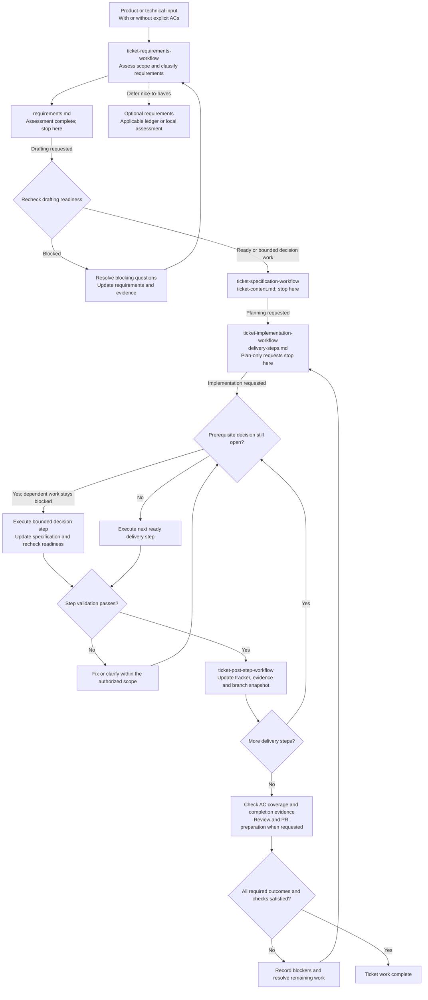

<!-- START doctoc generated TOC please keep comment here to allow auto update -->
<!-- DON'T EDIT THIS SECTION, INSTEAD RE-RUN doctoc TO UPDATE -->

- [Prompt and Skill Invocations](#prompt-and-skill-invocations)
  - [Reusable prompt](#reusable-prompt)
  - [Ticket lifecycle](#ticket-lifecycle)
  - [Example requests](#example-requests)
  - [Workflow sources](#workflow-sources)

<!-- END doctoc generated TOC please keep comment here to allow auto update -->

# Prompt and Skill Invocations

This directory contains reusable prompt fragments and copyable examples for common repository
tasks. The examples select workflows; the canonical instructions remain in `AGENTS.md` and the
applicable `ai/skills/*/SKILL.md` file.

## Reusable prompt

- [Session bootstrap](session-bootstrap.md): load repository instructions and existing ticket
  context at the start of a session.

## Ticket lifecycle

Each skill stops at its own output. The next stage runs only when requested and may resume in a
later session from the saved artifact. All ticket artifacts share the resolved `<ticket-dir>`;
filenames below omit the `<ticket>-` prefix for readability. This diagram summarizes the
[canonical workflows](#workflow-sources); it does not add requirements to them.

Bounded decision work requires a safe investigation scope, responsible role, expected evidence,
acceptance condition, and blocked dependencies. Unresolved security or personal-data safeguards
cannot be treated as optional work. A scope or contract change returns to requirements and
specification reconciliation before dependent implementation resumes.

An existing implementation-ready ticket can enter at planning without a retrospective requirements
assessment. Review reports findings; authorized implementation resolves them. Completion requires
the ticket's applicable outcomes and evidence, including any required CI, manual, or operational
checks. Commits, pushes, publication, merge, and remote issue closure remain separately authorized
actions; this diagram does not trigger them.

For issue-based work, [GitHub ticket synchronization](../rules/spec-first-rules.md#github-ticket-synchronization)
also gates planning, implementation/resume, and completion. Every local specification edit
triggers preparation of a GitHub update with explicit permission; local review checks the match
without repairing drift. Ad hoc tickets are exempt.

## Example requests

Replace each placeholder with the real issue or pull request number.

For local ticket work, [AGENTS.md Artifact Rules](../../AGENTS.md#artifact-rules) resolves the
artifact directory, including tickets grouped under an epic. You may supply the exact path, for
example: `Continue issue-131 using ai/artifacts/epic-4.2/issue-131/issue-131-ticket-content.md`.

| Task and context                                        | Example request                                                                   |
|---------------------------------------------------------|-----------------------------------------------------------------------------------|
| Assess future scope and requirements                    | `Use ticket-requirements-workflow for <ticket>: <description and any ACs>. Use ai/artifacts/<ticket>.` |
| Draft a specification from an earlier assessment        | `Use ticket-specification-workflow to draft ticket content from ai/artifacts/<ticket>/<ticket>-requirements.md.` |
| Request both assessment and specification drafting      | `Assess requirements for <ticket> from <input>, then draft ticket content when ready. Do not start implementation planning.` |
| Start ticket implementation                             | `Please implement issue-<number>.`                                                |
| Continue ticket work in a new local session             | `You will continue working on issue-<number>. Please proceed with step <number>.` |
| Review from a local checkout                            | `Please conduct a local code review for issue-<number>.`                          |
| Review a GitHub pull request                            | `Please conduct a code review for PR #<number>.`                                  |
| Draft and update the current GitHub PR                  | `Please draft and update the PR description for issue-<number>.`                  |
| Draft and update a PR outside its page or agent context | `Please draft and update the description for PR #<number>.`                       |
| Draft a GitHub PR description without changing the PR   | `Please draft the description for PR #<number>, but do not update it.`            |
| Draft a PR description from a local checkout            | `Please draft a PR description locally for issue-<number>.`                       |

The mode words are intentional:

- `local` selects the checkout workflow and its ignored `ai/artifacts/` output.
- For PR requests, `draft` alone does not change GitHub. `Update` explicitly authorizes changing
  the existing GitHub PR body and no other PR fields.
- An issue number identifies ticket requirements, but it does not always identify a unique pull
  request. Include `PR #<number>` unless the current GitHub context already identifies the target.

## Workflow sources

- [`ticket-requirements-workflow`](../skills/ticket-requirements-workflow/SKILL.md) assesses scope
  and classified requirements, records readiness, and stops before specification drafting.
- [`ticket-specification-workflow`](../skills/ticket-specification-workflow/SKILL.md) resumes from
  assessed requirements and drafts local ticket content when questions are resolved or bounded
  as prerequisite decisions. It stops before implementation planning or publication.
- [`ticket-implementation-workflow`](../skills/ticket-implementation-workflow/SKILL.md) implements
  a ticket and invokes the post-step workflow after each completed delivery step.
- [`code-review`](../skills/code-review/SKILL.md) handles local and GitHub pull request reviews.
- [`pr-description`](../skills/pr-description/SKILL.md) handles local PR-description artifacts and
  GitHub PR-body drafting or updates.

The [`ticket-post-step-workflow`](../skills/ticket-post-step-workflow/SKILL.md) is normally invoked
by ticket implementation and does not require a separate user prompt.
