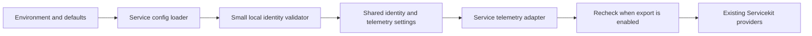

<!-- START doctoc generated TOC please keep comment here to allow auto update -->
<!-- DON'T EDIT THIS SECTION, INSTEAD RE-RUN doctoc TO UPDATE -->

- [Go Service Identity and Validation](#go-service-identity-and-validation)
  - [Common Contract](#common-contract)
  - [Ownership and Implementation](#ownership-and-implementation)
  - [Startup and Telemetry](#startup-and-telemetry)
  - [Source Version and Pod UID](#source-version-and-pod-uid)
  - [Adoption and Scaffold](#adoption-and-scaffold)
  - [Focused Verification](#focused-verification)

<!-- END doctoc generated TOC please keep comment here to allow auto update -->

# Go Service Identity and Validation

**Scope: all existing and future repository-owned Go services, including the Go service scaffold.**
This document defines the common minimal identity contract. It is independent of any ticket,
service inventory or migration phase. Existing services should converge on it; new services should
implement it from the start. A documented target is not evidence that every service already conforms.

Reuse Servicekit's existing identity/default/telemetry infrastructure and public APIs. The contract
requires no new library helper, publication, policy framework or configuration option.

The purpose is to identify the service, build and instance behind a signal. Identity metadata is
not authentication or permission to access business data. Keep the work proportionate to this
learning project.

## Common Contract

| Concern | Rule for every service |
| --- | --- |
| Service name | The loader requires the service's fixed logical name, normally `<domain>-service`. Deployment workload names remain separate. Scaffold generation must replace the default with the new service's own name. |
| Namespace / implementation | Keep `insurance-hub` / `go`. |
| Identity strings | Service name, environment, version and instance contain 1–128 ASCII letters, digits, dots, underscores or hyphens. Reject empty/invalid values with fixed reasons without echoing input. |
| Local defaults | Environment/version `development`, instance `local-<PID>`, telemetry disabled. Reuse the existing Servicekit development helper. |
| Non-development version | Exactly `git-` plus 12 lowercase hexadecimal characters, with at least one nonzero suffix character. Check even when telemetry is disabled. |
| Enabled telemetry | Explicit environment/version/instance values; reject environment/version `development` and instance prefix `local-`. Recheck the same local policy before constructing the enabled provider. |
| Tests | No special mode: environment `test` follows the non-development version rule. A supplied `test-instance` is sufficient; no UUID generation or `test-*` version convention. |
| Kubernetes instance | Inject Pod `metadata.uid` through the Downward API. No application UUID parser, Kubernetes API lookup or additional RBAC. |

`development` is the only environment exempt from canonical-version validation. Other environment
names follow the general string check, without a mode registry or stricter per-service grammar.
Development values are defaults: with export disabled, explicit overrides still follow the general
string rules. A non-development process with export disabled may use a synthetic instance;
Kubernetes deployment configuration supplies the real Pod UID.

The canonical check rejects `sha-*`, wrong prefix/length/case, nonhex, padding and
`git-000000000000`. It accepts individual zeros, such as `git-000000000001`. Do not normalize or
repair rejected values.

## Ownership and Implementation

| Owner | Responsibility |
| --- | --- |
| Existing Servicekit identity package | Plain six-field identity and development-default helper |
| Each service's small config validator | Implement the same contract above; the loader enforces its own fixed service name |
| Service telemetry adapter | Reuse local validation before enabled provider construction and enforce name agreement |
| Existing Servicekit telemetry package | Resource mapping, exporter/provider mechanics and lifecycle |
| Build/release tooling | Derive the version from verified full source and propagate it consistently |
| Deployment configuration | Inject environment, version and Pod UID; retain workload labels and immutable image selection |

Use a small service-owned `Identity.Validate` around the shared identity value. A few identical
pure checks across modules are acceptable. Keep their behavior consistent through this contract,
the scaffold and a small matching set of tests. Do not introduce cross-service private imports or
a library release solely to eliminate these few lines.

Existing consumers of a different deployment-identity policy should move to this local contract.
Leave published library APIs unchanged for compatibility; their continued availability does not
make them the target policy for new services. Shared helper extraction is deferred unless
maintenance demonstrates a real benefit.

## Startup and Telemetry



Validate on the normal startup path even with export disabled. Enabled telemetry construction
repeats the same service policy so direct settings construction cannot bypass it. Keep settings
immutable after validation. Servicekit's neutral exporter/nonempty-field checks remain defensive
infrastructure checks, not a substitute for the local policy. Preserve disabled no-op providers.

The [shared identity](../../../libs/servicekit/identity/identity.go) and
[telemetry implementation](../../../libs/servicekit/telemetry/telemetry.go) already map:

| Identity field | OpenTelemetry resource attribute |
| --- | --- |
| `ServiceNamespace` | `service.namespace` |
| `ServiceName` | `service.name` |
| `ServiceVersion` | `service.version` |
| `ServiceInstance` | `service.instance.id` |
| `Environment` | `deployment.environment.name` |
| `Implementation` | `insurance_hub.service.implementation` |

Keep this representation. No additional identity fields or resource abstraction are needed.

## Source Version and Pod UID

Use the existing release process to verify the full source revision and derive `git-<first-12>`.
OCI version, workload/Pod labels, `SERVICE_VERSION`, logs and OTel `service.version` should agree.
Keep the full OCI revision and registry digest separately. A format check does not prove source or
image provenance. Follow the existing [release identity rules](../../../ai/framework/rules/release-identity-rules.md)
through each service's owning tooling without creating a new provenance system.

Kubernetes supplies the instance through ordinary configuration:

```yaml
- name: SERVICE_INSTANCE_ID
  valueFrom:
    fieldRef:
      apiVersion: v1
      fieldPath: metadata.uid
```

Application code accepts its ordinary string form. UUID syntax would not prove that the value
belongs to the current Pod. Rendering checks the wiring; a focused live observation can compare
that Pod UID with emitted identity. `local-<PID>` is local diagnostic identity, not global uniqueness.

## Adoption and Scaffold

Existing services should compare their configuration loader, telemetry adapter, tests and
deployment inputs against this contract. Reuse conformant code. Remove divergent test-version,
random test-UUID or release UUID-format requirements as explicitly recorded identity changes.
Keep safe errors, fixed names, namespace/implementation, Pod UID wiring and consistent versions.
This alignment does not change business validation, authentication, data or administration privileges.

The [Go service scaffold](../../../templates/go-service) should implement the same defaults,
validator, telemetry integration and focused test expectations. Its documented copy/rename flow
must set the new service's logical name and leave no source-service identity behind. A generated
service should conform without a separate identity migration or copied private service code.

For every new service, include identity configuration and the relevant deployment inputs in its
ordinary initial implementation. Kubernetes deployments use the Pod UID; local and test processes
use the defaults or explicit synthetic identities described above. The deployment mechanism may
differ, but the observable identity contract remains the same.

Track concrete service gaps, adoption scope, release constraints and PR sequencing in the owning
tickets and delivery plans. Do not embed a fixed service list or a particular ticket's boundaries
in this generic contract. Use existing release tooling; no Servicekit upgrade is required solely
to adopt this design.

## Focused Verification

Use the existing module-owned config/telemetry tests with these common expectations:

- Default local identity works with export disabled; a foreign configured service name fails.
- A canonical non-development version and supplied instance work, including environment `test`.
- Old-prefix, malformed and zero versions fail outside development, including with export off.
- Enabled export rejects development/local identity and invalid strings without echoing values.
- A supplied non-UUID test/release instance is accepted; no random UUID generation is required.

Use representative failures rather than exhaustive matrices in every service. Run existing
required gates for changed modules. Reuse Servicekit's resource-mapping tests; add no shared test
framework. Include the same expectations in the scaffold's ordinary copy proof. Render affected
Pod UID/version wiring and combine live identity observations with the adopting service's ordinary
deployment smoke. No separate cross-service qualification, load, installation or retirement
campaign is required.
