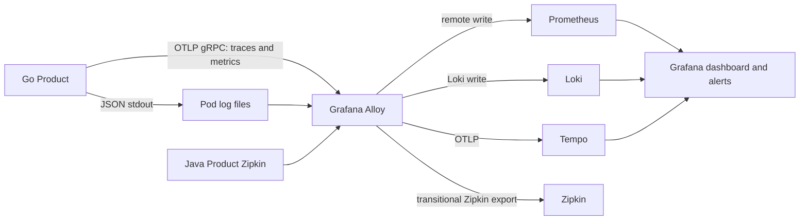

<!-- START doctoc generated TOC please keep comment here to allow auto update -->
<!-- DON'T EDIT THIS SECTION, INSTEAD RE-RUN doctoc TO UPDATE -->

- [Product observability runbook](#product-observability-runbook)
  - [Signal paths and ownership](#signal-paths-and-ownership)
  - [Configuration and identity](#configuration-and-identity)
  - [Source and local validation](#source-and-local-validation)
  - [QA preflight](#qa-preflight)
  - [Staged apply and enablement](#staged-apply-and-enablement)
  - [Grafana UI workflow](#grafana-ui-workflow)
    - [Open the Product dashboard](#open-the-product-dashboard)
    - [Inspect metrics](#inspect-metrics)
    - [Inspect logs](#inspect-logs)
    - [Inspect traces](#inspect-traces)
  - [Investigation queries](#investigation-queries)
  - [Loss, recovery, and cardinality](#loss-recovery-and-cardinality)
  - [Rollback and cleanup](#rollback-and-cleanup)
  - [Evidence checklist](#evidence-checklist)

<!-- END doctoc generated TOC please keep comment here to allow auto update -->

# Product observability runbook

This runbook operates the issue #135 Go Product telemetry pilot. The normative signal, identity,
cardinality, budget, and ownership decisions remain in the
[Product observability design contract](observability-contract.md). Use this document for
preflight, staged delivery, verification, investigation, rollback, and evidence collection.

The Go Product service remains an internal migration candidate. Product code and QA configuration
are reconciled from canonical `main` by Flux. Prometheus/Grafana and Alloy are maintained through
their pinned Helm owners in [`k8s/Makefile`](../../../../k8s/Makefile). Product rules and the
dashboard are separate repository assets applied through guarded Make targets. Test and
verification targets and their exclusive variables live in
[`k8s/tests/validation.mk`](../../../../k8s/tests/validation.mk), which the repository root Makefile
includes explicitly. Do not edit live ConfigMaps, Prometheus resources, dashboards, or Product
workloads by hand.

## Signal paths and ownership



| Concern | Durable owner | Live owner |
| --- | --- | --- |
| Product instrumentation and configuration | `services/product-service/` and `k8s/apps/svc/product/` overlays | Product release plus Flux `qa-svc` |
| Alloy program, image, chart, and RBAC | `k8s/overlays/qa/infra/alloy/` and `k8s/Makefile` | Helm release `qa-alloy` |
| Prometheus/Grafana base | `k8s/overlays/qa/infra/prometheus/` and `k8s/Makefile` | Helm release `qa-prometheus` |
| Product alerts | `k8s/observability/services/product/alerts.yaml` | Guarded `prometheus-rules-apply` target |
| Product dashboard | `k8s/observability/services/product/dashboard.json` | Guarded `grafana-dashboard-apply` target and Grafana sidecar |
| QA target coordinates | `k8s/observability/environments/qa.json` | Flux and the named Kubernetes resources |
| Kubernetes tests and verification | `k8s/tests/validation.mk` | Included explicitly by the repository root `Makefile`; invoke its public targets from the repository root |

Application reads, management probes, and shutdown do not depend on a collector. Export is
bounded and asynchronous. When Alloy or a backend is unavailable, preserve Product availability,
observe the bounded delivery counters, and investigate the signal path separately.

## Configuration and identity

Normal local development, base manifests, and the first instrumented QA image use
`OTEL_ENABLED=false`. Enabled telemetry requires the internal Alloy OTLP/gRPC endpoint and a fixed
identity:

| Setting | Disabled mode | Enabled QA mode |
| --- | --- | --- |
| `OTEL_ENABLED` | `false` | `true` |
| `OTEL_EXPORTER_OTLP_ENDPOINT` | Unset or ignored | Internal `qa-alloy.qa-monitoring.svc` HTTP endpoint |
| `OTEL_EXPORTER_OTLP_TIMEOUT` | `2s` default | `2s` |
| `DEPLOYMENT_ENVIRONMENT` | `development` | `qa` |
| `SERVICE_NAME` | `product-service` default | `product-service` |
| `SERVICE_VERSION` | `development` | Immutable `sha-<git-sha>` |
| `SERVICE_INSTANCE_ID` | Local process identity | Pod UID from the Downward API |

The Go SDK emits six application-owned resource values. Alloy adds the cluster, namespace, Pod,
and container identity. Keep `service.name=product-service` across Go and Java and distinguish
them with `insurance_hub.service.implementation=go|java`.

Request metrics allow only `list|get`, `http|grpc`, the eight reviewed outcomes, and their bounded
HTTP or gRPC status. Completion logs contain constant messages and the reviewed request fields;
trace and span IDs remain JSON fields. Product codes, raw paths, query strings, caller identity,
headers, database addresses, SQL parameters, payloads, arbitrary errors, and stack traces are not
telemetry fields. The exact attribute, log-label, histogram, runtime-metric, and cardinality
allowlists are in the [identity and field-schema decision](observability-contract.md#identity-and-field-schema-decision).

## Source and local validation

Run source validation before any shared-environment operation:

```sh
make -C services/product-service check-go-pr FORMAT_SCOPE=all
make go-svc-image-check SVC_NAME=product
make product-security-test-tooling
make product-security-check
make go-svc-deploy-check SVC_NAME=product
make go-svc-deploy-test-tooling SVC_NAME=product
make check-observability
make -C services/product-service check-docs
```

The disabled telemetry suite starts a listener at the configured exporter endpoint and launches
the production process twice at each supported log level. It proves zero collector connections,
successful reads, completion logs, health, and bounded graceful shutdown:

```sh
make -C services/product-service test-integration \
  INTEGRATION_SUITE=telemetry FIXTURE_SET=qa
```

The enabled disposable backend suite runs a real Product process against pinned Prometheus, Loki,
Tempo, and Alloy components without using QA:

```sh
make test-observability-backends
```

Run the fixed acceptance profile in restartable phases. Each phase validates its candidate
identity and replaces only its own evidence file. The aggregate rejects missing, stale, or mixed
candidate evidence:

```sh
make test-observability-acceptance-overhead-1
make test-observability-acceptance-overhead-2
make test-observability-acceptance-overhead-3
make test-observability-acceptance-healthy
make test-observability-acceptance-recovery
make test-observability-acceptance-aggregate
```

`test-observability-acceptance-smoke` exercises the lifecycle with reduced timings. Its output is
tooling evidence and does not satisfy the fixed acceptance budget.

## QA preflight

Work from a clean checkout of the reviewed canonical `main` revision. Synchronize clocks and set
the active Kubernetes context and namespace explicitly:

```sh
kubectl config use-context qa-insurance-hub
kubectl config set-context --current --namespace=qa-svc
kubectl --context qa-insurance-hub -n flux-system get gitrepository insurance-hub
kubectl --context qa-insurance-hub -n flux-system get kustomization qa-svc
```

Record the full 40-character source revision. Require ready Flux source and Kustomization
conditions with the same source/applied revision. Revalidate the #134 handoff: active Go and Java
Product workloads, restricted reader, internal Services and endpoints, immutable Product image,
catalog/schema identity, Java gateway routing, and tested Go-only restoration. Revalidate the
#154 chart and application versions, Helm revisions, storage, existing routes, capacity, and
rollback points.

Before telemetry is enabled, run the read-only verifier against the exact disabled revision:

```sh
make verify-product-observability \
  ENV_NAME=qa SVC_NAME=product VERIFY_MODE=disabled \
  VERIFY_SOURCE_REVISION=<full-40-character-revision>
```

The verifier performs no deployment or backend shutdown. In disabled mode it checks coordinates,
Flux identity, Product rollout and image IDs, effective telemetry mode, health, and a real catalog
read. Enabled mode also checks the rules and immutable dashboard identity. It creates loopback-only
port-forwards and closes every child on success or failure. Its JSON output contains no credentials
or raw Secret values.

Stop before applying if the checkout is dirty, the selected revision is not reconciled, chart or
image identities drift, the Product/Java handoff is unhealthy, clocks are unsynchronized, capacity
is insufficient, or an existing telemetry route is failing.

## Staged apply and enablement

Capture sanitized before-state: Git and Flux revisions, Product image ID and Pod UID, Helm release
revisions and effective versions, configuration checksums, PVC state, readiness, rule/dashboard
inventory, existing route counters, and representative existing Java/Prometheus/Loki/Tempo
queries. Never record Secret data or credential-bearing URLs.

Apply each stage separately and retain its evidence before continuing:

```sh
# The active context must be qa-insurance-hub. These targets select qa-monitoring.
make -C k8s prometheus-stack-install
make -C k8s prometheus-rules-apply ENV_NAME=qa SVC_NAME=product
make -C k8s grafana-dashboard-apply ENV_NAME=qa SVC_NAME=product
make -C k8s alloy-install
```

After Prometheus/Grafana, verify the remote-write receiver, ready stack, bound 1 GiB Grafana PVC,
normal scrape ingestion, exact ten-rule inventory, dashboard UID
`insurance-hub-product-service`, file-provider immutability, and unrelated rule/dashboard
preservation. Replace a Grafana Pod and prove the provisioned dashboard returns unchanged.

After Alloy, verify chart `1.13.1`, Alloy `v1.20.1`, the reviewed config checksum and RBAC, ready
workload, and zero delivery failures/backlog. Recheck Java Zipkin input, Tempo and transitional
Zipkin output, existing Loki logs, Prometheus remote write, configuration reload, and synthetic
Product signals. Abort if any existing route regresses.

QA Product enablement is a separate reviewed Git change on canonical `main`. Set the approved
non-secret configuration in the QA Product overlay, keep the internal Alloy endpoint, and let Flux
roll the ConfigMap hash. Do not apply Product manifests directly, point Flux at a feature branch,
suspend reconciliation, or combine enablement with an unreleased image.

After Flux reports the reviewed revision applied, return the active namespace to `qa-svc` and run:

```sh
kubectl config set-context --current --namespace=qa-svc
make verify-product-observability \
  ENV_NAME=qa SVC_NAME=product VERIFY_MODE=enabled \
  VERIFY_SOURCE_REVISION=<full-40-character-revision>
```

Enabled verification performs the disabled checks, sends a traced Product list request, and waits
for the exact Pod identity in Prometheus, a correlated completion log in Loki, the trace in Tempo,
and zero firing Product pilot alerts. Preserve its output with the Flux revision, new Pod UID and
image ID, effective safe settings, and rollout state.

## Grafana UI workflow

### Open the Product dashboard

Confirm that the active context is QA, then start the repository-owned foreground port-forward:

```sh
kubectl config current-context
make -C k8s grafana-ui
```

Require `qa-insurance-hub` from the context check. Keep that terminal open, visit
`http://localhost:3000`, and authenticate with the current QA Grafana credentials. Stop the
port-forward with `Ctrl+C` when the investigation is complete. Do not copy credentials into an
evidence record.

In Grafana, open **Dashboards**, search for **Insurance Hub / Product service**, and select the
dashboard with UID `insurance-hub-product-service`. Set **Environment** to `qa` and
**Implementation** to `go`. The dashboard defaults to the last hour in the browser's timezone and
refreshes every 30 seconds. For an incident or acceptance record, choose a time range that covers
the request or alert window plus telemetry delivery time; use an absolute UTC range when another
operator must reproduce the view.

The dashboard is provisioned with UI updates and deletion disabled. Use **Explore** for temporary
queries. Make durable query or panel changes in
`k8s/observability/services/product/dashboard.json`, validate them with
`make monitoring-assets-check ENV_NAME=qa SVC_NAME=product`, and apply the reviewed source through
the guarded dashboard target.

### Inspect metrics

Use the Prometheus-backed panels in this order:

1. Start with **Request rate**, **Service error rate**, and **Request latency percentiles** to
   establish traffic, bounded outcomes, and the affected interval.
2. Compare **Database and pool latency** with **Database pool pressure** to distinguish query time
   from connection acquisition and saturation.
3. Check **Go runtime** and **Pod CPU and memory** for process or container pressure.
4. Check **Readiness and restarts** and **Telemetry delivery health** before attributing missing
   data to the Product service.

Open a panel's menu and select **Explore** when the aggregate view needs refinement. Keep the
Prometheus data source and dashboard time range, then add an operation, transport, outcome, Pod, or
instance filter supported by the existing series. Use the canonical PromQL selector below as a
freshness and identity check. Zero request rate with a current Go runtime sample is legitimate idle
time. An available Product deployment without a current runtime sample is missing telemetry.

### Inspect logs

Open **Explore**, select the Loki data source, set the same time range, and run the canonical LogQL
selector below. The dashboard's **Failed and slow-request investigation logs** panel focuses on
unexpected and deadline outcomes; remove its outcome filter in Explore when successful,
not-found, or invalid-request completion records are also relevant.

Expand a log row and inspect `operation`, `transport`, `outcome`, `duration_ms`, the applicable
HTTP or gRPC status, and `trace_id`. A slow-request search can append
`| duration_ms >= 250` after `| json`. Copy the exact `trace_id` from the parsed fields for trace
correlation. Trace and span IDs remain fields rather than Loki index labels.

### Inspect traces

Open **Explore**, select the Tempo data source, and either look up the copied trace ID or run the
canonical TraceQL selector below. A successful Product read contains one transport server span,
one `product.list` or `product.get` application span, one `product.db.acquire` span, and one
`SELECT products` or `SELECT product` client span.

Check the service, environment, implementation, version, and instance identity before comparing
span durations. For a slow read, compare the server and application duration with pool acquisition
and query time. For a failed read, inspect the bounded Product outcome and safe error type. The
trace must not contain product codes, raw request paths, SQL text or parameters, credentials, or
payload data.

Use one investigation window and move through the signals in this order:

```text
alert or unusual metric
  -> narrow the dashboard time range
  -> inspect matching completion logs
  -> copy trace_id
  -> inspect the Tempo trace
  -> compare request, pool, database, runtime, and pod timing
```

## Investigation queries

Use the dashboard first to split by environment and implementation, then correlate one trace ID.
Canonical selectors are:

```promql
insurance_hub_product_requests_total{
  service_name="product-service",
  deployment_environment_name="qa",
  service_implementation="go"
}
```

```logql
{service_name="product-service", deployment_environment_name="qa",
 service_implementation="go"} | json
```

```traceql
{ resource.service.name = "product-service" &&
  resource.insurance_hub.service.implementation = "go" &&
  resource.deployment.environment.name = "qa" }
```

Start with `ProductServiceErrorRate` by finding failed operations in logs and traces, then check
PostgreSQL health. For `ProductHighLatency`, split operation and transport before inspecting pool
wait, database duration, and a slow trace. For `ProductDatabasePoolPressure` or
`ProductDatabasePoolTimeouts`, inspect pool utilization, wait time, database latency, and database
capacity; do not raise the pool maximum without review.

For `ProductResourcePressure`, correlate load, Go runtime signals, throttling, pod events, and the
last rollout. For `ProductUnavailable`, inspect rollout, readiness, events, image pull,
configuration, and database access. For `ProductUnexpectedRestart`, inspect the prior container
state, safe logs, events, memory/CPU pressure, and rollout identity.

`ProductTelemetryMissing` means a Product replica is available without its runtime series. Check
effective Product settings, current Pod UID, Alloy receiver health, remote write, and the active
series identity. Legitimate zero request traffic does not fire this rule.
`ProductTelemetryDeliveryFailure` identifies drops or failed exports; isolate Loki, remote write,
or OTLP span export while keeping reads available. `ProductTelemetryBacklog` identifies sustained
remote-write lag or exporter queue pressure; check backend reachability, WAL/queue state, and the
accepted 120-second recovery budget.

## Loss, recovery, and cardinality

Exercise backend loss and recovery only in the disposable acceptance environment. The fixed fault
phase proves Product reads, probes, and shutdown remain available; bounded queues may lose no more
than the accepted budget; replacement collectors resume without duplicate delivery beyond the
accepted limits; new trace/log correlation returns within 15 seconds, new metrics within 30
seconds, and queues return healthy within 120 seconds.

Vary Product codes and trace IDs during acceptance and require no change in span-name inventory,
metric series identity, or Loki stream identity. Enforce 800 Product application/runtime series
per active instance and eight Loki streams with exactly eight approved index labels. A new label,
dimension, span name, field, or sampling policy requires a reviewed contract change; do not tune
the ceiling from an observed result.

## Rollback and cleanup

For a Product image or configuration regression, restore `OTEL_ENABLED=false` or the last accepted
image/configuration through a reviewed Git change on `main`. Let Flux reconcile, then verify
Product and Java reads, health, endpoints, image/config identity, and telemetry cessation. Manual
scaling, direct Product apply, and Flux suspension are not durable rollback paths.

For an Alloy regression, restore the revision captured immediately before the change:

```sh
helm rollback qa-alloy <captured-revision> \
  --namespace qa-monitoring --wait --timeout 5m
```

For a Prometheus/Grafana regression, use the equivalent rollback for `qa-prometheus`. Helm rollback
does not restore separately applied Product rules or dashboard assets; check out their accepted
repository revision and reapply them with the guarded targets. Follow every live rollback with a
reviewed repository revert so the next install cannot reapply the failed intent. Do not delete or
roll back shared Loki, Tempo, Zipkin, databases, PVCs, Java resources, or the Product reader Secret.

The read-only verifier owns and closes only the port-forwards it starts. Disposable targets remove
their containers, networks, temporary files, and controlled evidence on failure. Inspect remaining
resources after an interrupted run before retrying. Never use a broad process kill as routine
cleanup on a shared workstation.

## Evidence checklist

Keep sanitized local records under the ignored `ai/artifacts/epic-4.2/issue-135/` directory. For
each source, disposable, Helm, Flux, and live verification result, record:

- UTC start/end, operator, command, result, and whether the source is local, hosted CI, disposable,
  or shared QA;
- full Git source and Flux applied revisions, release run, image tag/digest/ID, Deployment
  generation, ConfigMap identity, Pod UIDs, and ready endpoints;
- Helm release revisions, chart/application versions, values/config checksums, ready workloads,
  PVC state, and rollback revisions;
- sanitized backend queries and results, dashboard UID, all ten alert states, route and delivery
  counters, cardinality inventory, workload totals, latency/resource budgets, fault windows, loss,
  duplicates, and recovery times;
- Java continuity, unchanged catalog/schema identity, cleanup results, residual blockers, and the
  acceptance criterion supported by each record.

Exclude passwords, tokens, Secret YAML, credential-bearing URLs, Product payloads, and arbitrary
error text. Source validation, hosted release, Flux reconciliation, Helm rollout, and backend
acceptance are separate evidence sources; one does not imply another.
