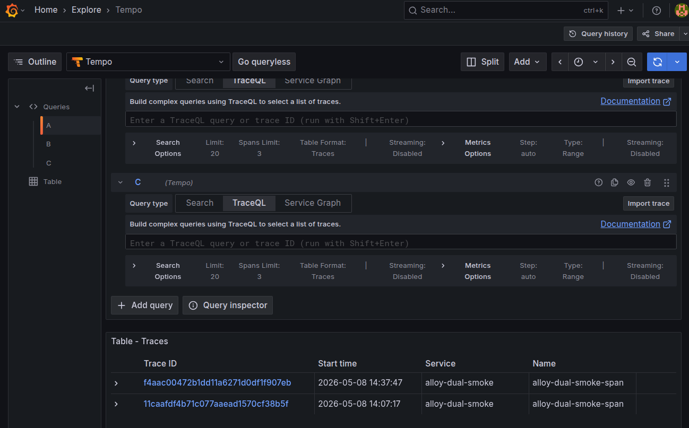
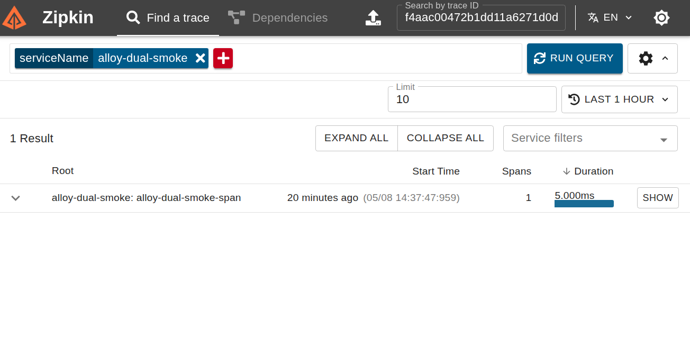
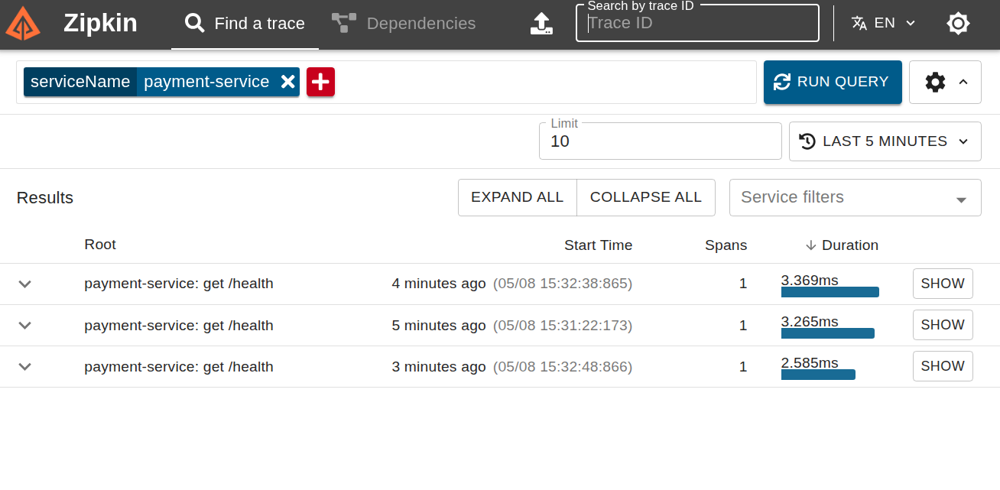

<!-- START doctoc generated TOC please keep comment here to allow auto update -->
<!-- DON'T EDIT THIS SECTION, INSTEAD RE-RUN doctoc TO UPDATE -->

- [Verify Alloy Trace Routing](#verify-alloy-trace-routing)
  - [Verify Release And Configuration](#verify-release-and-configuration)
  - [Verify Alloy And The Zipkin Bridge](#verify-alloy-and-the-zipkin-bridge)
  - [Send A Fresh OTLP Trace](#send-a-fresh-otlp-trace)
  - [Verify The Legacy Java Route](#verify-the-legacy-java-route)

<!-- END doctoc generated TOC please keep comment here to allow auto update -->

# Verify Alloy Trace Routing

This runbook verifies Alloy chart `1.13.1` with Alloy `v1.20.1` in QA. It proves that the retained
Zipkin and OTLP inputs still deliver traces to Tempo and the unchanged Zipkin bridge. Run commands
from `k8s/` against context `qa-insurance-hub` and namespace `qa-monitoring`.

## Verify Release And Configuration

```shell
test "$(kubectl config current-context)" = "qa-insurance-hub"
helm --kube-context qa-insurance-hub list -n qa-monitoring --filter '^qa-alloy$'
kubectl --context qa-insurance-hub -n qa-monitoring rollout status \
  deployment/qa-alloy --timeout=10m
kubectl --context qa-insurance-hub -n qa-monitoring get deployment,pod,service,servicemonitor \
  -l app.kubernetes.io/instance=qa-alloy -o wide
kubectl --context qa-insurance-hub -n qa-monitoring get configmap qa-alloy \
  -o jsonpath='{.data.config\.alloy}' > /tmp/qa-alloy-config.alloy
cmp /tmp/qa-alloy-config.alloy overlays/qa/infra/alloy/config.alloy
```

Expected: chart `1.13.1`, image `grafana/alloy:v1.20.1`, one Ready Deployment replica, ClusterIP
exposure, and Service ports `12345`, `9411`, `4317`, and `4318`. The deployed configuration must
match the checked-in mirror byte for byte.

Observe Alloy for 10 minutes. Restart counts must settle after first readiness and the pod must not
be `OOMKilled`, evicted, unschedulable, or continuously saturated at its resource limit.

## Verify Alloy And The Zipkin Bridge

```shell
kubectl --context qa-insurance-hub -n qa-monitoring get deployment,pod,service \
  -l app.kubernetes.io/name=zipkin-bridge
kubectl --context qa-insurance-hub -n qa-monitoring logs \
  deployment/qa-zipkin-bridge --since=15m
kubectl --context qa-insurance-hub -n qa-monitoring get deployment qa-zipkin-bridge \
  -o jsonpath='{.spec.template.spec.containers[*].image}{"\n"}'
```

Expected: the bridge remains Ready on
`otel/opentelemetry-collector-contrib:0.114.0`, with no configuration or lifecycle change and no
fatal exporter errors.

Forward the Alloy HTTP and OTLP HTTP ports in separate terminals:

```shell
make alloy-ui
kubectl --context qa-insurance-hub -n qa-monitoring \
  port-forward svc/qa-alloy 4318:4318
```

```shell
curl -sf http://localhost:12345/-/ready
curl -sf http://localhost:12345/metrics | \
  rg 'otelcol_receiver_accepted_spans_total|otelcol_exporter_sent_spans_total|otelcol_exporter_send_failed_spans_total'
```

## Send A Fresh OTLP Trace

Use a unique sanitized trace ID and retain it as evidence.

```shell
export ALLOY_TRACE_ID="$(openssl rand -hex 16)"
ALLOY_SPAN_ID="$(openssl rand -hex 8)"
ALLOY_TS=$(date +%s%N)
curl -fsS http://localhost:4318/v1/traces \
  -H 'Content-Type: application/json' \
  -d '{"resourceSpans":[{"resource":{"attributes":[{"key":"service.name","value":{"stringValue":"issue154-alloy-dual"}}]},"scopeSpans":[{"scope":{"name":"issue154"},"spans":[{"traceId":"'"$ALLOY_TRACE_ID"'","spanId":"'"$ALLOY_SPAN_ID"'","name":"issue154-alloy-dual","kind":"SPAN_KIND_INTERNAL","startTimeUnixNano":"'"$ALLOY_TS"'","endTimeUnixNano":"'"$((ALLOY_TS+5000000))"'"}]}]}]}'
```

Expected: `{"partialSuccess":{}}`. Within two minutes:

- Alloy's accepted counter increases;
- the `otelcol.exporter.otlp.tempo` and `otelcol.exporter.otlp.zipkin_bridge` sent counters increase;
- neither exporter develops a growing permanent-failure counter;
- `http://localhost:3200/api/traces/$ALLOY_TRACE_ID` returns the trace from Tempo;
- Grafana Explore finds `{resource.service.name="issue154-alloy-dual"}` in Tempo; and
- Zipkin finds service `issue154-alloy-dual` with the same trace ID.

## Verify The Legacy Java Route

Generate one controlled request through an existing legacy Java service. Record its sanitized
trace ID and prove that the same trace reaches both Tempo and Zipkin through Alloy's Zipkin
receiver. Do not change Java instrumentation, Zipkin, Elasticsearch, or the bridge.

The expected visual checks remain:

- 
- 
- 

Record the chart and image versions, probe IDs and timestamps, query results, exporter counters,
readiness/restart counts, resources, and any recovery action. If Alloy fails, use the recorded Helm
revision and then stop the staged rollout:

```shell
helm --kube-context qa-insurance-hub rollback qa-alloy <revision> \
  -n qa-monitoring --wait --timeout 10m
```

Unset the probe variables when finished:

```shell
unset ALLOY_TRACE_ID ALLOY_SPAN_ID ALLOY_TS
```
