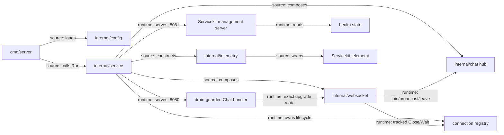

<!-- START doctoc generated TOC please keep comment here to allow auto update -->
<!-- DON'T EDIT THIS SECTION, INSTEAD RE-RUN doctoc TO UPDATE -->

- [Chat service](#chat-service)
  - [Architecture and ownership](#architecture-and-ownership)
  - [Runtime contract](#runtime-contract)
  - [Configuration](#configuration)
  - [Development and validation](#development-and-validation)
  - [Image and delivery boundary](#image-and-delivery-boundary)
    - [Live deployment operations](#live-deployment-operations)

<!-- END doctoc generated TOC please keep comment here to allow auto update -->

# Chat service

`chat-service` is the standalone Go implementation of the accepted Insurance Hub Chat WebSocket
contract. It exposes the private candidate route while Java remains the only deployed browser Chat
upstream until the later route-transfer milestone.

## Architecture and ownership



`cmd/server` is the composition root, `internal/config` owns typed environment loading and fixed
identity, `internal/service` owns both listeners and bounded shutdown, and `internal/telemetry`
adapts the shared Servicekit telemetry provider. `internal/chat` owns process-local room state and
bounded queues; `internal/websocket` owns the Gorilla upgrade, frames, deadlines and close policy.
The protocol-neutral connection registry owns upgraded connections that `net/http` shutdown cannot
join.

A representative business connection reaches `:8080`, passes the drain guard and upgrades only at
`GET /ws/chat/{topic}/{username}`. Wrong paths remain 404, wrong methods remain 405 and a
non-upgrade request to the exact route is rejected without registering a session. A management
request to `:8081/readyz` reaches the Servicekit management server and reads the lifecycle health
state. Readiness is withdrawn before new upgrades are rejected and tracked sessions receive close
1001 during bounded shutdown.

The module depends on the published `libs/servicekit` version in `go.mod`. It has no Go workspace,
filesystem replacement, template import, sibling-service private import, Java runtime dependency,
gRPC listener, protobuf surface, generated API contract, persistence or message broker.

Source-copy provenance is recorded in [COPYING.md](COPYING.md).

## Runtime contract

The process owns exactly two HTTP listeners:

| Listener | Default address | Contract |
| --- | --- | --- |
| Business | `127.0.0.1:8080` | `GET /ws/chat/{topic}/{username}` upgrades to the bounded Chat protocol; no other business route is exposed. |
| Management | `127.0.0.1:8081` | `/livez` reports process liveness; `/readyz` follows lifecycle readiness. |

Readiness is published only after both listeners start. Cancellation or an unexpected server exit
withdraws readiness, rejects new upgrades and connection registration, begins the hub drain,
suppresses room disconnect broadcasts, sends close 1001 and joins tracked connections within the
eight-second non-exporter shutdown budget. Management then stops and telemetry receives its
reserved two-second exporter budget. Cleanup errors are preserved with the initiating failure.

Rooms are process-local and case-insensitive. The sender and other topics are excluded from each
broadcast; accepted text, including empty text, is forwarded byte-for-byte. The route remains
anonymous and retains the existing HTML payload contract.

## Configuration

Configuration is loaded once at startup. Blank, malformed and inconsistent values fail safely
without logging raw configuration values.

| Setting | Default or rule |
| --- | --- |
| `SERVICE_NAME` | Fixed to `chat-service`. |
| `HTTP_ADDR` | `127.0.0.1:8080`; must differ from `HEALTH_ADDR`. |
| `HEALTH_ADDR` | `127.0.0.1:8081`; owns management health only. |
| `HTTP_READ_HEADER_TIMEOUT` | `5s`; positive and no greater than `HTTP_READ_TIMEOUT`. |
| `HTTP_READ_TIMEOUT` | `10s`; positive and no greater than `HTTP_WRITE_TIMEOUT`. |
| `HTTP_WRITE_TIMEOUT` | `10s`; positive. |
| `HTTP_IDLE_TIMEOUT` | `30s`; positive. |
| `HTTP_MAX_HEADER_BYTES` | `16384`; from 1024 through 1048576. |
| `PROBE_TIMEOUT` | `2s`; positive. |
| `SHUTDOWN_TIMEOUT` | `10s`; positive and greater than the exporter timeout. |
| `LOG_LEVEL` | `INFO`; a supported structured-log level. |
| `OTEL_ENABLED` | `false`. |
| `OTEL_EXPORTER_OTLP_ENDPOINT` | Required only when telemetry is enabled. |
| `OTEL_EXPORTER_OTLP_TIMEOUT` | Application default `2s`; positive and reserved from shutdown. Deployed configuration omits the override and guards reject one so the OpenTelemetry SDK cannot independently reinterpret it. |
| `WEBSOCKET_MAX_CONNECTIONS` | `128`; positive and no greater than 128. |
| `WEBSOCKET_MAX_MESSAGE_BYTES` | `32768`; positive and no greater than 32 KiB. |
| `WEBSOCKET_OUTBOUND_QUEUE_SIZE` | `8`; positive and no greater than eight. |
| `WEBSOCKET_WRITE_TIMEOUT` | `5s`; positive and inside the service shutdown budget. |
| `WEBSOCKET_PING_INTERVAL` | `30s`; positive and less than the pong timeout. |
| `WEBSOCKET_PONG_TIMEOUT` | `60s`; positive. |
| `WEBSOCKET_CLOSE_TIMEOUT` | `2s`; positive and reserved with the write timeout inside the service budget. |
| `DEPLOYMENT_ENVIRONMENT` | Defaults to `development`; explicit when telemetry is enabled. |
| `SERVICE_VERSION` | Development default locally; otherwise `git-` plus 12 nonzero-capable lowercase hexadecimal characters. |
| `SERVICE_INSTANCE_ID` | Local process identity by default; explicit when telemetry is enabled. |

The image supplies `HTTP_ADDR=0.0.0.0:8080` and `HEALTH_ADDR=0.0.0.0:8081` for its lifecycle
smoke. The [Kubernetes base](../../k8s/apps/svc/chat/base) and the
[local-dev](../../k8s/overlays/local-dev/svc/chat) and
[QA](../../k8s/overlays/qa/svc/chat) overlays own the deployed settings.

## Development and validation

Run commands from the repository root:

```bash
make -C services/chat-service bootstrap-tools
make -C services/chat-service test
make -C services/chat-service test-tooling
make -C services/chat-service check FORMAT_SCOPE=all
make -C services/chat-service image-check
make go-svc-deploy-check SVC_NAME=chat
make go-svc-deploy-test-tooling SVC_NAME=chat
make go-svc-deploy-smoke SVC_NAME=chat
```

`bootstrap-tools` explicitly installs only the two pinned module tools: `golangci-lint` and
`govulncheck`, plus the repository-managed Python environment. The main check covers formatting,
lint, unit/race and real-listener smoke tests, build, dependency synchronization, vulnerability
analysis, generated Dockerfile drift and Servicekit selection. Controlled defects cover only the
implemented Dockerfile, format, lint, test and dependency boundaries.

Generated-source and compatibility-breaking phases are explicit no-ops because Chat owns no
generated source or published protobuf/gateway contract. There is no active source-copy phase.

## Image and delivery boundary

`Dockerfile` is generated from `go-service-tooling.json`. It builds `/chat-service`, runs as
`65532:65532` on a distroless nonroot image, exposes only 8080 and 8081 and carries OCI source,
revision and version labels. The workload is designed for a read-only root filesystem and needs no
runtime file writes.

The generic service catalog and module-owned deployment guards render hardened, one-replica
local-dev and QA workloads with distinct business and management Services. Neither Go workload has
browser ingress; local-dev is default-denied, and QA adds only DNS and Alloy OTLP egress. Before
release, the QA service aggregate keeps only `./chat/legacy`; the generic release adds `./chat`
after publishing the image and canonical identity. Both Vue environments retain the legacy Chat URL
as their only route authority.

The base Deployment owns `replicas: 1` and the `Recreate` strategy, so neither overlay can run two
process-local room owners during replacement. `deploy-check` validates both renders, exact
source-derived version mapping, legacy coexistence and unchanged Vue authority without contacting a
cluster. `deploy-test-tooling` uses fake boundaries to exercise target selection, failure and
bounded cleanup. `deploy-smoke` builds the exact candidate, loads it into the cataloged local Kind
cluster, verifies health and negative HTTP route behavior in a uniquely owned namespace, and
deletes that namespace within a fixed deadline. It does not touch the shared local-dev namespace.

### Live deployment operations

Live commands require separate authorization and these exact catalog coordinates:

| Target | Mode | Context | Service namespace | Data namespace |
| --- | --- | --- | --- | --- |
| local-dev | direct | `kind-local-dev-insurance-hub` | `local-dev-all` | `local-dev-all` |
| QA | Flux | `qa-insurance-hub` | `qa-svc` | `qa-data` |

For local-dev, use a checkout at the accepted service source revision—the exact revision the generic
release builds, not a later release-target commit. Verify that full revision and build its exact
local image. The image override is accepted only for the direct target and must end with the first
12 characters of that revision:

```bash
source_revision=$(git rev-parse --verify 'HEAD^{commit}')
source_short=$(git rev-parse --short=12 'HEAD^{commit}')
image_ref="insurance-hub-chat-api:1.0.0-local.$source_short"
make go-svc-image-build SVC_NAME=chat

env DEPLOY_ENV=local-dev \
  DEPLOY_CONTEXT=kind-local-dev-insurance-hub \
  DEPLOY_SVC_NS=local-dev-all \
  DEPLOY_DATA_NS=local-dev-all \
  DEPLOY_IMAGE_REF="$image_ref" \
  make go-svc-deploy-preflight SVC_NAME=chat
```

`go-svc-deploy-status` and `go-svc-deploy-verify` observe the selected workload. The following
commands mutate only the cataloged direct target and require explicit local-dev authority:
`go-svc-image-load` changes the Kind node cache, `go-svc-deploy` server-side applies the rendered Go
resources, and `go-svc-stop` scales only `local-dev-chat-api` to zero. Supply the same five
environment values to every command. Rerun preflight after an uncertain failure; use status and
verify to establish the postcondition before retrying. Stop never deletes the namespace, legacy
Chat resources or repository manifests.

QA is Flux-owned. The generic release publishes the canonical image and activates `./chat`; do not
use `go-svc-image-load`, `go-svc-deploy` or `go-svc-stop` for QA. After the release and with
separate read authority, use the exact QA coordinates above with `go-svc-deploy-status` and
`go-svc-deploy-verify`. Registry digest, Flux revision and runtime identity evidence belong to the
post-release verification step.

Until route transfer in C03, the Go service must not be made a browser/Nginx Chat upstream. Java
retirement is a separate, one-time manual C04 operation and never removes legacy source or
repository manifests.
