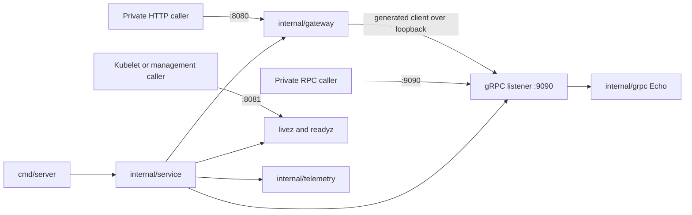

<!-- START doctoc generated TOC please keep comment here to allow auto update -->
<!-- DON'T EDIT THIS SECTION, INSTEAD RE-RUN doctoc TO UPDATE -->

- [Dashboard service](#dashboard-service)
  - [Capabilities and request path](#capabilities-and-request-path)
  - [Package map](#package-map)
  - [Configuration](#configuration)
  - [Development commands](#development-commands)
  - [Repository and deployment ownership](#repository-and-deployment-ownership)
  - [Generated inventory and provenance](#generated-inventory-and-provenance)

<!-- END doctoc generated TOC please keep comment here to allow auto update -->

# Dashboard service

`dashboard-service` is the first private Go Dashboard process. It runs beside the authoritative
Java Dashboard and exposes only the temporary synthetic `ExampleService/Echo` capability used to
prove the runtime, image and deployment foundation. Issue 287 replaces this bootstrap contract
with the first Dashboard query. This module has no Elasticsearch, Kafka, database, customer-data
or traffic-authority responsibility.

The standalone module is
`github.com/igor-baiborodine/insurance-hub/services/dashboard-service`. It resolves the published
Servicekit `v1.0.1` dependency without a workspace, local replacement or import from another
service.

## Capabilities and request path

The editable protobuf source is `api/dashboard/v1/example_service.proto`; generated gRPC, gateway
and Swagger 2.0 outputs live under `gen/dashboard/v1` and `gen/openapiv2/dashboard/v1`.

- Direct gRPC: `dashboard.v1.ExampleService/Echo`.
- Private HTTP gateway: `POST /v1/example/echo` with JSON `{"message":"hello"}`.
- Management: `GET /livez` and `GET /readyz` on the separate management listener.

The HTTP adapter validates the strict request and media contract, then calls the actual local gRPC
listener. Messages must contain 1–128 UTF-8 bytes. Diagnostics never include the message body or
arbitrary metadata.



Solid arrows show runtime calls. `cmd/server` loads settings and delegates resource construction to
`internal/service`. The composition owner acquires listeners, the gateway channel and telemetry,
then shuts them down in the documented HTTP-first order.

## Package map

| Package or path | Responsibility |
| --- | --- |
| `cmd/server` | Load settings, construct identity-aware logging and telemetry, own signals and exit |
| `internal/config` | Compose typed common settings and Dashboard identity policy |
| `internal/gateway` | Strict HTTP decoding, generated client registration, metadata stripping and safe errors |
| `internal/grpc` | Register generated Echo, enforce request validation and map safe gRPC statuses |
| `internal/service` | Compose listeners/providers, track readiness and own partial-start rollback and drain |
| `internal/logger` | Emit safe completion records with Dashboard runtime identity |
| `internal/telemetry` | Own bounded HTTP/RPC metrics and traces over Servicekit providers |
| `api/dashboard/v1` | Editable protobuf and HTTP annotation source |
| `gen/dashboard/v1` | Generated Go, gRPC and gateway code; never edit manually |
| `gen/openapiv2/dashboard/v1` | Generated Swagger 2.0 contract; never edit manually |

## Configuration

Settings are read once from the environment. Empty values fail unless the optional telemetry
endpoint is empty while telemetry is disabled. Diagnostics name a setting without printing its
value.

| Group | Settings and accepted behavior |
| --- | --- |
| Identity | `SERVICE_NAME=dashboard-service`, `SERVICE_NAMESPACE=insurance-hub`, `IMPLEMENTATION=go`, `SERVICE_VERSION`, `SERVICE_INSTANCE_ID`, `DEPLOYMENT_ENVIRONMENT` |
| Listeners | `HTTP_ADDR=127.0.0.1:8080`, `GRPC_ADDR=127.0.0.1:9090`, `HEALTH_ADDR=127.0.0.1:8081`; nonzero values must be distinct |
| Request and probes | `REQUEST_TIMEOUT=8s`, `PROBE_TIMEOUT=2s`, `SHUTDOWN_TIMEOUT=10s` |
| HTTP limits | Header/body `16384`/`4096` bytes; read-header/read/write/idle `5s`/`10s`/`10s`/`30s` |
| gRPC limits | Receive/send `1048576`/`8388608` bytes |
| Telemetry | `OTEL_ENABLED=false`, optional `OTEL_EXPORTER_OTLP_ENDPOINT`, `OTEL_EXPORTER_OTLP_TIMEOUT=2s` |
| Logging | `LOG_LEVEL=info`; safe structured fields only |

`git-000000000000`, `unconfigured` and `development` are unresolved templates. Image, deployment
and runtime acceptance owners must replace them with the verified source-derived version, Pod or
process identity and target environment. Wildcard binds are normalized to loopback for the
process-owned gateway. Readiness reflects listeners and gateway-channel state; liveness is
independent of an optional collector.

## Development commands

Prerequisites are Go 1.27.3, managed CPython 3.14.8, uv 0.13.1, GNU Make 4.3 or newer, Git and a C
compiler for race tests. All operations use this module's Makefile. `GO`, `PYTHON` and `UV` may
select verified executables.

Explicit setup and source mutations:

```sh
make -C services/dashboard-service bootstrap-tools
make -C services/dashboard-service update-proto-deps
make -C services/dashboard-service gen-proto
make -C services/dashboard-service update-deps
make -C services/dashboard-service format FORMAT_SCOPE=all
```

`bootstrap-tools` installs pinned tools only under ignored `.tools/`. Normal checks never install
tools, update dependencies, rewrite generated output or deploy.

```sh
make -C services/dashboard-service check FORMAT_SCOPE=all
make -C services/dashboard-service test-tooling
```

`check` covers exact pins, Go/protobuf formatting and lint, race-enabled tests, build, dependency
consistency, generated-output drift, protobuf compatibility, gateway/Swagger agreement, Python
tooling, Servicekit selection and reachable vulnerabilities. `test-tooling` uses disposable copies
to show that controlled defects fail the owning gates.

Run locally with accepted identity values:

```sh
SERVICE_VERSION=git-123456789abc \
SERVICE_INSTANCE_ID=dashboard-local \
DEPLOYMENT_ENVIRONMENT=local-dev \
make -C services/dashboard-service run
```

## Repository and deployment ownership

Repository topology, CI selection, active Servicekit-consumer coverage and generic service
dispatch/release registration are owned at the repository root. The service owns its image,
render/check and guarded direct local-dev operations. QA remains Flux-owned; direct QA apply,
image load, stop and Flux suspension are forbidden.

The guarded local-dev sequence uses catalog service `dashboard`, context
`kind-local-dev-insurance-hub` and namespace coordinate `local-dev-all`:

```sh
make go-svc-deploy-preflight SVC_NAME=dashboard ENV_NAME=local-dev
make go-svc-image-load SVC_NAME=dashboard ENV_NAME=local-dev
make go-svc-deploy SVC_NAME=dashboard ENV_NAME=local-dev
make go-svc-deploy-status SVC_NAME=dashboard ENV_NAME=local-dev
make go-svc-deploy-verify SVC_NAME=dashboard ENV_NAME=local-dev
```

`go-svc-stop` scales only the Go Dashboard Deployment to zero. A guarded redeploy restores the
same accepted image. Java Dashboard resources, routes, configuration and data/event authority stay
unchanged. `deployment-runbook.md` owns the complete deployment and return procedure after those
owners are onboarded.

## Generated inventory and provenance

Generation owns exactly:

```text
gen/dashboard/v1/example_service.pb.go
gen/dashboard/v1/example_service.pb.gw.go
gen/dashboard/v1/example_service_grpc.pb.go
gen/openapiv2/dashboard/v1/example_service.swagger.json
```

`COPYING.md` intentionally retains source-template identities as historical provenance. It is not a
runtime interface. This service owns later changes through normal review; the source template does
not update it automatically.
