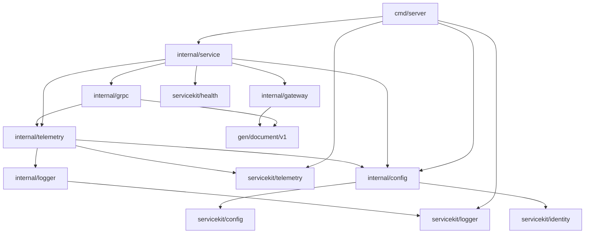

<!-- START doctoc generated TOC please keep comment here to allow auto update -->
<!-- DON'T EDIT THIS SECTION, INSTEAD RE-RUN doctoc TO UPDATE -->

- [Document service](#document-service)
  - [Prerequisites](#prerequisites)
    - [Mutating and runtime targets](#mutating-and-runtime-targets)
    - [Non-mutating validation targets](#non-mutating-validation-targets)
    - [Go file selection](#go-file-selection)
    - [Setup and normal validation](#setup-and-normal-validation)
    - [Repository onboarding](#repository-onboarding)
  - [Runtime configuration](#runtime-configuration)
  - [Run and stop the service](#run-and-stop-the-service)
  - [Example RPC and HTTP gateway](#example-rpc-and-http-gateway)
  - [Architecture and ownership](#architecture-and-ownership)
    - [Package map and request walkthrough](#package-map-and-request-walkthrough)
  - [Deployment and operation](#deployment-and-operation)

<!-- END doctoc generated TOC please keep comment here to allow auto update -->

# Document service

This standalone module is the private Go Document lookup candidate. It runs beside the
authoritative Java Document service; ordinary traffic and registration/rendering authority remain
with Java. Issue #362 replaces temporary Echo with compatible PostgreSQL/MinIO lookup. Issue #363
adds registration and rendering. Java source and legacy resources remain intact.

The module identity is
`github.com/igor-baiborodine/insurance-hub/services/document-service`. It resolves published
Servicekit `v1.1.0` with `GOWORK=off` and no filesystem replacement or private service import. The
service provides `DocumentService/FindDocuments`, a generated HTTP gateway and Swagger 2.0
contract, typed PostgreSQL/MinIO configuration, safe structured logging, optional trace and metric
export, three owned listeners, dependency-aware health and bounded signal-driven shutdown.

## Prerequisites

- Go 1.27.4 exactly
- uv 0.13.1 for the repository CPython environment
- managed CPython 3.14.8; repository-level `make python-toolchain-setup` provisions it without
  changing system Python
- GNU Make 4.3 or newer
- Git for the default changed-file formatting scope; `FORMAT_SCOPE=all` also works outside Git
- GCC on Linux for `test-race`
- Network access when the Go module proxy/checksum service, source-based tool installation, Buf
  Schema Registry dependencies, or `vuln.go.dev` are not already cached

All Go and tooling operations use this module's Makefile. Bare `make` displays help without installing tools. Run module targets from
`services/document-service/`, or use `make -C services/document-service <target>` from the repository root.
Tool installation, dependency maintenance, formatting, linting, tests, builds, vulnerability
analysis, and execution set `GOWORK=off`; normal validation uses readonly module resolution and
never depends on a root workspace or filesystem replacement. `GO` may override the Go executable,
and `UV` may override uv. `test-tooling` preserves both selections across nested Make boundaries;
it also prefers the selected Go executable's directory when child tools invoke
`go` by name.

`bootstrap-tools` verifies or provisions the repository's ignored `.venv/` from the root
`.python-version`, `pyproject.toml`, and `uv.lock`, then installs these exact binaries under the
module's ignored `.tools/bin/`:

- Buf 1.73.0
- protoc-gen-go 1.36.12
- protoc-gen-go-grpc 1.6.2
- protoc-gen-grpc-gateway 2.30.0
- protoc-gen-openapiv2 2.30.0
- golangci-lint 2.14.0
- govulncheck 1.8.0

### Mutating and runtime targets

These operations are explicit and are never hidden inside `check`:

| Target                   | Mutation or side effect                                                                                                    | Prerequisite and network behavior                                                              |
|--------------------------|----------------------------------------------------------------------------------------------------------------------------|------------------------------------------------------------------------------------------------|
| `make python-toolchain-setup` | Installs managed CPython 3.14.8 when needed and creates or synchronizes the repository's ignored `.venv/` from the root lock. | uv 0.13.1 and Python package/index access unless cached; rejects a conflicting existing root environment. |
| `make bootstrap-tools`   | Runs the repository Python setup, then installs or replaces only binaries under the module's ignored `.tools/bin/`; it does not change source, generated output, or manifests. | uv 0.13.1, Go 1.27.4, and source/module download access unless cached; finishes by running `verify-tools`. |
| `make update-deps`       | Updates only `go.mod` and `go.sum` to the Makefile's pinned runtime/generated-code dependencies, then tidies.              | Go proxy and checksum access unless cached.                                                    |
| `make update-proto-deps` | Updates only `buf.lock` for the schema dependency declared in `buf.yaml`.                                                  | Verified pinned Buf binary and BSR access unless cached.                                       |
| `make format`            | Rewrites only the selected eligible handwritten Go files through gofumpt, goimports, then golines at 100 columns.          | Verified pinned tools; file selection is described below.                                      |
| `make format-proto`      | Rewrites only `api/document/v1/document_service.proto` with pinned Buf.                                                    | Verified pinned tools.                                                                         |
| `make gen-proto`         | Removes and regenerates the exact declared Go/gateway/Swagger inventory under `gen/`.                                     | Pinned Buf and generators already installed; BSR access unless cached.                         |
| `make run`               | Starts `./cmd/server`; it changes no repository file.                                                                      | Go 1.27.4; readonly modules; runtime settings below.                                           |

Generated bindings must never be edited by hand. `gen-proto` owns only:

```text
gen/document/v1/document_service.pb.go
gen/document/v1/document_service.pb.gw.go
gen/document/v1/document_service_grpc.pb.go
gen/openapiv2/document/v1/document_service.swagger.json
```

### Non-mutating validation targets

These targets preserve the module outside ignored `.tools/`. Targets that invoke pinned tools
require `bootstrap-tools` to have been run explicitly.

| Target                      | Coverage                                                                                                                                                                                                                                                                   | Network or other prerequisite                                                                                                                                                      |
|-----------------------------|----------------------------------------------------------------------------------------------------------------------------------------------------------------------------------------------------------------------------------------------------------------------------|------------------------------------------------------------------------------------------------------------------------------------------------------------------------------------|
| `make verify-tools`         | Exact Go/tool versions, golangci-lint schema and formatter order, module/import prefix, 100-column settings, readonly loading, all-test lint scope, and vet-equivalent coverage.                                                                                           | All seven pinned binaries already installed; no installation.                                                                                                                      |
| `make python-toolchain-check` | Exact CPython, pytest, Ruff, and root locked-environment identity without installing or changing packages. | uv 0.13.1 and the provisioned repository environment, or a verified `PYTHON` override containing the root-locked tools. |
| `make python-check`         | Ruff format/lint plus the focused generated-gateway contract tests for Document-owned Python. | Passing `python-toolchain-check`; no Go tools or network mutation. |
| `make dockerfile-check` | Exact generated Dockerfile bytes against the validated service configuration and repository-owned fixed template. | Managed Python; no container runtime or mutation. |
| `make image-check` | Builds the generated Dockerfile from committed source identity, inspects OCI/runtime identity, then runs the image through the real PostgreSQL/MinIO lookup fixture with exact bytes, empty lookup, readiness, safe startup identity, graceful shutdown and bounded cleanup. | Docker Buildx, OpenSSL, psql, mc and the pinned builder, runtime, PostgreSQL and MinIO images available locally. |
| `make format-check`         | The same ordered formatter pipeline and selected handwritten files as `format`, reported without rewriting them.                                                                                                                                                           | Verified tools; file selection below.                                                                                                                                              |
| `make check-deps`           | Reproduces `update-deps` in a temporary standalone module and compares `go.mod` and `go.sum`.                                                                                                                                                                              | Go proxy/checksum access unless cached.                                                                                                                                            |
| `make format-proto-check`   | Buf formatting for the one owned schema.                                                                                                                                                                                                                                   | Verified tools.                                                                                                                                                                    |
| `make lint-proto`           | Buf lint for the one owned schema.                                                                                                                                                                                                                                         | Verified tools and locked BSR dependencies.                                                                                                                                        |
| `make check-proto-breaking` | Current schema against `testdata/contract-baseline/` with Buf `FILE` rules. The baseline is fixed and never promoted automatically.                                                                                                                                        | Verified tools and readable checked-in baseline/lock data.                                                                                                                         |
| `make check-proto-drift`    | Exact generated path set and bytes against two isolated regenerations, detecting added, modified, missing, deleted, and non-reproducible output.                                                                                                                           | Verified tools and BSR access unless cached.                                                                                                                                       |
| `make check-gateway-contract` | Generated Swagger route, schemas, media types, responses and safe examples against `testdata/http-contract.json`. | Managed Python and readable generated Swagger; no service process or network. |
| `make lint`                 | golangci-lint over `./...`, including tests and vet-equivalent analysis; generated, vendor, third-party, fixture, and tool paths are excluded by configuration.                                                                                                            | Verified tools; readonly modules.                                                                                                                                                  |
| `make test`                 | Every package under `./...`, including `cmd/server`, generated consumers, configuration, transport, health, logging, service lifecycle, and telemetry.                                                                                                                     | Go 1.27.4; readonly modules.                                                                                                                                                       |
| `make test-race`            | The same complete package/test scope as `test`, with race instrumentation.                                                                                                                                                                                                 | Go 1.27.4, readonly modules, and a C compiler.                                                                                                                                     |
| `make build`                | Every package under `./...` and an executable `server`, with build output in a removed temporary directory.                                                                                                                                                                | Go 1.27.4; readonly modules.                                                                                                                                                       |
| `make vulncheck`            | Reachability-aware analysis of every package under `./...`.                                                                                                                                                                                                                | Verified govulncheck; access to `vuln.go.dev` unless cached.                                                                                                                       |
| `make check`                | In order: tool/configuration verification, Go and Protobuf format checks, Go and Protobuf lint, race tests, build, dependency reproduction, generation drift/reproducibility, compatibility, and vulnerability analysis. It does not repeat the equivalent non-race suite. | All prerequisites and network access inherited from its checks. It never installs tools, formats, tidies, regenerates real output, updates baselines, starts services, or deploys. |
| `make test-tooling`         | Pytest-managed Git-free disposable copies containing controlled Go-format, lint, test, dependency, schema, compatibility, and generated-output defects; each intended gate must reject its defect without mutation. Child commands have 20-minute phase deadlines inside a 60-minute suite deadline, 30-second activity heartbeats, and bounded process-group cleanup. | Verified Python and Go tools; temporary storage and the network/cache prerequisites of nested checks. |

The shared `test-tooling` runner handles SIGINT and SIGTERM, unwinds the active child process group, and
returns 130 or 143 when invoked through `scripts/test-tooling.sh`. GNU Make reports an interrupted
`test-tooling` recipe with its own nonzero Make status after the runner exits; it does not preserve
the runner's numeric status. The runner disables pytest temporary-path retention, so its disposable
tooling fixtures are removed after successful, failed, and interrupted sessions.

The API startup never creates schema, roles, buckets or credentials. The explicit migrator and
resource-administration targets own those operations; see the deployment runbook.

### Go file selection

`format` and `format-check` share one stable ordered selector:

- `FORMAT_FILES="path/a.go path/b.go"` has highest precedence and accepts only module-relative
  handwritten Go files.
- `FORMAT_SCOPE=all` selects every eligible handwritten Go file and works without Git.
- The default `FORMAT_SCOPE=changed` compares tracked added/copied/modified/renamed files against
  `FORMAT_BASE` when supplied, or against `HEAD`, then includes eligible untracked files.
- An unresolved supplied base fails. A legitimate zero-file selection is reported as zero and does
  not broaden scope.
- Generated headers and paths under `gen/`, `vendor/`, `third_party/`, `testdata/`, and `.tools/`
  are excluded. Escaping the module or selecting an excluded file explicitly fails.

### Setup and normal validation

Bootstrap and refresh owned generated/dependency content explicitly:

```sh
make bootstrap-tools
make update-proto-deps
make gen-proto
make update-deps
make format FORMAT_SCOPE=all
make dockerfile-generate
```

Run normal non-mutating validation after tools are installed:

```sh
make check FORMAT_SCOPE=all
make test-tooling
```

### Repository onboarding

The generic Go PR workflow selects qualifying inputs under this immediate `services/*-service`
module. Root topology, active Servicekit-consumer and service-dispatch registration are completed
separately so each owner can validate the final Document identity. See the
[module topology guide](../../docs/migration/phase-4/go-module-topology.md).

## Runtime configuration

Settings are read once from the process environment. An explicitly empty setting is invalid unless
the optional OTLP endpoint is empty while telemetry is disabled. Diagnostics name the setting and
do not repeat its supplied value.

| Setting | Default | Validation |
| --- | --- | --- |
| `SERVICE_NAME` | `document-service` | Must equal the service's fixed logical name. |
| `HTTP_ADDR` | `127.0.0.1:8080` | Valid host and numeric port; port `0` is available for tests. |
| `GRPC_ADDR` | `127.0.0.1:9090` | Valid host and numeric port; port `0` is available for tests. |
| `HEALTH_ADDR` | `127.0.0.1:8081` | Valid host and numeric port; port `0` is available for tests. Nonzero listener addresses must be pairwise distinct. |
| `HTTP_MAX_HEADER_BYTES` | `16384` | Integer from 1024 through 1048576; applied by the business HTTP server. |
| `HTTP_MAX_BODY_BYTES` | `4096` | Integer from 1024 through 1048576; overflow is rejected before RPC. |
| `HTTP_READ_HEADER_TIMEOUT` | `5s` | Positive duration no greater than `HTTP_READ_TIMEOUT`. |
| `HTTP_READ_TIMEOUT` | `10s` | Positive duration no greater than `HTTP_WRITE_TIMEOUT`. |
| `HTTP_WRITE_TIMEOUT` | `10s` | Positive duration greater than `REQUEST_TIMEOUT`. |
| `HTTP_IDLE_TIMEOUT` | `30s` | Positive duration. |
| `LOG_LEVEL` | `info` | A level accepted by `slog.Level`, including documented offsets. |
| `REQUEST_TIMEOUT` | `4s` | Positive duration bounding HTTP admission and lookup; never extends a shorter caller deadline. |
| `PROBE_TIMEOUT` | `2s` | Positive duration bounding initial gateway connection and readiness checks. |
| `GRPC_MAX_RECV_BYTES` | `25165824` | Positive integer through 24 MiB; server receive and gateway-client send limit. |
| `GRPC_MAX_SEND_BYTES` | `25165824` | Positive integer through 24 MiB; server send and gateway-client receive limit. |
| `DOCUMENT_DATABASE_URL` | required | PostgreSQL reader URL; retained in a redacting value. |
| `DB_MAX_CONNS` | `4` | Integer from 1 through 16. |
| `DB_CONNECT_TIMEOUT` / `DB_ACQUIRE_TIMEOUT` / `DB_QUERY_TIMEOUT` | `3s` / `1s` / `2s` | Positive bounded database durations. |
| `MINIO_ENDPOINT` / `MINIO_ACCESS_KEY` / `MINIO_SECRET_KEY` / `MINIO_BUCKET` | required | Fixed HTTP(S) origin, redacted credentials and `policies` bucket. |
| `MINIO_CA_FILE` | required for HTTPS | CA bundle used with hostname verification; insecure TLS is unavailable. |
| `MINIO_FETCH_TIMEOUT` | `3s` | Positive per-object fetch duration. |
| `STARTUP_TIMEOUT` | `10s` | Positive bound covering dependency construction and readiness. |
| `DOCUMENT_MAX_BYTES` / `DOCUMENT_RESPONSE_MAX_BYTES` / `HTTP_RESPONSE_MAX_BYTES` | 8 MiB / 16 MiB / 24 MiB | Per-document, aggregate protobuf and JSON safety budgets. |
| `DOCUMENT_MAX_CONCURRENT_LOOKUPS` | `2` | Immediate bounded admission; saturation maps to 429. |
| `DEPLOYMENT_ENVIRONMENT` | `development` when disabled | General identity string; an explicit non-development value is required when telemetry is enabled. |
| `SERVICE_VERSION` | `development` when disabled | General identity string in `development`; otherwise exactly `git-` plus 12 lowercase hexadecimal characters with at least one nonzero suffix character, even when telemetry is disabled. |
| `SERVICE_INSTANCE_ID` | `local-<pid>` when disabled | General identity string; enabled telemetry requires an explicit value without the `local-` prefix. Kubernetes injects Pod `metadata.uid`. |
| `SHUTDOWN_TIMEOUT` | `10s` | Positive duration at least `REQUEST_TIMEOUT + OTEL_EXPORTER_OTLP_TIMEOUT`. |
| `OTEL_ENABLED` | `false` | Boolean. Disabled mode creates no exporter and needs no collector. |
| `OTEL_EXPORTER_OTLP_ENDPOINT` | unset | Required when telemetry is enabled. An `http` or `https` OTLP/gRPC URL with host and numeric port; credentials, query, fragment and HTTP path are rejected. |
| `OTEL_EXPORTER_OTLP_TIMEOUT` | `2s` | Positive duration reserved at the end of `SHUTDOWN_TIMEOUT`. |

Identity values use 1–128 ASCII letters, digits, dots, underscores or hyphens. The namespace
`insurance-hub`, implementation `go` and generated logical service name are fixed. `development` is
the only environment exempt from canonical-version validation. Enabled telemetry requires explicit
non-development environment/version/instance values and rejects the `local-` instance prefix.
Kubernetes deployments use the Downward API to inject Pod `metadata.uid`; the existing release
process derives the matching canonical version from verified full source. See the common
[Go service identity contract](../../docs/migration/phase-4/go-service-identity-and-validation.md).

Logs are JSON with UTC timestamps and `service_namespace`, `service_name`, `service_version`,
`service_instance_id`, `deployment_environment_name`, and `service_implementation`. Valid logging
contexts add `trace_id` and `span_id`. Credential, token, payload, customer, policy and payment
attribute keys are redacted recursively, and error objects are redacted entirely. Callers must
still select safe fields and keep sensitive data out of messages and ordinary string attributes.
Configuration failures include validator-owned `setting` and `reason` fields alongside the redacted
error. Unrecognized errors use constant fallback fields and never contribute their raw text.
The shared `servicekit/logger.New` constructor is available for tests; process wiring uses
`servicekit/logger.NewIdentity`. The local logger package owns the required `request completed`
record and delegates its redaction and threshold handling to the shared logger.

Enabled telemetry exports traces and cumulative metrics over OTLP/gRPC to the configured collector,
using the same six identity dimensions as logs. Disabled mode creates neither exporter and needs
no collector. W3C trace context is extracted at HTTP ingress and propagated through the owned gRPC
client and registered gRPC server; arbitrary application metadata and B3 propagation are excluded.

The pinned `libs/servicekit` `v1.1.0` provider owns a nonblocking trace queue (2048 spans, 256-span
batches, one-second batch delay), a ten-second periodic metric reader, and Go runtime instruments
for memory, allocations, GC, goroutines and processor limit. Exporter initialization, retries,
flush and shutdown use bounded contexts. Safe export diagnostics are rate-limited to once per 30
seconds; queue saturation has a separate safe warning. The executable installs the shared
diagnostic handler before enabled providers and restores the previous handler after service exit.

`insurance_hub.document.requests` and `insurance_hub.document.request.duration` separately record
bounded HTTP and gRPC transport outcomes. HTTP labels use only
`GET /documents/{policyNumber}` or `unmatched`; gRPC records the fixed `find_documents` operation
and final status. Lookup instruments distinguish complete and partial/omitted responses. Dependency
instruments record PostgreSQL outcomes and actual object-fetch success or failure without counting
inline content as object-store activity. Request paths, queries,
payloads, raw errors, headers and instance IDs are not metric labels. The same provider connects
the HTTP server, gRPC client and gRPC server trace. Service identity stays on the resource.

The service lifecycle owns provider shutdown within the overall shutdown budget.
`Config` embeds the shared `Runtime`, `GRPC`, `HTTPServer`, and `Telemetry` setting groups. The local identity
type embeds `servicekit/identity.Identity` and adds Document validation. Loading uses the shared
environment keys and `LoadGRPC`, then applies local
identity, listener and shutdown-budget rules. The development identity uses the shared constructor.
Embedding does not load environment variables or automatically validate settings. The telemetry
provider embeds the shared provider and uses its promoted methods directly.
All 17 canonical gRPC statuses remain distinct in completion logs and request metrics; unsupported
compression returns and records `UNIMPLEMENTED`. Unknown status values normalize to `UNKNOWN`.

Local tests use an owned loopback OTLP receiver to verify actual trace/metric transport; they do
not prove Alloy pipelines or deployed delivery.

## Run and stop the service

Start the executable from this module root:

```sh
make run
```

The owning target disables workspace mode and uses readonly module resolution. Override runtime
settings in the environment when needed; for example, this selects ephemeral loopback ports:

```sh
HTTP_ADDR=127.0.0.1:0 GRPC_ADDR=127.0.0.1:0 HEALTH_ADDR=127.0.0.1:0 make run
```

The business HTTP, gRPC and management defaults are `127.0.0.1:8080`, `127.0.0.1:9090` and
`127.0.0.1:8081`. Management exposes only `GET /livez` and `GET /readyz`. Startup marks readiness
only after the actual gRPC server is accepting the owned gateway connection and all listeners are
serving. The owned same-process connection disables grpc-go channel idleness so an inactive but
healthy gateway cannot become permanently unready. Each readiness request rechecks that the
connection remains `READY` within `PROBE_TIMEOUT`; liveness stays independent of that dependency.

An interrupt or `SIGTERM` withdraws readiness, stops new business HTTP admission and lets accepted
HTTP handlers finish before closing the gateway connection. It then gracefully or forcibly stops
gRPC, stops management HTTP and shuts down telemetry. HTTP, connection, gRPC and management cleanup
share the cutoff at `SHUTDOWN_TIMEOUT - OTEL_EXPORTER_OTLP_TIMEOUT`; telemetry receives the final
reserved interval within the one overall deadline.

## Example RPC and HTTP gateway

The generated `document.v1.DocumentService` exposes unary `FindDocuments`. One exact, nonempty
policy number returns every retrievable matching row in the `documents` collection. Duplicates are
preserved, missing metadata is a successful empty collection, and unavailable object-backed rows
are omitted without hiding a database failure. The generated gateway exposes
`GET /documents/{policyNumber}`:

```sh
curl --fail-with-body http://127.0.0.1:8080/documents/SYN-362
```

Synthetic `%PDF-362` bytes are `{"documents":[{"policyNumber":"SYN-362",`\
`"content":"JVBERi0zNjI="}]}`. A missing segment is 404, a decoded slash is not another policy
segment, a nonempty query is 400 and an unsupported method is 405. Failures use fixed JSON envelopes.
The generated Swagger 2.0 document is
`gen/openapiv2/document/v1/document_service.swagger.json`; `testdata/http-contract.json` is the
independent contract fixture checked by `make check-gateway-contract`.

The transports log neither request/response bodies nor underlying failure details. HTTP identity,
forwarding, `Grpc-Timeout` and `Grpc-Metadata-*` headers are stripped; application metadata and
upstream response metadata have empty allowlists. `REQUEST_TIMEOUT` begins at HTTP admission and
the configured HTTP/gRPC limits remain independent. Reflection, CORS, profiling, authentication,
debug endpoints and production exposure are not enabled by this foundation.

## Architecture and ownership

Dashboard is the reference for common runtime, transport, telemetry and lifecycle code. Product is
used only for PostgreSQL pool, reader, migration and administration mechanics. Neither is a runtime
dependency; Document owns its domain, storage mapping and generated contract.

| Foundation | Product reference | Document adaptation |
| --- | --- | --- |
| Go and shared libraries/tools | `go.mod`, `Makefile` | Exact matching shared pins; independent manifests and tool caches. |
| Typed configuration and identity | `internal/config/config.go` | Same six identity dimensions; generated fixed name, canonical non-development version, safe identity strings and Pod UID deployment input. Existing loopback ports preserved. |
| Safe structured logs | `servicekit/logger`, `internal/logger/logger.go` | Shared UTC, recursive redaction, redacted error objects and trace correlation; local completion message. |
| Trace/metric lifecycle | `servicekit/telemetry`, `internal/telemetry/telemetry.go` | Shared provider resources, bounded queue/export/cleanup, diagnostics and process instruments; local identity policy and metric views. |
| Gateway, request observation and limits | Dashboard `internal/gateway`, `internal/grpc`, `internal/telemetry/request.go` | Generated real-RPC lookup, fixed operation, safe errors and bounded transport signals. |
| Health and lifecycle | Dashboard `internal/service/service.go` | PostgreSQL/MinIO-aware readiness, three listener ownership, HTTP-first drain and ordered cleanup. |
| PostgreSQL | Product `internal/postgres` and migration owners | Parameterized Document reader, explicit schema administration and Document-owned SQL. |
| Business architecture | Dashboard application ports and injected adapters | Document lookup owns duplicate, inline/key, omission and response-budget behavior. |


Review this adaptation map when Product or Servicekit changes an operational foundation. Document
adopts compatible fixes through its own reviewed changes and behavior tests.

### Package map and request walkthrough

| Package | Responsibility |
| --- | --- |
| `cmd/server` | Load validated settings, create identity logger, install safe enabled diagnostics, own signals/exit. |
| `internal/service` | Construct the one provider, three listeners, owned gateway connection and servers; own channel readiness, partial-start rollback and ordered drain. |
| `internal/domain`, `internal/application` | Wire-independent Document values, lookup orchestration, concurrency and aggregate budgets. |
| `internal/postgres`, `internal/objectstore` | Bounded metadata reads and compatible inline/MinIO content resolution. |
| `internal/gateway` | Strict HTTP contract, generated client registration, safe status mapping, metadata policy and HTTP telemetry. |
| `internal/grpc` | Generated lookup registration, request validation, deadlines, size limits, safe status mapping and final-status observation. |
| `internal/config` | Compose shared setting groups, load the environment and apply Document identity and cross-setting policy. |
| `internal/logger`, `internal/telemetry` | Transport, lookup and dependency signals; shared provider construction with local policy and metric views. |
| `servicekit/config`, `servicekit/identity`, `servicekit/logger`, `servicekit/health`, `servicekit/telemetry` | Published shared settings, identity fields, parsing, safe logs, probes and SDK resource ownership. |
| `api/document/v1`, `gen/document/v1`, `gen/openapiv2/document/v1` | Editable protobuf/HTTP contract and generated Go, gateway and Swagger output; compatibility baseline remains separate. |

This component diagram shows source dependencies; construction and runtime dispatch are described
below it.



At startup, composition opens and checks PostgreSQL and MinIO, builds the lookup, binds all
listeners, starts gRPC, derives the same-process client target and waits for every dependency to be
ready. An HTTP lookup uses the generated client across the instrumented connection, passes protobuf
validation, queries metadata and resolves inline or object-backed content within the shorter deadline.
HTTP and gRPC record separate bounded completion signals. Shutdown withdraws readiness and drains
accepted HTTP work before connection and gRPC teardown, then closes management and telemetry within
the shared deadline.

## Deployment and operation

Use the [deployment runbook](deployment-runbook.md) for candidate, local-dev and Flux-owned QA
commands. Use the [observability runbook](observability-runbook.md) for safe foundation signal
checks. The Go workload exposes separate private HTTP/gRPC and management Services. Its
NetworkPolicy admits business traffic only from an explicitly labeled disposable qualification
caller, allows only DNS, PostgreSQL, MinIO and QA telemetry egress, and preserves the separate Java
Document workload and ordinary gateway destination.

The standalone `cmd/migrate` uses `internal/service/administration.go` for command lifecycle,
`internal/postgres/administration.go` for connections, and `internal/administration` for migration
policy/SQL, following Product. These own explicit Document PostgreSQL setup/adoption and read-only
status/version. They are not used by server startup or
included as an administrative entrypoint in the API image. Service-local resource tooling owns
protected PostgreSQL/MinIO read credentials separately. See
[explicit database and read-access administration](deployment-runbook.md#explicit-database-and-read-access-administration)
for fresh Java-independent initialization, compatible adoption, target/confirmation requirements,
credential recovery and focused `resource-test-fast`, `test-administration` and
`resource-test-integration` commands. The runtime mounts only the reader Secrets; migrator and
administrative target credentials are never part of API startup or its image.

Both command entry points use the same service-local logger facade as Product, backed by published
Servicekit logging. Administrative queries and session/lock/grant statements live in embedded
`.sql` files beside their owning administration or PostgreSQL adapter packages.
