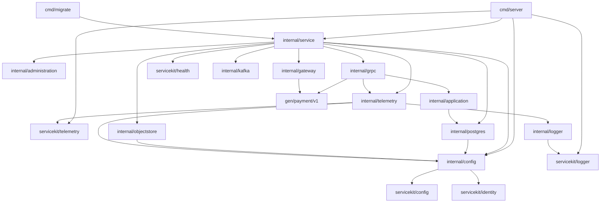

<!-- START doctoc generated TOC please keep comment here to allow auto update -->
<!-- DON'T EDIT THIS SECTION, INSTEAD RE-RUN doctoc TO UPDATE -->

- [Payment service](#payment-service)
  - [Prerequisites](#prerequisites)
    - [Mutating and runtime targets](#mutating-and-runtime-targets)
    - [Non-mutating validation targets](#non-mutating-validation-targets)
    - [Go file selection](#go-file-selection)
    - [Setup and normal validation](#setup-and-normal-validation)
    - [Repository onboarding](#repository-onboarding)
  - [Runtime configuration](#runtime-configuration)
  - [Run and stop the service](#run-and-stop-the-service)
  - [Private account RPC and HTTP API](#private-account-rpc-and-http-api)
  - [Reusable baseline and ownership](#reusable-baseline-and-ownership)
    - [Package map and request walkthrough](#package-map-and-request-walkthrough)

<!-- END doctoc generated TOC please keep comment here to allow auto update -->

# Payment service

The Go Payment service is a standalone Insurance Hub module. Its module identity is
`github.com/igor-baiborodine/insurance-hub/services/payment-service`. Run every command in this
document from `services/payment-service/` with workspace mode disabled. The module has no root
workspace or filesystem replacements.

The service provides versioned private account reads through direct gRPC and a generated HTTP
gateway, generated Go and Swagger 2.0 artifacts, typed PostgreSQL/MinIO/Kafka configuration with bounded
startup checks, safe structured logging, optional trace and metric export, dependency-aware health,
and bounded signal-driven shutdown.

## Prerequisites

- Go 1.27.4 exactly
- uv 0.13.1 for the repository CPython environment
- managed CPython 3.14.8; repository-level `make python-toolchain-setup` provisions it without
  changing system Python
- GNU Make 4.3 or newer
- Git for the default changed-file formatting scope; `FORMAT_SCOPE=all` also works outside Git
- GCC on Linux for `test-race`
- Network access when the Go module proxy/checksum service, source-based tool installation, Buf
  Schema Registry dependencies, or `vuln.go.dev` are not already cached

All Go and tooling operations use this module's Makefile. Bare `make` displays help without installing tools. Run module targets from
`services/payment-service/`, or use `make -C services/payment-service <target>` from the repository root.
Tool installation, dependency maintenance, formatting, linting, tests, builds, vulnerability
analysis, and execution set `GOWORK=off`; normal validation uses readonly module resolution and
never depends on a root workspace or filesystem replacement. `GO` may override the Go executable,
and `UV` may override uv. `test-tooling` preserves both selections across nested
Make boundaries. It also prefers the selected Go executable's directory when child tools invoke
`go` by name.

`bootstrap-tools` verifies or provisions the repository's ignored `.venv/` from the root
`.python-version`, `pyproject.toml`, and `uv.lock`, then installs these exact binaries under the
module's ignored `.tools/bin/`:

- Buf 1.73.0
- protoc-gen-go 1.36.12
- protoc-gen-go-grpc 1.6.2
- protoc-gen-grpc-gateway 2.30.0
- protoc-gen-openapiv2 2.30.0
- golangci-lint 2.14.0
- govulncheck 1.8.0

### Mutating and runtime targets

These operations are explicit and are never hidden inside `check`:

| Target                   | Mutation or side effect                                                                                                    | Prerequisite and network behavior                                                              |
|--------------------------|----------------------------------------------------------------------------------------------------------------------------|------------------------------------------------------------------------------------------------|
| `make python-toolchain-setup` | Installs managed CPython 3.14.8 when needed and creates or synchronizes the repository's ignored `.venv/` from the root lock. | uv 0.13.1 and Python package/index access unless cached; rejects a conflicting existing root environment. |
| `make bootstrap-tools`   | Runs the repository Python setup, then installs or replaces only binaries under the module's ignored `.tools/bin/`; it does not change source, generated output, or manifests. | uv 0.13.1, Go 1.27.4, and source/module download access unless cached; finishes by running `verify-tools`. |
| `make update-deps`       | Updates only `go.mod` and `go.sum` to the Makefile's pinned runtime/generated-code dependencies, then tidies.              | Go proxy and checksum access unless cached.                                                    |
| `make update-proto-deps` | Updates only `buf.lock` for the schema dependency declared in `buf.yaml`.                                                  | Verified pinned Buf binary and BSR access unless cached.                                       |
| `make format`            | Rewrites only the selected eligible handwritten Go files through gofumpt, goimports, then golines at 100 columns.          | Verified pinned tools; file selection is described below.                                      |
| `make format-proto`      | Rewrites only `api/payment/v1/payment_service.proto` with pinned Buf.                                                     | Verified pinned tools.                                                                         |
| `make gen-proto`         | Removes and regenerates the exact declared Go/gateway/Swagger inventory under `gen/`.                                     | Pinned Buf and generators already installed; BSR access unless cached.                         |
| `make run`               | Starts `./cmd/server`; it changes no repository file.                                                                      | Go 1.27.4; readonly modules; runtime settings below.                                           |

Generated bindings must never be edited by hand. `gen-proto` owns only:

```text
gen/payment/v1/payment_service.pb.go
gen/payment/v1/payment_service.pb.gw.go
gen/payment/v1/payment_service_grpc.pb.go
gen/openapiv2/payment/v1/payment_service.swagger.json
```

### Non-mutating validation targets

These targets preserve the module outside ignored `.tools/`. Targets that invoke pinned tools
require `bootstrap-tools` to have been run explicitly.

| Target                      | Coverage                                                                                                                                                                                                                                                                   | Network or other prerequisite                                                                                                                                                      |
|-----------------------------|----------------------------------------------------------------------------------------------------------------------------------------------------------------------------------------------------------------------------------------------------------------------------|------------------------------------------------------------------------------------------------------------------------------------------------------------------------------------|
| `make verify-tools`         | Exact Go/tool versions, golangci-lint schema and formatter order, module/import prefix, 100-column settings, readonly loading, all-test lint scope, and vet-equivalent coverage.                                                                                           | All seven pinned binaries already installed; no installation.                                                                                                                      |
| `make python-toolchain-check` | Exact CPython, pytest, Ruff, and root locked-environment identity without installing or changing packages. | uv 0.13.1 and the provisioned repository environment, or a verified `PYTHON` override containing the root-locked tools. |
| `make python-check`         | Ruff format/lint plus fast gateway-contract pytest coverage for service-owned Python. | Passing `python-toolchain-check`; no Go tools or network mutation. |
| `make dockerfile-check` | Exact generated Dockerfile bytes against the validated service configuration and repository-owned fixed template. | Managed Python; no container runtime or mutation. |
| `make image-check` | Builds the generated Dockerfile from committed source identity, then verifies OCI labels, platform, nonroot user, entrypoint and exposed ports. | Docker Buildx and access to the pinned builder and runtime images unless cached. Use the read-only `make deploy-smoke` for focused startup, dependency, account-list, network-access, liveness and graceful-shutdown qualification in an owned disposable Kind namespace. |
| `make format-check`         | The same ordered formatter pipeline and selected handwritten files as `format`, reported without rewriting them.                                                                                                                                                           | Verified tools; file selection below.                                                                                                                                              |
| `make check-deps`           | Reproduces `update-deps` in a temporary standalone module and compares `go.mod` and `go.sum`.                                                                                                                                                                              | Go proxy/checksum access unless cached.                                                                                                                                            |
| `make format-proto-check`   | Buf formatting for the one owned schema.                                                                                                                                                                                                                                   | Verified tools.                                                                                                                                                                    |
| `make lint-proto`           | Buf lint for the one owned schema.                                                                                                                                                                                                                                         | Verified tools and locked BSR dependencies.                                                                                                                                        |
| `make check-proto-breaking` | Current schema against `testdata/contract-baseline/` with Buf `FILE` rules. The baseline is fixed and never promoted automatically.                                                                                                                                        | Verified tools and readable checked-in baseline/lock data.                                                                                                                         |
| `make check-proto-drift`    | Exact generated path set and bytes against two isolated regenerations, detecting added, modified, missing, deleted, and non-reproducible output.                                                                                                                           | Verified tools and BSR access unless cached.                                                                                                                                       |
| `make check-gateway-contract` | Generated Swagger route, schemas, media types, responses and safe examples against `testdata/http-contract.json`. | Managed Python and readable generated Swagger; no service process or network. |
| `make lint`                 | golangci-lint over `./...`, including tests and vet-equivalent analysis; generated, vendor, third-party, fixture, and tool paths are excluded by configuration.                                                                                                            | Verified tools; readonly modules.                                                                                                                                                  |
| `make test`                 | Every package under `./...`, including `cmd/server`, generated consumers, configuration, transport, health, logging, service lifecycle, and telemetry.                                                                                                                     | Go 1.27.4; readonly modules.                                                                                                                                                       |
| `make test-race`            | The same complete package/test scope as `test`, with race instrumentation.                                                                                                                                                                                                 | Go 1.27.4, readonly modules, and a C compiler.                                                                                                                                     |
| `make test-integration`     | Race-enabled production-composition tests on loopback listeners, plus account list/detail, registration transaction/replay and worker recovery, schema migration, status and writer-access checks against owned disposable TLS PostgreSQL and Kafka containers. The worker smoke uses group `payment-service-qualification`; it never uses a configured deployment environment or the serving group. `check-go-pr` writes the profile to `integration-coverage.txt`; `check` writes both coverage profiles to a disposable directory. | Go 1.27.4, Docker, OpenSSL, readonly modules, a C compiler and the cached pinned PostgreSQL/Kafka images or registry access. |
| `make build`                | Every package under `./...` and the `server` and `migrate` executables, with build output in a removed temporary directory.                                                                                                                                                                | Go 1.27.4; readonly modules.                                                                                                                                                       |
| `make vulncheck`            | Reachability-aware analysis of every package under `./...`.                                                                                                                                                                                                                | Verified govulncheck; access to `vuln.go.dev` unless cached.                                                                                                                       |
| `make check`                | In order: tool/configuration verification, Go and Protobuf format checks, Go and Protobuf lint, race tests with the 75% coverage gate, real-listener integration coverage, build, dependency reproduction, generation drift/reproducibility, compatibility, and vulnerability analysis. It does not repeat the equivalent non-race suite. | All prerequisites and network access inherited from its checks. It never installs tools, formats, tidies, regenerates real output, updates baselines, starts services, or deploys. |
| `make test-tooling`         | Pytest-managed Git-free disposable copies containing controlled Go-format, lint, test, dependency, schema, compatibility, and generated-output defects; each intended gate must reject its defect without mutation. Child commands have 20-minute phase deadlines inside a 60-minute suite deadline, 30-second activity heartbeats, and bounded process-group cleanup. | Verified Python and Go tools; temporary storage and the network/cache prerequisites of nested checks. |

The shared `test-tooling` runner handles SIGINT and SIGTERM, unwinds the active child process group, and
returns 130 or 143 when invoked through `scripts/test-tooling.sh`. GNU Make reports an interrupted
`test-tooling` recipe with its own nonzero Make status after the runner exits; it does not preserve
the runner's numeric status. The runner disables pytest temporary-path retention, so its disposable
tooling fixtures are removed after successful, failed, and interrupted sessions.

The service has no generated mocks or Go workspace. Its schema migrations run only from the
operator command `./cmd/migrate`, never from the serving image or during startup; the server does
not migrate the schema.
Use the [deployment runbook](deployment-runbook.md) for deployment validation and operator commands.

### Go file selection

`format` and `format-check` share one stable ordered selector:

- `FORMAT_FILES="path/a.go path/b.go"` has highest precedence and accepts only module-relative
  handwritten Go files.
- `FORMAT_SCOPE=all` selects every eligible handwritten Go file and works without Git.
- The default `FORMAT_SCOPE=changed` compares tracked added/copied/modified/renamed files against
  `FORMAT_BASE` when supplied, or against `HEAD`, then includes eligible untracked files.
- An unresolved supplied base fails. A legitimate zero-file selection is reported as zero and does
  not broaden scope.
- Generated headers and paths under `gen/`, `vendor/`, `third_party/`, `testdata/`, and `.tools/`
  are excluded. Escaping the module or selecting an excluded file explicitly fails.

### Setup and normal validation

Bootstrap and refresh owned generated/dependency content explicitly:

```sh
make bootstrap-tools
make update-proto-deps
make gen-proto
make update-deps
make format FORMAT_SCOPE=all
make dockerfile-generate
```

Run normal non-mutating validation after tools are installed:

```sh
make check FORMAT_SCOPE=all
make test-tooling
```

### Repository onboarding

Payment is registered in the root module inventory as a standalone business service owned by
the Payment service maintainers and as a consumer of the published `libs/servicekit` library. The
[Go module topology guide](../../docs/go-module-topology.md) describes the inventory and CI
ownership. Pull requests can rely on these checks:

- The module PR workflow runs `make check-go-pr` for changes to this module. It enforces 75% patch
  coverage over `coverage.txt` and `integration-coverage.txt` and uploads both profiles.
- The shared Go PR workflow validates the inventory. When Servicekit changes, it runs this module's
  `shared-fast-*` and `shared-candidate-*` consumer phases.

Main-branch coverage reporting and the Go service release catalog are not configured for Payment;
each is a separate registration. The shared template remains under `templates/go-service`; this
module owns only Payment-specific source and operational documentation.

## Runtime configuration

Settings are read once from the process environment. An explicitly empty setting is invalid unless
the optional OTLP endpoint is empty while telemetry is disabled. Diagnostics name the setting and
do not repeat its supplied value.

| Setting | Default | Validation |
| --- | --- | --- |
| `SERVICE_NAME` | `payment-service` | Must equal the service's fixed logical name. |
| `HTTP_ADDR` | `127.0.0.1:8080` | Valid host and numeric port; port `0` is available for tests. |
| `GRPC_ADDR` | `127.0.0.1:9090` | Valid host and numeric port; port `0` is available for tests. |
| `HEALTH_ADDR` | `127.0.0.1:8081` | Valid host and numeric port; port `0` is available for tests. Nonzero listener addresses must be pairwise distinct. |
| `HTTP_MAX_HEADER_BYTES` | `16384` | Integer from 1024 through 1048576; applied by the business HTTP server. |
| `HTTP_MAX_BODY_BYTES` | `4096` | Integer from 1024 through 1048576; overflow is rejected before RPC. |
| `HTTP_READ_HEADER_TIMEOUT` | `5s` | Positive duration no greater than `HTTP_READ_TIMEOUT`. |
| `HTTP_READ_TIMEOUT` | `10s` | Positive duration no greater than `HTTP_WRITE_TIMEOUT`. |
| `HTTP_WRITE_TIMEOUT` | `10s` | Positive duration greater than `REQUEST_TIMEOUT`. |
| `HTTP_IDLE_TIMEOUT` | `30s` | Positive duration. |
| `LOG_LEVEL` | `info` | A level accepted by `slog.Level`, including documented offsets. |
| `REQUEST_TIMEOUT` | `8s` | Positive duration bounding HTTP admission and application work; never extends a shorter caller deadline. |
| `PROBE_TIMEOUT` | `2s` | Positive duration bounding initial gateway connection and readiness checks. |
| `GRPC_MAX_RECV_BYTES` | `1048576` | Integer from 1 through 16777216; server receive and gateway-client send limit. |
| `GRPC_MAX_SEND_BYTES` | `8388608` | Integer from 1 through 67108864; server send and gateway-client receive limit. |
| `PAYMENT_DATABASE_URL` | required | A `postgres`/`postgresql` URL for database `payment` with a password and exactly `sslmode=verify-full` and `sslrootcert`; retained in a redacting value. The pool accepts only login `go_payment_writer`. |
| `DB_MAX_CONNS` | `4` | Integer from 1 through 16; writer pool size. |
| `DB_CONNECT_TIMEOUT` | `3s` | Positive duration bounding each connection attempt and the startup ping. |
| `DB_QUERY_TIMEOUT` | `1s` | Positive duration bounding the `SELECT 1` readiness query. |
| `MINIO_ENDPOINT` / `MINIO_ACCESS_KEY` / `MINIO_SECRET_KEY` | required | Fixed HTTP(S) origin and redacted credentials. |
| `MINIO_BUCKET` | `payments-import` | Must select the fixed `payments-import` bucket. |
| `MINIO_CA_FILE` | required for HTTPS | CA bundle used with hostname verification; insecure TLS is unavailable. |
| `MINIO_FETCH_TIMEOUT` | `3s` | Positive duration bounding each object-store connection attempt. |
| `MINIO_MAX_STATEMENT_BYTES` | `1048576` | Integer from 1 through 8388608; bounds one statement snapshot before parsing and hashing. |
| `KAFKA_BROKERS` | required | Comma-separated TLS `host:port` bootstrap addresses. |
| `EVENT_WORKERS_ENABLED` | `false` | Boolean. The default performs metadata-only Kafka checks and joins no group. `true` explicitly enables registration consumption. |
| `KAFKA_GROUP` | `payment-service` when event workers are enabled; otherwise unset | Consuming mode accepts only the serving group `payment-service`. Supplying this setting while workers are disabled is rejected. |
| `KAFKA_REGISTERED_TOPIC` | `policy-registered` | Must select the registration topic exactly. |
| `KAFKA_CA_FILE` | required | Bounded CA bundle for TLS 1.2+ with hostname verification; plaintext is unavailable. |
| `STARTUP_TIMEOUT` | `10s` | Positive bound covering dependency construction and readiness. |
| `DEPLOYMENT_ENVIRONMENT` | `development` when disabled | General identity string; an explicit non-development value is required when telemetry is enabled. |
| `SERVICE_VERSION` | `development` when disabled | General identity string in `development`; otherwise exactly `git-` plus 12 lowercase hexadecimal characters with at least one nonzero suffix character, even when telemetry is disabled. |
| `SERVICE_INSTANCE_ID` | `local-<pid>` when disabled | General identity string; enabled telemetry requires an explicit value without the `local-` prefix. Kubernetes injects Pod `metadata.uid`. |
| `SHUTDOWN_TIMEOUT` | `10s` | Positive duration at least `REQUEST_TIMEOUT + OTEL_EXPORTER_OTLP_TIMEOUT`. |
| `OTEL_ENABLED` | `false` | Boolean. Disabled mode creates no exporter and needs no collector. |
| `OTEL_EXPORTER_OTLP_ENDPOINT` | unset | Required when telemetry is enabled. An `http` or `https` OTLP/gRPC URL with host and numeric port; credentials, query, fragment and HTTP path are rejected. |
| `OTEL_EXPORTER_OTLP_TIMEOUT` | `2s` | Positive duration reserved at the end of `SHUTDOWN_TIMEOUT`. |

Identity values use 1–128 ASCII letters, digits, dots, underscores or hyphens. The namespace
`insurance-hub`, implementation `go` and generated logical service name are fixed. `development` is
the only environment exempt from canonical-version validation. Enabled telemetry requires explicit
non-development environment/version/instance values and rejects the `local-` instance prefix.
Kubernetes deployments use the Downward API to inject Pod `metadata.uid`; the existing release
process derives the matching canonical version from verified full source. See the common
[Go service identity contract](../../docs/migration/phase-4/go-service-identity-and-validation.md).

Logs are JSON with UTC timestamps and `service_namespace`, `service_name`, `service_version`,
`service_instance_id`, `deployment_environment_name`, and `service_implementation`. Valid logging
contexts add `trace_id` and `span_id`. Credential, token, payload, customer, policy and payment
attribute keys are redacted recursively, and error objects are redacted entirely. Callers must
still select safe fields and keep sensitive data out of messages and ordinary string attributes.
Configuration failures include validator-owned `setting` and `reason` fields alongside the redacted
error. Unrecognized errors use constant fallback fields and never contribute their raw text.
The shared `servicekit/logger.New` constructor is available for tests; process wiring uses
`servicekit/logger.NewIdentity`. The local logger package owns the required `request completed`
record and delegates its redaction and threshold handling to the shared logger.

Enabled telemetry exports traces and cumulative metrics over OTLP/gRPC to the configured collector,
using the same six identity dimensions as logs. Disabled mode creates neither exporter and needs
no collector. W3C trace context is extracted at HTTP ingress and propagated through the owned gRPC
client and registered gRPC server; arbitrary application metadata and B3 propagation are excluded.

The pinned `libs/servicekit` `v1.1.0` provider owns a nonblocking trace queue (2048 spans, 256-span
batches, one-second batch delay), a ten-second periodic metric reader, and Go runtime instruments
for memory, allocations, GC, goroutines and processor limit. Exporter initialization, retries,
flush and shutdown use bounded contexts. Safe export diagnostics are rate-limited to once per 30
seconds; queue saturation has a separate safe warning. The executable installs the shared
diagnostic handler before enabled providers and restores the previous handler after service exit.

`insurance_hub.payment.requests` and `insurance_hub.payment.request.duration` separately record
bounded HTTP and gRPC transport outcomes. Request instruments and their attributes use the
`insurance_hub.<domain>.*` form with this module's telemetry domain. Metric labels are limited
to `insurance_hub.payment.operation`, `insurance_hub.payment.transport`,
`insurance_hub.payment.outcome` and the final HTTP or RPC status code. The HTTP route
(`GET /payment/accounts`, `GET /payment/accounts/{accountNumber}` or `unmatched`) is recorded on the
span only; gRPC records the fixed account operation and final status. Request paths, queries,
payloads, raw errors, headers, account identifiers, amounts and instance IDs
are not metric labels. The same provider connects the HTTP server, gRPC client and gRPC server
trace. Service identity stays on the resource.

The service lifecycle owns provider shutdown within the overall shutdown budget.
`Config` embeds the shared `Runtime`, `GRPC`, `HTTPServer`, and `Telemetry` setting groups. The local identity
type embeds `servicekit/identity.Identity` and adds service validation. Loading uses the shared
environment keys and `LoadGRPC` at its existing lookup position, then applies local
identity, listener and shutdown-budget rules. The development identity uses the shared constructor.
Embedding does not load environment variables or automatically validate settings. The telemetry
provider embeds the shared provider and uses its promoted methods directly.
All 17 canonical gRPC statuses remain distinct in completion logs and request metrics; unsupported
compression returns and records `UNIMPLEMENTED`. Unknown status values normalize to `UNKNOWN`.

Local tests use an owned loopback OTLP receiver to verify actual trace/metric transport; they do
not prove Alloy pipelines or deployed delivery.

## Run and stop the service

Start the executable from this module root:

```sh
make run
```

The owning target disables workspace mode and uses readonly module resolution. Override runtime
settings in the environment when needed; for example, this selects ephemeral loopback ports:

```sh
HTTP_ADDR=127.0.0.1:0 GRPC_ADDR=127.0.0.1:0 HEALTH_ADDR=127.0.0.1:0 make run
```

Startup also requires the PostgreSQL, MinIO and Kafka settings above and reachable dependencies.
A failed check stops startup before readiness with an error that names PostgreSQL, MinIO or Kafka.
The deployed default remains metadata-only. Explicit consuming mode first verifies inactive,
stable committed positions, constructs the registration use case and starts its worker before
readiness; it never initializes, resets or skips progress.

The business HTTP, gRPC and management defaults are `127.0.0.1:8080`, `127.0.0.1:9090` and
`127.0.0.1:8081`. Management exposes only `GET /livez` and `GET /readyz`. Startup marks readiness
only after the actual gRPC server is accepting the owned gateway connection and all listeners are
serving and one bounded PostgreSQL query, MinIO list and Kafka check succeed. In consuming mode,
the check includes the worker's ready/running state. A held record, uncertain offset commit or
worker drain withdraws readiness and stops the process for operator resolution.
The owned same-process connection disables grpc-go channel idleness so an inactive but healthy
gateway cannot become permanently unready. Each readiness request rechecks that the connection
remains `READY`, then reruns the PostgreSQL query and MinIO list within `PROBE_TIMEOUT`; liveness
stays independent of these dependencies.

An interrupt or `SIGTERM` withdraws readiness, stops new business HTTP admission and lets accepted
HTTP handlers finish before closing the gateway connection. It then gracefully or forcibly stops
gRPC, stops management HTTP, releases idle MinIO connections, then stops the registration worker
before closing the PostgreSQL pool and telemetry. The worker releases blocked rebalances without
a final commit. HTTP, connection, gRPC and management cleanup
share the cutoff at `SHUTDOWN_TIMEOUT - OTEL_EXPORTER_OTLP_TIMEOUT`; telemetry receives the final
reserved interval within the one overall deadline.

## Private account RPC and HTTP API

The generated `payment.v1.PaymentService` exposes `ListAccounts` and `GetAccountBalance`.
Protovalidate rejects an empty or oversized detail identifier at the gRPC boundary. Cancellation
and deadlines retain their gRPC status; missing accounts use `NotFound`; unavailable storage uses
`Unavailable`; unexpected failures return `Internal` with the stable message `internal error`.
The generated gateway serves the private reads:

```sh
curl --fail-with-body http://127.0.0.1:8080/payment/accounts
curl --fail-with-body http://127.0.0.1:8080/payment/accounts/payment-1
```

The list is a bare JSON array with exactly `policyAccountNumber`, `policyNumber`, `created` and
`updated`; timestamps are numeric epoch milliseconds. Detail adds an exact numeric `balance`.
A missing account returns HTTP 500 with only `_links` and the safe `message` value
`Internal Server Error`. A nonempty query, unsupported response media type, unknown route or wrong
method receives a fixed JSON error envelope. The generated Swagger 2.0 document is
`gen/openapiv2/payment/v1/payment_service.swagger.json`; `testdata/http-contract.json` is the
independent contract fixture checked by `make check-gateway-contract`.

The transports log neither request/response bodies nor underlying failure details. HTTP identity,
forwarding, `Grpc-Timeout` and `Grpc-Metadata-*` headers are stripped; application metadata and
upstream response metadata have empty allowlists. `REQUEST_TIMEOUT` begins at HTTP admission and
the configured HTTP/gRPC limits remain independent. Reflection, CORS, profiling, authentication,
debug endpoints and production exposure are not enabled by this service.

## Reusable baseline and ownership

Payment owns its contracts, runtime wiring and operational boundaries. Product is the reference
for operational foundations, not a runtime dependency. Both modules own independent runtime code
and use the repository's shared non-runtime Go Make tooling.

| Foundation | Product reference | Payment adaptation |
| --- | --- | --- |
| Go and shared libraries/tools | `go.mod`, `Makefile` | Exact matching shared pins; independent manifests and tool caches. |
| Typed configuration and identity | `internal/config/config.go` | Same six identity dimensions; generated fixed name, canonical non-development version, safe identity strings and Pod UID deployment input. Existing loopback ports preserved. |
| Safe structured logs | `servicekit/logger`, `internal/logger/logger.go` | Shared UTC, recursive redaction, redacted error objects and trace correlation; local completion message. |
| Trace/metric lifecycle | `servicekit/telemetry`, `internal/telemetry/telemetry.go` | Shared provider resources, bounded queue/export/cleanup, diagnostics and process instruments; local identity policy and metric views. |
| Gateway, request observation and limits | `internal/gateway`, `internal/grpc`, `internal/telemetry/request.go` | Generated account gateway, strict HTTP shapes, fixed account operations, bounded transport signals and configurable HTTP/gRPC limits. |
| Health and lifecycle | `servicekit/health`, `internal/service/service.go` | Channel-, PostgreSQL-, MinIO- and worker-aware readiness, three listener ownership, HTTP-first drain and bounded ordered cleanup. |
| PostgreSQL | Policy `internal/postgres/pool.go` and composition | The same pgx writer pool: verified TLS, pinned writer login, `search_path=pg_catalog`, startup ping within `DB_CONNECT_TIMEOUT`, the bounded `SELECT 1` readiness check and Payment-owned atomic statement receipt/credit writes. |
| Object storage | Document `internal/objectstore/reader.go` and composition | The same path-style MinIO client with system roots plus the configured CA, a dial bound, a one-key list read check on `payments-import`, one bounded statement snapshot read and idle-connection release on shutdown. |
| Kafka | Dashboard `internal/kafka` and composition | The same TLS trust and bounded CA file. Metadata-only mode joins no group. Explicit consuming mode validates stable committed positions for group `payment-service`, handles one registration at a time and commits only after durable success. |
| Business architecture | Product application-owned catalog ports and injected adapters | Account reads, policy registration and bank-statement posting are application-owned use cases over PostgreSQL ports; transport and storage remain replaceable adapters. |


Review this adaptation map whenever Product changes an operational foundation. Adopt compatible
fixes with behavior tests and update intentional differences explicitly through reviewed changes.

### Package map and request walkthrough

| Package | Responsibility |
| --- | --- |
| `cmd/server` | Load validated settings, create identity logger, install safe enabled diagnostics, own signals/exit. |
| `internal/service` | Construct the one provider, dependency clients, three listeners, owned gateway connection and servers; own dependency-aware readiness, partial-start rollback and ordered drain. |
| `cmd/migrate`, `internal/administration` | Operator-run `migrate`/`status` against one protected target enrollment: target identity checks, an advisory lock, the versioned schema and its history in one transaction, and exact schema inspection. |
| `internal/application` | Account-list, current-UTC-business-date balance, idempotent policy-registration and whole-file bank-statement validation/posting use cases plus their storage ports and classified failures. |
| `internal/postgres`, `internal/objectstore` | sqlc-backed account reads, atomic registration/debit and statement receipt/credit writes on the verified PostgreSQL writer pool, the readiness query, the separate verified migrator connection, and bounded `payments-import` checks and statement snapshots. |
| `internal/kafka` | TLS registration-topic metadata client and opt-in group worker with stable-progress preflight, strict event decoding and commit-after-storage ordering. |
| `internal/gateway` | Strict HTTP contract, generated client registration, safe status mapping, metadata policy and HTTP telemetry. |
| `internal/grpc` | Generated Payment registration, account projection, request validation, deadlines, size limits, safe status mapping and final-status observation. |
| `internal/config` | Compose shared setting groups, load the environment and apply service identity and cross-setting policy. |
| `internal/logger`, `internal/telemetry` | Completion-log and bounded account/event signal contracts; shared provider construction with local policy and metric views. Registration signals expose only event type, bounded outcome, duration and worker state through `insurance_hub.payment.events`, `insurance_hub.payment.event.duration`, `insurance_hub.payment.event.commit.failures`, `insurance_hub.payment.event.worker.enabled` and `insurance_hub.payment.event.worker.in_flight_age`. |
| `servicekit/config`, `servicekit/identity`, `servicekit/logger`, `servicekit/health`, `servicekit/telemetry` | Published shared settings, identity fields, parsing, safe logs, probes and SDK resource ownership. |
| `api/payment/v1`, `gen/payment/v1`, `gen/openapiv2/payment/v1` | Editable protobuf/HTTP contract and generated Go, gateway and Swagger output; compatibility baseline remains separate. |

This component diagram shows source dependencies; construction and runtime dispatch are described
below it.



At startup, composition opens and checks PostgreSQL and MinIO, reads the Kafka CA and configures
either the metadata client or the explicitly enabled registration worker, binds all listeners,
starts gRPC, derives the same-process client target from the bound address and waits for that
channel, PostgreSQL, MinIO and Kafka to be ready. Consuming mode starts only after its committed
positions pass preflight.
Each acquired client is registered for cleanup before the next is constructed, so a partial
startup releases what it already opened. An HTTP account read obtains a bounded HTTP server span,
uses the generated client across the instrumented connection, obtains client and server spans,
passes protobuf validation, enters the application use case and executes a read-only PostgreSQL
transaction with the shorter deadline.
HTTP, gRPC and registration work record separate bounded completion signals. Shutdown withdraws
readiness and drains accepted HTTP work before connection and gRPC teardown, then closes
management and MinIO idle connections, stops the worker without a final commit, closes the
PostgreSQL pool and finally telemetry within the shared deadline.

The C07 statement path currently validates one bounded snapshot and commits its review or posted
outcome through the application-owned PostgreSQL port. It remains unstarted in the serving process
until the isolated scheduler and lifecycle composition are added in the planned worker step.
