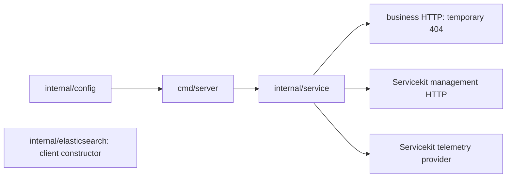

<!-- START doctoc generated TOC please keep comment here to allow auto update -->
<!-- DON'T EDIT THIS SECTION, INSTEAD RE-RUN doctoc TO UPDATE -->

- [Policy search service](#policy-search-service)
  - [Product and Servicekit alignment](#product-and-servicekit-alignment)
  - [Current architecture](#current-architecture)

<!-- END doctoc generated TOC please keep comment here to allow auto update -->

# Policy search service

This standalone Go module is the HTTP foundation for the internal policy search migration.
The Java `GET /policies` behavior and error baseline are recorded in issue #229; the Go search
handler, OpenAPI contract, and real Elasticsearch integration arrive in later delivery steps.
There is no gRPC API or Echo example in this service.

The module is derived from committed `templates/go-service` tree
`201064d910fc63cabad86fd7be8ff9c36f635a9f` at repository commit
`7fd0cf563dcccd703fdf9f03748a83932d66354d`. It retains the published
`libs/servicekit` `v1.0.1` dependency and shared runtime conventions. The root Go module
inventory now registers this foundation so repository planning and selected-module CI can
validate it. HTTP contract, real Elasticsearch integration, image, and shared-candidate gates
remain assigned to Step 4. No workspace or filesystem replacement is used.

## Product and Servicekit alignment

Common runtime code follows Product's implementation pattern through the published Servicekit
API. The policy-search module does not import `product-service/internal` packages.

| Boundary | Shared implementation | Intentional policy-search difference |
| --- | --- | --- |
| Configuration | Servicekit address, runtime, HTTP timeout, telemetry, and validation helpers; Product deployment-identity validation and test-instance generation | `httpAddressSetting` remains a private local name because Servicekit v1.0.1 publishes `DefaultHTTPAddress` but no `EnvHTTPAddress`; no duplicate HTTP default is declared |
| HTTP and health | Product's business-server timeout fields and Servicekit management server/state | The business handler is a temporary 404 until the Java-derived policy contract is implemented; Product's private handler and malformed-URI mapping are Product contract code |
| Lifecycle | Product's concrete runtime-resource ownership, expected server-stop handling, readiness withdrawal, concurrent HTTP drain, forced-cleanup reserve, and separate telemetry shutdown diagnostics | There is no PostgreSQL pool or business gRPC server to acquire or close |
| Logging and telemetry | Servicekit identity logger/provider, Product's W3C plus B3-multiple HTTP propagation policy, and the same safe enabled-export validation | Signal names use the policy-search identity; propagation middleware is completed with the real HTTP handler |
| gRPC | Servicekit remains available for shared OTLP exporter mechanics | Policy search exposes no business gRPC API, so it has no gRPC listener, limits, generated contract, or interceptors |

Comments on shared configuration aliases deliberately match Product. Comments differ where the
type or policy-search responsibility differs; they describe behavior rather than copy a service
name mechanically.

## Current architecture

| Path | Current responsibility |
| --- | --- |
| `cmd/server` | Loads configuration, installs signal cancellation and logging, then delegates lifecycle ownership |
| `internal/config` | Composes Servicekit settings with the policy-search service name and HTTP listener policy |
| `internal/service` | Owns business and management listeners, readiness state, telemetry, and bounded shutdown |
| `internal/telemetry` | Selects policy-search resource identity and signal names over the Servicekit provider |
| `internal/elasticsearch` | Constructs a verified, bounded, non-retrying Elasticsearch client; query behavior is not implemented yet |

Arrows show construction and lifecycle calls. The Elasticsearch constructor is intentionally not
wired into readiness or request handling yet. A current business request reaches the configured
HTTP server and returns 404; a management request reaches Servicekit's `/livez` or `/readyz`
handler. Later steps replace the temporary business handler with the policy search use case and
wire its owned Elasticsearch client without changing these process boundaries.

Run commands from this directory. `make` lists the current interface. `make update-deps` owns
manifest changes; `make format`, `make format-check`, `make test`, `make build`, and
`make check-servicekit` own their respective checks. The aggregate `make check-go-pr` validates
the current foundation with formatting, lint, race-enabled coverage, build, dependency,
vulnerability, and Servicekit checks. It does not certify the absent HTTP contract, real
Elasticsearch integration, or runtime image; Step 4 adds those gates. All Go commands use
standalone `GOWORK=off` module resolution.

The process reads typed environment settings. `SERVICE_NAME` defaults to
`policy-search-service`; `HTTP_ADDR` defaults to `127.0.0.1:8080`; `HEALTH_ADDR` defaults to
`127.0.0.1:8081`. `REQUEST_TIMEOUT`, `PROBE_TIMEOUT`, `SHUTDOWN_TIMEOUT`, `LOG_LEVEL`, and the
shared `OTEL_*` and deployment identity settings retain the scaffold's validated semantics.
The business listener loads `HTTP_READ_HEADER_TIMEOUT` (default `5s`), `HTTP_READ_TIMEOUT`
(`10s`), `HTTP_WRITE_TIMEOUT` (`10s`), and `HTTP_IDLE_TIMEOUT` (`30s`) through Servicekit, as
Product does. The read-header timeout cannot exceed the read timeout, and the request timeout
cannot exceed the write timeout. The management listener retains Servicekit's separate probe
server defaults.
The management listener exposes `GET /livez` and `GET /readyz`. The business HTTP listener has
no `/policies` handler yet; requests return 404 until the specified HTTP mapping is implemented.
Do not route traffic to this incomplete service.

The selected Elasticsearch client is `github.com/elastic/go-elasticsearch/v8` `v8.19.7`, for
the tested Elasticsearch 8.19 line. Its built-in retry is disabled by the owned constructor;
the existing Java gateway alone owns application retries and fallback. The client constructor
uses verified TLS, optional custom CA, bounded transport timeouts, and no implicit connection
or index mutation. Query construction and real dependency readiness are added in later steps.
