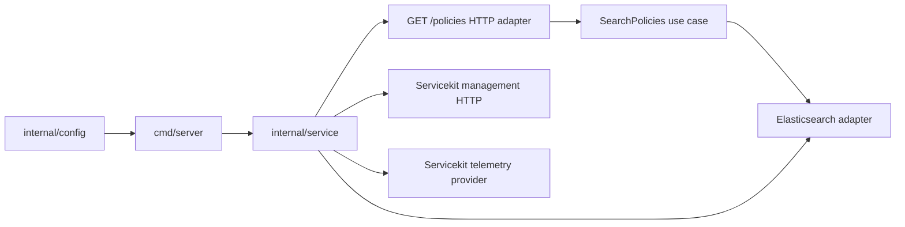

<!-- START doctoc generated TOC please keep comment here to allow auto update -->
<!-- DON'T EDIT THIS SECTION, INSTEAD RE-RUN doctoc TO UPDATE -->

- [Policy search service](#policy-search-service)
  - [Product and Servicekit alignment](#product-and-servicekit-alignment)
  - [Current architecture](#current-architecture)

<!-- END doctoc generated TOC please keep comment here to allow auto update -->

# Policy search service

This standalone Go module implements the internal policy search migration. It exposes the recorded
Java-compatible `GET /policies` behavior over Elasticsearch. There is no gRPC API, separately
maintained OpenAPI contract, or Echo example in this service.

The module is derived from committed `templates/go-service` tree
`201064d910fc63cabad86fd7be8ff9c36f635a9f` at repository commit
`7fd0cf563dcccd703fdf9f03748a83932d66354d`. It retains the published
`libs/servicekit` `v1.0.1` dependency and shared runtime conventions. The root Go module
inventory now registers this foundation so repository planning and selected-module CI can
validate it. The module owns a disposable Elasticsearch foundation suite, runtime image, and
applicable shared-candidate gates. No workspace or filesystem replacement is used.

## Product and Servicekit alignment

Common runtime code follows Product's implementation pattern through the published Servicekit
API. The policy-search module does not import `product-service/internal` packages.

| Boundary | Shared implementation | Intentional policy-search difference |
| --- | --- | --- |
| Configuration | Servicekit address, runtime, HTTP timeout, telemetry, and validation helpers; Product deployment-identity validation and test-instance generation | `httpAddressSetting` remains a private local name because Servicekit v1.0.1 publishes `DefaultHTTPAddress` but no `EnvHTTPAddress`; no duplicate HTTP default is declared |
| HTTP and health | Product's business-server timeout fields and Servicekit management server/state | Policy Search owns its Java-compatible query binding, DTO/error mapping, and Elasticsearch readiness check |
| Lifecycle | Product's concrete runtime-resource ownership, expected server-stop handling, readiness withdrawal, concurrent HTTP drain, forced-cleanup reserve, and separate telemetry shutdown diagnostics | The reusable Elasticsearch transport replaces Product's PostgreSQL pool; there is no business gRPC server |
| Logging and telemetry | Servicekit identity logger/provider, Product's W3C plus B3-multiple HTTP propagation policy, and the same safe enabled-export validation | Policy Search uses bounded search/request outcome labels and never records query, policy, credential, URL, or upstream payload values |
| gRPC | Servicekit remains available for shared OTLP exporter mechanics | Policy search exposes no business gRPC API, so it has no gRPC listener, limits, generated contract, or interceptors |

Comments on shared configuration aliases deliberately match Product. Comments differ where the
type or policy-search responsibility differs; they describe behavior rather than copy a service
name mechanically.

## Current architecture

| Path | Current responsibility |
| --- | --- |
| `cmd/server` | Loads configuration, installs signal cancellation and logging, then delegates lifecycle ownership |
| `internal/config` | Composes Servicekit settings with typed listener, Elasticsearch, startup, trust, and credential policy |
| `internal/service` | Injects Elasticsearch into the search use case and HTTP handler; owns listeners, readiness, telemetry, pooled connections, and bounded shutdown |
| `internal/http` | Preserves direct query binding, field/date omission, status, and framework-shaped error behavior |
| `internal/telemetry` | Selects policy-search resource identity and bounded request signal names over the Servicekit provider |
| `internal/elasticsearch` | Constructs the verified, bounded, non-retrying client and implements the legacy search query |

Arrows show construction and lifecycle calls. Readiness performs a bounded, non-mutating
Elasticsearch check while liveness remains available during dependency loss. Requests use one
reusable verified client and propagate cancellation through the HTTP adapter, application use case,
and Elasticsearch request. Shutdown withdraws readiness, drains HTTP, closes idle Elasticsearch
connections, and flushes telemetry within the configured bound.

Run commands from this directory. `make` lists the current interface. `make update-deps` owns
manifest changes; `make format`, `make format-check`, `make test`, `make build`, and
`make check-servicekit` own their respective checks. `make test-integration` starts pinned
disposable Elasticsearch and writes `integration-coverage.txt`; `make image-check` separately
builds and exercises the pinned nonroot runtime image. Image build, base identity/lifecycle checks,
Servicekit candidate phases, and bounded child-process ownership use repository tooling under
`scripts/go/service` and `scripts/python`, configured by `go-service-tooling.json`. The shared
interfaces are service-neutral; this change adopts them only in Policy Search, leaving Product
Service adoption to a separate PR. The aggregate `make check-go-pr` runs the integration suite
with formatting, lint, race-enabled `coverage.txt`, build, dependency, vulnerability, and
Servicekit checks. All Go commands use standalone `GOWORK=off` module resolution.

The current Elasticsearch integration proves owned container startup, synthetic index lifecycle,
client read/write behavior, query fields and cap, race execution, test discovery, coverage, and
cleanup. Focused handler and composition tests cover the direct HTTP response matrix, binding,
failure sanitization, cancellation, startup verification, readiness, and shutdown. The later parity
step replays the full Java scenarios through disposable real HTTP and Elasticsearch boundaries.

The process reads typed environment settings. `SERVICE_NAME` defaults to
`policy-search-service`; `HTTP_ADDR` defaults to `127.0.0.1:8080`; `HEALTH_ADDR` defaults to
`127.0.0.1:8081`. `REQUEST_TIMEOUT`, `PROBE_TIMEOUT`, `SHUTDOWN_TIMEOUT`, `LOG_LEVEL`, and the
shared `OTEL_*` and deployment identity settings retain the scaffold's validated semantics.
The business listener loads `HTTP_READ_HEADER_TIMEOUT` (default `5s`), `HTTP_READ_TIMEOUT`
(`10s`), `HTTP_WRITE_TIMEOUT` (`10s`), and `HTTP_IDLE_TIMEOUT` (`30s`) through Servicekit, as
Product does. The read-header timeout cannot exceed the read timeout, and the request timeout
cannot exceed the write timeout. The management listener retains Servicekit's separate probe
server defaults.
The management listener exposes `GET /livez` and dependency-backed `GET /readyz`. The business
listener exposes only `GET /policies`. `q` is required by the direct service; present empty and
whitespace values remain valid, and duplicate values use the first entry for Java compatibility.

`ELASTICSEARCH_URL` defaults to `http://127.0.0.1:9200`. Optional paired
`ELASTICSEARCH_USERNAME` and `ELASTICSEARCH_PASSWORD` settings keep credentials outside the URL.
`ELASTICSEARCH_CA_CERT_FILE` supplies an additional PEM trust root for HTTPS, and
`ELASTICSEARCH_TIMEOUT` defaults to `5s`. `STARTUP_TIMEOUT` defaults to `10s`. A dependency failure
keeps `/livez` available, makes `/readyz` unavailable, and maps a search failure to the sanitized
direct-service `500` contract.

The selected Elasticsearch client is `github.com/elastic/go-elasticsearch/v8` `v8.19.7`, for
the tested Elasticsearch 8.19 line. Its built-in retry is disabled by the owned constructor;
the existing Java gateway alone owns application retries and fallback. The client constructor
uses verified TLS, an optional custom CA, bounded transport timeouts, and no implicit connection
or index mutation. Readiness uses `GET /`; search uses `policy-views/_search`. Neither path retries
in the Go service.
