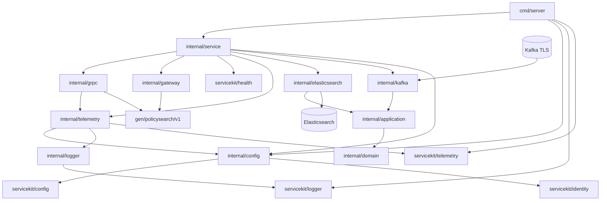

<!-- START doctoc generated TOC please keep comment here to allow auto update -->
<!-- DON'T EDIT THIS SECTION, INSTEAD RE-RUN doctoc TO UPDATE -->

- [Policy Search service](#policy-search-service)
  - [Operational runbooks](#operational-runbooks)
  - [Prerequisites](#prerequisites)
    - [Mutating and runtime targets](#mutating-and-runtime-targets)
    - [Non-mutating validation targets](#non-mutating-validation-targets)
    - [Go file selection](#go-file-selection)
    - [Setup and normal validation](#setup-and-normal-validation)
    - [Repository onboarding](#repository-onboarding)
    - [Continuous integration](#continuous-integration)
    - [Repository topology](#repository-topology)
  - [Runtime configuration](#runtime-configuration)
  - [Run and stop the service](#run-and-stop-the-service)
  - [Policy search RPC and HTTP gateway](#policy-search-rpc-and-http-gateway)
  - [Architecture and ownership](#architecture-and-ownership)
    - [Package map and request walkthrough](#package-map-and-request-walkthrough)
    - [Event processing and diagnostics walkthrough](#event-processing-and-diagnostics-walkthrough)

<!-- END doctoc generated TOC please keep comment here to allow auto update -->

# Policy Search service

This standalone module delivers the first private Go Policy Search capability alongside the legacy
Java service. Its module identity is
`github.com/igor-baiborodine/insurance-hub/services/policy-search-service`. Run every command in this
document from `services/policy-search-service/` with workspace mode disabled. The module has no root
workspace, filesystem replacements, database, or mandatory collector dependency. Kafka and the
Elasticsearch writer are optional and are acquired only when event workers are enabled.

The service provides the versioned Policy Search contract through direct gRPC and a generated HTTP
gateway. It owns generated Go and Swagger 2.0 artifacts, Elasticsearch query and policy-projection
adapters, typed configuration, safe structured logging, optional trace and metric export,
dependency-aware health, and bounded signal-driven shutdown.

## Operational runbooks

- The [deployment runbook](deployment-runbook.md) owns QA dependency provisioning, release
  verification, diagnostics, application rollback and resource retirement.
- The [observability runbook](observability-runbook.md) owns monitoring validation, QA
  provisioning, Grafana investigation, alert response and monitoring rollback.

The runbooks use QA for concrete operational examples and document the corresponding local-dev
adaptations. This README remains the module reference for prerequisites, development,
configuration, interfaces and architecture.

## Prerequisites

- Go 1.27.3 exactly
- uv 0.13.1 for the repository CPython environment
- managed CPython 3.14.8; repository-level `make python-toolchain-setup` provisions it without
  changing system Python
- GNU Make 4.3 or newer
- Git for the default changed-file formatting scope; `FORMAT_SCOPE=all` also works outside Git
- GCC on Linux for `test-race`
- Network access when the Go module proxy/checksum service, source-based tool installation, Buf
  Schema Registry dependencies, or `vuln.go.dev` are not already cached

All Go and tooling operations use this module's Makefile. Bare `make` displays help without installing tools. Run module targets from
`services/policy-search-service/`, or use `make -C services/policy-search-service <target>` from the repository root.
Tool installation, dependency maintenance, formatting, linting, tests, builds, vulnerability
analysis, and execution set `GOWORK=off`; normal validation uses readonly module resolution and
never depends on a root workspace or filesystem replacement. `GO` may override the Go executable,
and `UV` may override uv. `test-tooling` preserves both selections across nested Make boundaries;
it also prefers the selected Go executable's directory when child tools invoke `go` by name.

`bootstrap-tools` verifies or provisions the repository's ignored `.venv/` from the root
`.python-version`, `pyproject.toml`, and `uv.lock`, then installs these exact binaries under the
module's ignored `.tools/bin/`:

- Buf 1.73.0
- protoc-gen-go 1.36.12
- protoc-gen-go-grpc 1.6.2
- protoc-gen-grpc-gateway 2.30.0
- protoc-gen-openapiv2 2.30.0
- golangci-lint 2.14.0
- govulncheck 1.8.0

### Mutating and runtime targets

These operations are explicit and are never hidden inside `check`:

| Target                   | Mutation or side effect                                                                                                    | Prerequisite and network behavior                                                              |
|--------------------------|----------------------------------------------------------------------------------------------------------------------------|------------------------------------------------------------------------------------------------|
| `make python-toolchain-setup` | Installs managed CPython 3.14.8 when needed and creates or synchronizes the repository's ignored `.venv/` from the root lock. | uv 0.13.1 and Python package/index access unless cached; rejects a conflicting existing root environment. |
| `make bootstrap-tools`   | Runs the repository Python setup, then installs or replaces only binaries under the module's ignored `.tools/bin/`; it does not change source, generated output, or manifests. | uv 0.13.1, Go 1.27.3, and source/module download access unless cached; finishes by running `verify-tools`. |
| `make update-deps`       | Updates only `go.mod` and `go.sum` to the Makefile's pinned runtime/generated-code dependencies, then tidies.              | Go proxy and checksum access unless cached.                                                    |
| `make update-proto-deps` | Updates only `buf.lock` for the schema dependency declared in `buf.yaml`.                                                  | Verified pinned Buf binary and BSR access unless cached.                                       |
| `make format`            | Rewrites only the selected eligible handwritten Go files through gofumpt, goimports, then golines at 100 columns.          | Verified pinned tools; file selection is described below.                                      |
| `make format-proto`      | Rewrites only `api/policysearch/v1/policy_search_service.proto` with pinned Buf.                                               | Verified pinned tools.                                                                         |
| `make gen-proto`         | Removes and regenerates the exact declared Go/gateway/Swagger inventory under `gen/`.                                     | Pinned Buf and generators already installed; BSR access unless cached.                         |
| `make run`               | Starts `./cmd/server`; it changes no repository file.                                                                      | Go 1.27.3; readonly modules; runtime settings below.                                           |
| `make resource-inspect` | Reads the `policy-views` presence, exact mapping, alias state and document count without changing it. | Exact catalog coordinates, current Kubernetes context and ECK administrative Secret. |
| `make resource-ensure` | Creates missing `policy-views` resources and workload trust Secrets while preserving compatible populated data and existing credentials. It never copies, deletes or rewrites documents. | Exact catalog coordinates, ECK administrative Secret and `POLICY_SEARCH_RESOURCE_CONFIRM=ensure-policy-search-resources`; rejects mapping, alias, access or trust drift before mutation. |
| `make resource-verify` | Uses only the workload identities to verify the exact-index reader/writer boundary and unrelated-index/security denials. | Exact catalog coordinates and workload Secrets; no mutation is implied. |

Generated bindings must never be edited by hand. `gen-proto` owns only:

```text
gen/policysearch/v1/policy_search_service.pb.go
gen/policysearch/v1/policy_search_service.pb.gw.go
gen/policysearch/v1/policy_search_service_grpc.pb.go
gen/openapiv2/policysearch/v1/policy_search_service.swagger.json
```

### Non-mutating validation targets

These targets preserve the module outside ignored `.tools/`. Targets that invoke pinned tools
require `bootstrap-tools` to have been run explicitly.

| Target                      | Coverage                                                                                                                                                                                                                                                                   | Network or other prerequisite                                                                                                                                                      |
|-----------------------------|----------------------------------------------------------------------------------------------------------------------------------------------------------------------------------------------------------------------------------------------------------------------------|------------------------------------------------------------------------------------------------------------------------------------------------------------------------------------|
| `make verify-tools`         | Exact Go/tool versions, golangci-lint schema and formatter order, module/import prefix, 100-column settings, readonly loading, all-test lint scope, and vet-equivalent coverage.                                                                                           | All seven pinned binaries already installed; no installation.                                                                                                                      |
| `make python-toolchain-check` | Exact CPython, pytest, Ruff, and root locked-environment identity without installing or changing packages. | uv 0.13.1 and the provisioned repository environment, or a verified `PYTHON` override containing the root-locked tools. |
| `make python-check`         | Ruff format/lint plus fast lifecycle and gateway-contract pytest coverage for service-owned Python. | Passing `python-toolchain-check`; no Go tools or network mutation. |
| `make format-check`         | The same ordered formatter pipeline and selected handwritten files as `format`, reported without rewriting them.                                                                                                                                                           | Verified tools; file selection below.                                                                                                                                              |
| `make check-deps`           | Reproduces `update-deps` in a temporary standalone module and compares `go.mod` and `go.sum`.                                                                                                                                                                              | Go proxy/checksum access unless cached.                                                                                                                                            |
| `make format-proto-check`   | Buf formatting for the one owned schema.                                                                                                                                                                                                                                   | Verified tools.                                                                                                                                                                    |
| `make lint-proto`           | Buf lint for the one owned schema.                                                                                                                                                                                                                                         | Verified tools and locked BSR dependencies.                                                                                                                                        |
| `make check-proto-breaking` | Current schema against `testdata/contract-baseline/` with Buf `FILE` rules. The baseline is fixed and never promoted automatically.                                                                                                                                        | Verified tools and readable checked-in baseline/lock data.                                                                                                                         |
| `make check-proto-drift`    | Exact generated path set and bytes against two isolated regenerations, detecting added, modified, missing, deleted, and non-reproducible output.                                                                                                                           | Verified tools and BSR access unless cached.                                                                                                                                       |
| `make check-gateway-contract` | Generated Swagger route, schemas, media types, responses and safe examples against `testdata/http-contract.json`. | Managed Python and readable generated Swagger; no service process or network. |
| `make lint`                 | golangci-lint over `./...`, including tests and vet-equivalent analysis; generated, vendor, third-party, fixture, and tool paths are excluded by configuration.                                                                                                            | Verified tools; readonly modules.                                                                                                                                                  |
| `make test`                 | Every package under `./...`, including `cmd/server`, generated consumers, configuration, transport, health, logging, service lifecycle, and telemetry.                                                                                                                     | Go 1.27.3; readonly modules.                                                                                                                                                       |
| `make test-race`            | The same complete package/test scope as `test`, with race instrumentation.                                                                                                                                                                                                 | Go 1.27.3, readonly modules, and a C compiler.                                                                                                                                     |
| `make coverage-check`       | Race-enabled unit coverage across `./...`, with generated bindings and the disposable smoke client excluded from the 75% statement gate.                                                                                                                                  | Go 1.27.3, readonly modules, a C compiler, and managed Python.                                                                                                                      |
| `make test-integration`     | Real-listener HTTP-to-RPC composition, byte and presence semantics, readiness loss and recovery, and graceful shutdown. `INTEGRATION_COVERAGE_FILE` optionally records the selected suite for hosted reporting.                                                          | Go 1.27.3, readonly modules, and a C compiler.                                                                                                                                     |
| `make test-event-integration` | Independent event and search expectations against disposable pinned Kafka 4.1.0 over generated hostname-verified TLS and Elasticsearch 8.19.6. The runner rejects ambient endpoints, uses the ordinary topics/group/index, verifies HTTP/direct RPC and event test discovery, and removes both containers and generated credentials. | Docker, OpenSSL, Go 1.27.3, readonly modules, a C compiler and image access unless both pinned images are cached. The target never contacts a shared Kafka or Elasticsearch endpoint. |
| `make build`                | Every package under `./...` and an executable `server`, with build output in a removed temporary directory.                                                                                                                                                                | Go 1.27.3; readonly modules.                                                                                                                                                       |
| `make vulncheck`            | Reachability-aware analysis of every package under `./...`.                                                                                                                                                                                                                | Verified govulncheck; access to `vuln.go.dev` unless cached.                                                                                                                       |
| `make check`                | Tool/configuration verification, Go and Protobuf format and lint checks, 75% race-enabled unit coverage, real-listener, Elasticsearch and event integration coverage, build, dependency reproduction, generation drift/reproducibility, compatibility, gateway contract, vulnerability, Python, and Servicekit checks. | All prerequisites and network access inherited from its checks. It never installs tools, formats, tidies, regenerates real output, updates baselines, starts persistent services, or deploys. Disposable integration containers are always removed. |
| `make test-tooling`         | Pytest-managed Git-free disposable copies containing controlled Go-format, lint, test, dependency, schema, compatibility, and generated-output defects; each intended gate must reject its defect without mutation. Child commands have 20-minute phase deadlines inside a 60-minute suite deadline, 30-second activity heartbeats, and bounded process-group cleanup. | Verified Python and Go tools; temporary storage and the network/cache prerequisites of nested checks. |

The `test-tooling` runner handles SIGINT and SIGTERM, unwinds the active child process group, and
returns 130 or 143 when invoked through `scripts/test-tooling.sh`. GNU Make reports an interrupted
`test-tooling` recipe with its own nonzero Make status after the runner exits; it does not preserve
the runner's numeric status. The runner disables pytest temporary-path retention, so its disposable
tooling fixtures are removed after successful, failed, and interrupted sessions.

The event integration target starts disposable pinned Kafka and Elasticsearch containers and runs
the independent C230-01–07 event expectations together with the real HTTP-to-RPC search runtime.
It drives production workers through registration, termination, malformed-record, replacement and
restart paths. The disposable Kind smoke additionally exercises the index/access ensure helper
directly, access boundaries and a populated-state setup rerun; it does not exercise the Kubernetes
Secret and CA orchestration in `resource-ensure`. Required integration never passes by skip.

### Go file selection

`format` and `format-check` share one stable ordered selector:

- `FORMAT_FILES="path/a.go path/b.go"` has highest precedence and accepts only module-relative
  handwritten Go files.
- `FORMAT_SCOPE=all` selects every eligible handwritten Go file and works without Git.
- The default `FORMAT_SCOPE=changed` compares tracked added/copied/modified/renamed files against
  `FORMAT_BASE` when supplied, or against `HEAD`, then includes eligible untracked files.
- An unresolved supplied base fails. A legitimate zero-file selection is reported as zero and does
  not broaden scope.
- Generated headers and paths under `gen/`, `vendor/`, `third_party/`, `testdata/`, and `.tools/`
  are excluded. Escaping the module or selecting an excluded file explicitly fails.

### Setup and normal validation

Bootstrap and refresh owned generated/dependency content explicitly:

```sh
make bootstrap-tools
make update-proto-deps
make gen-proto
make update-deps
make format FORMAT_SCOPE=all
make test-event-integration
```

Run normal non-mutating validation after tools are installed:

```sh
make check FORMAT_SCOPE=all
make test-tooling
```

### Repository onboarding

The generic Go PR workflow selects qualifying changes under this immediate `services/*-service`
directory. The root topology inventory records the standalone module, its Servicekit consumption,
and the service-owned `check-go-pr` command. Deployment commands are registered separately through
the shared service catalog.

### Continuous integration

[Go PR Module Validation](../../.github/workflows/go-pr-mod.yml) runs only on pull requests to
`main` when qualifying Go source, generated Go or Swagger output, module metadata, Protobuf
contracts, contract baselines, or lint/generator configuration changes. Its explicit
`**/*-service` suffix matrix covers immediate Go services while excluding legacy
and nested service-shaped directories. Makefile, Python-tooling and README-only changes remain in
the local development workflow and do not select a Go module validation job.

After workflow filtering, the job maps the complete pull-request diff to conventionally named
service roots. It validates one selected module, reports a successful no-op for zero supported
modules, and rejects a diff spanning multiple modules before installing tools. Policy Search runs
`bootstrap-go-tools` and `check-go-pr`. Pull requests use the explicit base SHA for `FORMAT_BASE`;
generated Swagger changes select the same module path.

Topology and tooling-fixture changes are validated locally as applicable:

```sh
make go-modules-check FORMAT_SCOPE=all
make go-topology-test
```

A local pass is local equivalent-job evidence. Workflow inspection is configuration evidence. Only
a successful GitHub Actions run on a pushed branch or pull request is hosted-CI evidence.

### Repository topology

The root [Go module topology guide](../../docs/migration/phase-4/go-module-topology.md) defines
repository-wide discovery, resolution, import boundaries, CI coverage, and onboarding. Policy
Search is supported only when its inventory, owning target, Servicekit consumer record and
controlled fixtures agree. The service runs standalone with `GOWORK=off`, has no filesystem
replacement or cross-module runtime dependency, and uses the repository's shared
`scripts/go/module/common.mk`, root Python declarations and ignored root `.venv/`.

## Runtime configuration

Settings are read once from the process environment. An explicitly empty setting is invalid unless
the optional OTLP endpoint is empty while telemetry is disabled. Diagnostics name the setting and
do not repeat its supplied value.

| Setting | Default | Validation |
| --- | --- | --- |
| `SERVICE_NAME` | `policy-search-service` | Fixed deployment default; 1–128 ASCII letters, digits, dots, underscores or hyphens. |
| `HTTP_ADDR` | `127.0.0.1:8080` | Valid host and numeric port; port `0` is available for tests. |
| `GRPC_ADDR` | `127.0.0.1:9090` | Valid host and numeric port; port `0` is available for tests. |
| `HEALTH_ADDR` | `127.0.0.1:8081` | Valid host and numeric port; port `0` is available for tests. Nonzero listener addresses must be pairwise distinct. |
| `HTTP_MAX_HEADER_BYTES` | `16384` | Integer from 1024 through 1048576; applied by the business HTTP server. |
| `HTTP_MAX_BODY_BYTES` | `4096` | Integer from 1024 through 1048576; overflow is rejected before RPC. |
| `HTTP_READ_HEADER_TIMEOUT` | `5s` | Positive duration no greater than `HTTP_READ_TIMEOUT`. |
| `HTTP_READ_TIMEOUT` | `10s` | Positive duration no greater than `HTTP_WRITE_TIMEOUT`. |
| `HTTP_WRITE_TIMEOUT` | `10s` | Positive duration greater than `REQUEST_TIMEOUT`. |
| `HTTP_IDLE_TIMEOUT` | `30s` | Positive duration. |
| `LOG_LEVEL` | `info` | A level accepted by `slog.Level`, including documented offsets. |
| `REQUEST_TIMEOUT` | `8s` | Positive duration bounding HTTP admission and application work; never extends a shorter caller deadline. |
| `PROBE_TIMEOUT` | `2s` | Positive duration bounding initial gateway connection and readiness checks. Event activation sets `30s` so TLS discovery and the first group assignment remain bounded without using the query-only startup budget. |
| `GRPC_MAX_RECV_BYTES` | `1048576` | Integer from 1 through 16777216; server receive and gateway-client send limit. |
| `GRPC_MAX_SEND_BYTES` | `8388608` | Integer from 1 through 67108864; server send and gateway-client receive limit. |
| `DEPLOYMENT_ENVIRONMENT` | `development` when disabled | Explicit non-development value required when telemetry is enabled. |
| `SERVICE_VERSION` | `development` when disabled | Explicit non-development revision required when telemetry is enabled. |
| `SERVICE_INSTANCE_ID` | `local-<pid>` when disabled | Explicit instance identity without the `local-` prefix required when telemetry is enabled. |
| `SHUTDOWN_TIMEOUT` | `10s` | Positive duration at least `REQUEST_TIMEOUT + OTEL_EXPORTER_OTLP_TIMEOUT`. |
| `OTEL_ENABLED` | `false` | Boolean. Disabled mode creates no exporter and needs no collector. |
| `OTEL_EXPORTER_OTLP_ENDPOINT` | unset | Required when telemetry is enabled. An `http` or `https` OTLP/gRPC URL with host and numeric port; credentials, query, fragment and HTTP path are rejected. |
| `OTEL_EXPORTER_OTLP_TIMEOUT` | `2s` | Positive duration reserved at the end of `SHUTDOWN_TIMEOUT`. |
| `ELASTICSEARCH_URL` | `http://127.0.0.1:9200` | An `http` or `https` origin without credentials, path, query or fragment. |
| `ELASTICSEARCH_INDEX` | `policy-views` | Lowercase Elasticsearch index name. Query, projection writes, readiness and writer privilege checks use this one value. |
| `ELASTICSEARCH_USERNAME` | unset | Optional workload username; must be set together with `ELASTICSEARCH_PASSWORD`. |
| `ELASTICSEARCH_PASSWORD` | unset | Optional workload password; must be set together with `ELASTICSEARCH_USERNAME`. |
| `ELASTICSEARCH_CA_FILE` | unset | Optional public CA file for HTTPS only. The file is read during startup. |
| `ELASTICSEARCH_TIMEOUT` | `5s` | Positive duration no greater than five seconds; a shorter caller deadline remains authoritative. |
| `EVENT_WORKERS_ENABLED` | `false` | Boolean. Disabled mode creates no Kafka or writer client and needs no event settings or Secrets. |
| `KAFKA_BROKERS` | unset | Required when workers are enabled; comma-separated `host:port` bootstrap addresses. |
| `KAFKA_GROUP` | `policy-search-service` when enabled | Nonempty consumer group used by both event workers. |
| `KAFKA_REGISTERED_TOPIC` | `policy-registered` when enabled | Nonempty registered-event topic; must differ from the terminated topic. |
| `KAFKA_TERMINATED_TOPIC` | `policy-terminated` when enabled | Nonempty terminated-event topic; must differ from the registered topic. |
| `KAFKA_CA_FILE` | unset | Required when workers are enabled; public CA file used with TLS 1.2 or newer and hostname verification. |
| `ELASTICSEARCH_WRITER_USERNAME` | unset | Required when workers are enabled; separate document-writer identity. |
| `ELASTICSEARCH_WRITER_PASSWORD` | unset | Required with the writer username; never reused as query configuration. |

Identity values use 1–128 ASCII letters, digits, dots, underscores or hyphens. The namespace
`insurance-hub` and implementation `go` are fixed. Enabled telemetry requires explicit environment,
version and instance values; each deployed instance should receive its unique platform identity.
Deployments set the recorded environment, source-derived version and Pod UID instance identity.

Logs are JSON with UTC timestamps and `service_namespace`, `service_name`, `service_version`,
`service_instance_id`, `deployment_environment_name`, and `service_implementation`. Valid logging
contexts add `trace_id` and `span_id`. Credential, token, payload, customer, policy and payment
attribute keys are redacted recursively, and error objects are redacted entirely. Callers must
still select safe fields and keep sensitive data out of messages and ordinary string attributes.
Configuration failures include validator-owned `setting` and `reason` fields alongside the redacted
error. Unrecognized errors use constant fallback fields and never contribute their raw text.
The shared `servicekit/logger.New` constructor is available for tests; process wiring uses
`servicekit/logger.NewIdentity`. The local logger package owns the required `request completed`
record and delegates its redaction and threshold handling to the shared logger.

Enabled telemetry exports traces and cumulative metrics over OTLP/gRPC to the configured collector,
using the same six identity dimensions as logs. Disabled mode creates neither exporter and needs
no collector. W3C trace context is extracted at HTTP ingress and propagated through the owned gRPC
client and registered gRPC server; arbitrary application metadata and B3 propagation are excluded.

The pinned `libs/servicekit` `v1.0.1` provider owns a nonblocking trace queue (2048 spans, 256-span
batches, one-second batch delay), a ten-second periodic metric reader, and Go runtime instruments
for memory, allocations, GC, goroutines and processor limit. Exporter initialization, retries,
flush and shutdown use bounded contexts. Safe export diagnostics are rate-limited to once per 30
seconds; queue saturation has a separate safe warning. The executable installs the shared
diagnostic handler before enabled providers and restores the previous handler after service exit.

`insurance_hub.policy_search.requests` and `insurance_hub.policy_search.request.duration` separately record
bounded HTTP and gRPC transport outcomes. HTTP labels use only `GET /policies` or `unmatched`;
gRPC records the fixed search operation and final status. Request paths, queries,
payloads, raw errors, headers and instance IDs are not metric labels. The same provider connects
the HTTP server, gRPC client and gRPC server trace. Service identity stays on the resource.
`insurance_hub.policy_search.dependencies` and
`insurance_hub.policy_search.dependency.duration` record only the fixed Elasticsearch dependency,
the bounded `search` or `replace` operation, and bounded outcomes. The event counter and duration
histogram record only `registered` or `terminated` plus `success`, `malformed`, `error` or
`cancelled`. Workers extract W3C trace context from Kafka headers before projection. Query text,
event bodies, policy/customer identities, topics, groups and raw dependency errors are omitted.

`insurance_hub.policy_search.event.worker.enabled` reports `0` in disabled mode and `1` for both
configured workers. `insurance_hub.policy_search.event.worker.in_flight_age` reports zero while a
worker is idle and the elapsed seconds for its current synchronous record. Both observable gauges
use only the fixed `registered` and `terminated` event-type values. Completion and cancellation
reset age to zero; process restart reconstructs enabled state from configuration and starts idle.
Assignment loss remains a readiness failure rather than a consumer-lag estimate. These gauges do
not expose or claim topic, group, partition or broker backlog information.

The service lifecycle owns provider shutdown within the overall shutdown budget.
`Config` embeds the shared `Runtime`, `GRPC`, `HTTPServer`, and `Telemetry` setting groups. The local identity
type embeds `servicekit/identity.Identity` and adds service validation. Loading uses the shared
environment keys and `LoadGRPC`, then applies local
identity, listener and shutdown-budget rules. The development identity uses the shared constructor.
Embedding does not load environment variables or automatically validate settings. The telemetry
provider embeds the shared provider and uses its promoted methods directly.
All 17 canonical gRPC statuses remain distinct in completion logs and request metrics; unsupported
compression returns and records `UNIMPLEMENTED`. Unknown status values normalize to `UNKNOWN`.

Local tests use an owned loopback OTLP receiver to verify actual trace/metric transport; they do
not prove Alloy pipelines or deployed delivery.

## Run and stop the service

Start the executable from this module root:

```sh
make run
```

The owning target disables workspace mode and uses readonly module resolution. Override runtime
settings in the environment when needed; for example, this selects ephemeral loopback ports:

```sh
HTTP_ADDR=127.0.0.1:0 GRPC_ADDR=127.0.0.1:0 HEALTH_ADDR=127.0.0.1:0 make run
```

The business HTTP, gRPC and management defaults are `127.0.0.1:8080`, `127.0.0.1:9090` and
`127.0.0.1:8081`. Management exposes only `GET /livez` and `GET /readyz`. Startup marks readiness
only after the actual gRPC server accepts the owned gateway connection, the exact Elasticsearch
index is visible, and all listeners are serving. The owned same-process connection disables
grpc-go channel idleness so an inactive but
healthy gateway cannot become permanently unready. Each readiness request rechecks that the
connection remains `READY` and Elasticsearch can see the exact index within `PROBE_TIMEOUT`;
liveness stays independent of those dependencies.

An interrupt or `SIGTERM` withdraws readiness, stops new business HTTP admission and lets accepted
HTTP handlers finish before closing the gateway connection. It then gracefully or forcibly stops
gRPC, closes Elasticsearch idle connections, stops management HTTP and shuts down telemetry. HTTP,
connection, gRPC and management cleanup
share the cutoff at `SHUTDOWN_TIMEOUT - OTEL_EXPORTER_OTLP_TIMEOUT`; telemetry receives the final
reserved interval within the one overall deadline.

## Policy search RPC and HTTP gateway

The generated `policysearch.v1.PolicySearchService` exposes unary `SearchPolicies`. Direct gRPC
distinguishes an absent `q`, which returns `InvalidArgument`, from an explicitly empty value, which
is passed to Elasticsearch. Cancellation and deadlines keep their gRPC status; unexpected search
failures return `Internal` with the stable message `internal error`. The generated gateway exposes
the operation at the exact canonical route `GET /policies` and requires `q` at the HTTP boundary.
The legacy Java client also binds this exact downstream route; `/policies/` is not canonical and
returns `404`:

```sh
curl --fail-with-body \
  --get \
  --data-urlencode 'q=Synthetic Person' \
  http://127.0.0.1:8080/policies
```

The response contains an optional `policies` array. Each policy may contain `number`, `dateFrom`,
`dateTo` and `policyHolder`; zero matches serialize as `{}`. The HTTP adapter uses the first
duplicate `q`, preserves explicit empty and whitespace values, ignores unknown query parameters,
and rejects absent or malformed query values before RPC. Unknown routes and wrong methods receive
legacy JSON error envelopes; `POST /policies` also returns `Allow: GET`.
The generated Swagger 2.0 document is
`gen/openapiv2/policysearch/v1/policy_search_service.swagger.json`;
`testdata/http-contract.json` is the
independent contract fixture checked by `make check-gateway-contract`.

The transports log neither request/response bodies nor underlying failure details. HTTP identity,
forwarding, `Grpc-Timeout` and `Grpc-Metadata-*` headers are stripped; application metadata and
upstream response metadata have empty allowlists. `REQUEST_TIMEOUT` begins at HTTP admission and
the configured HTTP/gRPC limits remain independent. Reflection, CORS, profiling, authentication,
debug endpoints and public exposure are not enabled by this service.

## Architecture and ownership

Product is the reference for operational foundations, not a runtime dependency. Both modules own
independent runtime code and use the repository's shared non-runtime Go Make tooling. Policy Search
owns this contract, lifecycle, exposure and deployment configuration.

| Foundation | Product reference | Policy Search adaptation |
| --- | --- | --- |
| Go and shared libraries/tools | `go.mod`, `Makefile` | Exact matching shared pins; independent manifests and tool caches. |
| Typed configuration and identity | `internal/config/config.go` | Same six identity dimensions; general environment/version/instance validation instead of Product QA release rules. Existing loopback ports preserved. |
| Safe structured logs | `servicekit/logger`, `internal/logger/logger.go` | Shared UTC, recursive redaction, redacted error objects and trace correlation; local completion message. |
| Trace/metric lifecycle | `servicekit/telemetry`, `internal/telemetry/telemetry.go` | Shared provider resources, bounded queue/export/cleanup, diagnostics and process instruments; local identity policy and metric views. |
| Gateway, request observation and limits | `internal/gateway`, `internal/grpc`, `internal/telemetry/request.go` | Generated real-RPC search gateway, legacy HTTP mapping, bounded transport signals and configurable HTTP/gRPC limits. |
| Health and lifecycle | `servicekit/health`, `internal/service/service.go` | RPC, Elasticsearch and enabled-worker Kafka readiness, three listener ownership, HTTP drain and bounded ordered worker/client cleanup. |
| Business architecture | Product application-owned catalog ports and injected adapters | `internal/application` owns the policy-search and policy-view writer ports, stable selected-window ordering and Java-compatible event mapping; `internal/elasticsearch` implements query and whole-document replacement adapters. Runtime composition owns separate query and projection clients. |

Review this adaptation map whenever Product changes an operational foundation. Adopt compatible
fixes with behavior tests and update intentional differences explicitly. This service adopts later
source improvements through its own reviewed changes.

### Package map and request walkthrough

| Package | Responsibility |
| --- | --- |
| `cmd/server` | Load validated settings, create identity logger, install safe enabled diagnostics, own signals/exit. |
| `internal/service` | Construct the one provider, three listeners, owned gateway connection and servers; conditionally construct the separate writer and two Kafka workers; own readiness, partial-start rollback and ordered drain. |
| `internal/gateway` | Strict canonical `/policies` HTTP contract, generated gRPC client registration, legacy JSON error mapping, metadata policy and HTTP telemetry. |
| `internal/grpc` | Generated search registration, presence validation, deadlines, size limits, domain-to-protobuf mapping, safe status mapping and final-status observation. |
| `internal/config` | Compose shared setting groups, load the environment and apply Policy Search identity and cross-setting policy. |
| `internal/logger`, `internal/telemetry` | Safe request, event and Elasticsearch search/replace signals; shared provider construction with local policy and metric views. |
| `internal/domain` | Policy and strict calendar-date values without transport or datastore types. |
| `internal/application` | Search and policy-view writer ports, descending `dateFrom` ordering of the already selected hit window, and event-to-read-model projection with received date presence preserved. |
| `internal/elasticsearch` | Official Elasticsearch 8.19 client configuration, the query adapter, and whole-document number-keyed replacement for the `policy-views` index. |
| `internal/kafka` | Two franz-go clients with explicit legacy group/reset/commit/timing settings; decode the existing envelope, skip malformed records without payload logs, invoke projection synchronously, and perform bounded final-position commit and close. |
| `servicekit/config`, `servicekit/identity`, `servicekit/logger`, `servicekit/health`, `servicekit/telemetry` | Published shared settings, identity fields, parsing, safe logs, probes and SDK resource ownership. |
| `api/policysearch/v1`, `gen/policysearch/v1`, `gen/openapiv2/policysearch/v1` | Editable protobuf/HTTP contract and generated Go, gateway and Swagger output; compatibility baseline remains separate. |

This component diagram shows source dependencies; construction and runtime dispatch are described
below it.



At startup, composition binds all listeners, starts gRPC, derives the same-process client target
from the bound address and waits for that channel and the exact Elasticsearch index. The external
Java `/api/policies` controller calls exact downstream `GET /policies`; the Go gateway validates
and translates it through the generated client across the owned instrumented connection. The gRPC
server invokes the application port, which asks the official Elasticsearch adapter for the capped
hit window and applies stable date ordering before mapping the response. The request retains the
shorter caller deadline while HTTP, gRPC and dependency observations use fixed safe dimensions.
When event workers are enabled, composition checks the dedicated writer, starts one synchronous
worker per legacy topic, then requires Kafka reachability and an assignment for both workers. Each
worker decodes the existing envelope and invokes the same projection use case; the dedicated
Elasticsearch client performs full replacement under the policy-number document ID. Disabled mode
never constructs those resources. Shutdown
withdraws readiness, stops polling, performs the selected bounded final current-position commit,
closes both Kafka clients and the writer client, drains accepted HTTP work, then closes the query,
management and telemetry resources within the shared deadline.

### Event processing and diagnostics walkthrough

The local-dev and QA overlays select the ordinary `policy-views`, `policy-registered`,
`policy-terminated` and `policy-search-service` resource tuple. Enabled workers use the TLS 9093
bootstrap, a cert-only Kafka CA mount, separate writer credentials, a bounded 30-second initial
assignment budget and broker-only TCP 9093 egress. QA changes remain Git/Flux owned.

When enabled, each worker extracts incoming W3C trace headers, records a fixed event-type span,
decodes the existing envelope and synchronously replaces the number-keyed Elasticsearch document.
Malformed input is skipped with a safe outcome; projection failure stops the remainder of that
fetched batch under the accepted weak auto-commit behavior. Readiness verifies the writer's own
single-index `index` privilege through Elasticsearch's non-mutating self-check and requires both
consumers to hold assignments. Logs and metric labels never contain an event body, topic, group,
policy number, customer value, credential or raw error.

Use `make resource-verify` for index and permission diagnostics. In QA, trace and metric
delivery uses the configured Alloy endpoint; collector failure follows the provider's bounded,
rate-limited diagnostics and does not expose event data. See the
[deployment runbook](deployment-runbook.md) for ordinary setup and deployment commands.
