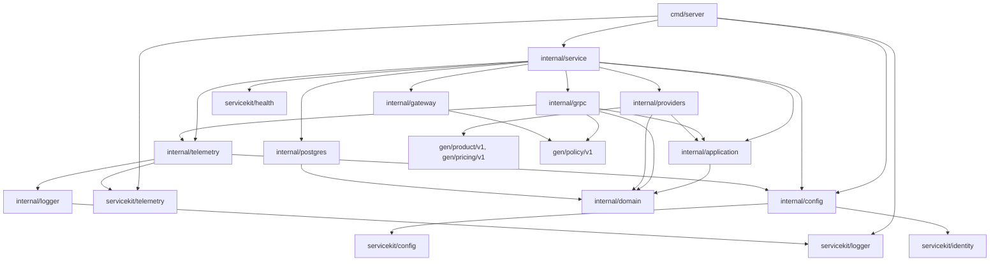

<!-- START doctoc generated TOC please keep comment here to allow auto update -->
<!-- DON'T EDIT THIS SECTION, INSTEAD RE-RUN doctoc TO UPDATE -->

- [Policy service](#policy-service)
  - [Prerequisites](#prerequisites)
    - [Mutating and runtime targets](#mutating-and-runtime-targets)
    - [Non-mutating validation targets](#non-mutating-validation-targets)
    - [Go file selection](#go-file-selection)
    - [Setup and normal validation](#setup-and-normal-validation)
    - [Repository onboarding](#repository-onboarding)
  - [Runtime configuration](#runtime-configuration)
  - [Run and stop the service](#run-and-stop-the-service)
  - [Offer creation](#offer-creation)
  - [Reusable baseline and ownership](#reusable-baseline-and-ownership)
    - [Package map and request walkthrough](#package-map-and-request-walkthrough)

<!-- END doctoc generated TOC please keep comment here to allow auto update -->

# Policy service

The Policy service creates priced offers for agents. It exposes this operation privately over
direct gRPC and an HTTP gateway, and its separate management listener serves liveness and
readiness.

## Prerequisites

- Go 1.27.4 exactly
- uv 0.13.1 for the repository CPython environment
- managed CPython 3.14.8; repository-level `make python-toolchain-setup` provisions it without
  changing system Python
- GNU Make 4.3 or newer
- Git for the default changed-file formatting scope; `FORMAT_SCOPE=all` also works outside Git
- GCC on Linux for `test-race`
- kubectl with Kustomize replacements and field creation support (verified with kubectl 1.34.1)
  and a full repository checkout for the Policy deployment and release fixtures
- Network access when the Go module proxy/checksum service, source-based tool installation, Buf
  Schema Registry dependencies, or `vuln.go.dev` are not already cached

All Go and tooling operations use this module's Makefile. Bare `make` displays help without installing tools. Run module targets from
`services/policy-service/`, or use `make -C services/policy-service <target>` from the repository root.
Tool installation, dependency maintenance, formatting, linting, tests, builds, vulnerability
analysis, and execution set `GOWORK=off`; normal validation uses readonly module resolution and
never depends on a root workspace or filesystem replacement. `GO` may override the Go executable,
and `UV` may override uv. `test-tooling` preserves both selections across nested
Make boundaries. It also prefers the selected Go executable's directory when child tools invoke
`go` by name.

`bootstrap-tools` verifies or provisions the repository's ignored `.venv/` from the root
`.python-version`, `pyproject.toml`, and `uv.lock`, then installs these exact binaries under the
module's ignored `.tools/bin/`:

- Buf 1.73.0
- protoc-gen-go 1.36.12
- protoc-gen-go-grpc 1.6.2
- protoc-gen-grpc-gateway 2.30.0
- protoc-gen-openapiv2 2.30.0
- golangci-lint 2.14.0
- govulncheck 1.8.0

### Mutating and runtime targets

These operations are explicit and are never hidden inside `check`:

| Target                   | Mutation or side effect                                                                                                    | Prerequisite and network behavior                                                              |
|--------------------------|----------------------------------------------------------------------------------------------------------------------------|------------------------------------------------------------------------------------------------|
| `make python-toolchain-setup` | Installs managed CPython 3.14.8 when needed and creates or synchronizes the repository's ignored `.venv/` from the root lock. | uv 0.13.1 and Python package/index access unless cached; rejects a conflicting existing root environment. |
| `make bootstrap-tools`   | Runs the repository Python setup, then installs or replaces only binaries under the module's ignored `.tools/bin/`; it does not change source, generated output, or manifests. | uv 0.13.1, Go 1.27.4, and source/module download access unless cached; finishes by running `verify-tools`. |
| `make update-deps`       | Updates only `go.mod` and `go.sum` to the Makefile's pinned runtime/generated-code dependencies, then tidies.              | Go proxy and checksum access unless cached.                                                    |
| `make update-proto-deps` | Updates only `buf.lock` for the schema dependency declared in `buf.yaml`.                                                  | Verified pinned Buf binary and BSR access unless cached.                                       |
| `make format`            | Rewrites only the selected eligible handwritten Go files through gofumpt, goimports, then golines at 100 columns.          | Verified pinned tools; file selection is described below.                                      |
| `make format-proto`      | Rewrites only `api/policy/v1/policy_service.proto` with pinned Buf.                                                      | Verified pinned tools.                                                                         |
| `make gen-proto`         | Removes and regenerates the exact declared Go/gateway/Swagger inventory under `gen/`.                                     | Pinned Buf and generators already installed; BSR access unless cached.                         |
| `make run`               | Starts `./cmd/server`; it changes no repository file.                                                                      | Go 1.27.4; readonly modules; runtime settings below.                                           |

Generated bindings must never be edited by hand. `gen-proto` owns only:

```text
gen/policy/v1/policy_service.pb.go
gen/policy/v1/policy_service.pb.gw.go
gen/policy/v1/policy_service_grpc.pb.go
gen/openapiv2/policy/v1/policy_service.swagger.json
gen/product/v1/product_service.pb.go
gen/product/v1/product_service_grpc.pb.go
gen/pricing/v1/pricing_service.pb.go
gen/pricing/v1/pricing_service_grpc.pb.go
```

The Product and Pricing client bindings come from exact copies of the provider-owned contracts in
`api/product/v1/` and `api/pricing/v1/`; the gateway and Swagger generators are limited to the
`policy.v1` package. Policy imports no provider module. After a provider contract changes, copy its
`.proto` file unchanged and run `make gen-proto`.

### Non-mutating validation targets

These targets preserve source and write reports and caches to ignored paths. Targets that invoke pinned tools
require `bootstrap-tools` to have been run explicitly.

| Target                      | Coverage                                                                                                                                                                                                                                                                   | Network or other prerequisite                                                                                                                                                      |
|-----------------------------|----------------------------------------------------------------------------------------------------------------------------------------------------------------------------------------------------------------------------------------------------------------------------|------------------------------------------------------------------------------------------------------------------------------------------------------------------------------------|
| `make verify-tools`         | Exact Go/tool versions, golangci-lint schema and formatter order, module/import prefix, 100-column settings, readonly loading, all-test lint scope, and vet-equivalent coverage.                                                                                           | All seven pinned binaries already installed; no installation.                                                                                                                      |
| `make python-toolchain-check` | Exact CPython, pytest, Ruff, and root locked-environment identity without installing or changing packages. | uv 0.13.1 and the provisioned repository environment, or a verified `PYTHON` override containing the root-locked tools. |
| `make python-check`         | Ruff format/lint plus fast gateway, deployment render and release fixtures. | Passing `python-toolchain-check`, kubectl/Kustomize and repository overlays. The fixtures do not access a cluster. |
| `make dockerfile-check` | Exact generated Dockerfile bytes against the validated service configuration and repository-owned fixed template. | Managed Python; no container runtime or mutation. |
| `make image-check` | Builds the generated Dockerfile from committed source identity, then verifies OCI labels, platform, nonroot user, entrypoint, exposed ports, liveness, and graceful shutdown. | Docker Buildx and access to the pinned builder and runtime images unless cached. |
| `make format-check`         | The same ordered formatter pipeline and selected handwritten files as `format`, reported without rewriting them.                                                                                                                                                           | Verified tools; file selection below.                                                                                                                                              |
| `make check-deps`           | Reproduces `update-deps` in a temporary standalone module and compares `go.mod` and `go.sum`.                                                                                                                                                                              | Go proxy/checksum access unless cached.                                                                                                                                            |
| `make format-proto-check`   | Buf formatting for the one owned schema.                                                                                                                                                                                                                                   | Verified tools.                                                                                                                                                                    |
| `make lint-proto`           | Buf lint for the one owned schema.                                                                                                                                                                                                                                         | Verified tools and locked BSR dependencies.                                                                                                                                        |
| `make check-proto-breaking` | Current schema against `testdata/contract-baseline/` with Buf `FILE` rules. The baseline is fixed and never promoted automatically.                                                                                                                                        | Verified tools and readable checked-in baseline/lock data.                                                                                                                         |
| `make check-proto-drift`    | Exact generated path set and bytes against two isolated regenerations, detecting added, modified, missing, deleted, and non-reproducible output.                                                                                                                           | Verified tools and BSR access unless cached.                                                                                                                                       |
| `make check-provider-protos` | The Product and Pricing contract copies under `api/` are byte-identical to `services/product-service` and `services/pricing-service`. | Repository checkout containing both provider services. |
| `make check-gateway-contract` | Generated Swagger routes, schemas, media types, responses and safe examples for `POST /offers` against `testdata/http-contract.json`. | Managed Python and readable generated Swagger; no service process or network. |
| `make lint`                 | golangci-lint over `./...`, including tests and vet-equivalent analysis; generated, vendor, third-party, fixture, and tool paths are excluded by configuration.                                                                                                            | Verified tools; readonly modules.                                                                                                                                                  |
| `make test`                 | Every package under `./...`, including `cmd/server`, generated consumers, configuration, transport, health, logging, service lifecycle, and telemetry.                                                                                                                     | Go 1.27.4; readonly modules.                                                                                                                                                       |
| `make test-race`            | The same complete package/test scope as `test`, with race instrumentation.                                                                                                                                                                                                 | Go 1.27.4, readonly modules, and a C compiler.                                                                                                                                     |
| `make build`                | Every package under `./...` and an executable `server`, with build output in a removed temporary directory.                                                                                                                                                                | Go 1.27.4; readonly modules.                                                                                                                                                       |
| `make vulncheck`            | Reachability-aware analysis of every package under `./...`.                                                                                                                                                                                                                | Verified govulncheck; access to `vuln.go.dev` unless cached.                                                                                                                       |
| `make check`                | In order: tool/configuration verification, Go and Protobuf format checks, Go and Protobuf lint, race tests with coverage, real-listener integration coverage, build, dependency reproduction, generation drift/reproducibility, compatibility, and vulnerability analysis. It does not repeat the equivalent non-race suite. | All prerequisites and network access inherited from its checks. It writes only the coverage profiles and tool-managed output. The real-listener tests use disposable loopback listeners. |
| `make test-tooling`         | Pytest-managed Git-free disposable copies containing controlled Go-format, lint, test, dependency, schema, compatibility, and generated-output defects; each intended gate must reject its defect without mutation. Child commands have 20-minute phase deadlines inside a 60-minute suite deadline, 30-second activity heartbeats, and bounded process-group cleanup. | Verified Python and Go tools; temporary storage and the network/cache prerequisites of nested checks. |

The shared `test-tooling` runner handles SIGINT and SIGTERM, unwinds the active child process group, and
returns 130 or 143 when invoked through `scripts/test-tooling.sh`. GNU Make reports an interrupted
`test-tooling` recipe with its own nonzero Make status after the runner exits; it does not preserve
the runner's numeric status. The runner disables pytest temporary-path retention, so its disposable
tooling fixtures are removed after successful, failed, and interrupted sessions.

The module has no broker, generated mocks or Go workspace. Its migrations run only from an
operator checkout, never at service startup.
Use the [deployment runbook](deployment-runbook.md) for deployment validation and operator commands.

### Go file selection

`format` and `format-check` share one stable ordered selector:

- `FORMAT_FILES="path/a.go path/b.go"` has highest precedence and accepts only module-relative
  handwritten Go files.
- `FORMAT_SCOPE=all` selects every eligible handwritten Go file and works without Git.
- The default `FORMAT_SCOPE=changed` compares tracked added/copied/modified/renamed files against
  `FORMAT_BASE` when supplied, or against `HEAD`, then includes eligible untracked files.
- An unresolved supplied base fails. A legitimate zero-file selection is reported as zero and does
  not broaden scope.
- Generated headers and paths under `gen/`, `vendor/`, `third_party/`, `testdata/`, and `.tools/`
  are excluded. Escaping the module or selecting an excluded file explicitly fails.

### Setup and normal validation

Bootstrap and refresh owned generated/dependency content explicitly:

```sh
make bootstrap-tools
make update-proto-deps
make gen-proto
make update-deps
make format FORMAT_SCOPE=all
make dockerfile-generate
```

Run normal non-mutating validation after tools are installed:

```sh
make check FORMAT_SCOPE=all
make test-tooling
```

### Repository onboarding

The [Go module topology guide](../../docs/go-module-topology.md) describes
inventory and CI ownership. Policy is registered as a standalone module and Servicekit consumer.
The [copy procedure](COPYING.md) records how the foundation was derived from the committed template.
Use [Dashboard](../dashboard-service/README.md) as the reference for common runtime behavior.

## Runtime configuration

Settings are read once from the process environment. An explicitly empty setting is invalid unless
the optional OTLP endpoint is empty while telemetry is disabled. Diagnostics name the setting and
do not repeat its supplied value.

| Setting | Default | Validation |
| --- | --- | --- |
| `SERVICE_NAME` | `policy-service` | Must equal the service's fixed logical name; the copy flow replaces that name. |
| `HTTP_ADDR` | `127.0.0.1:8080` | Valid host and numeric port; port `0` is available for tests. |
| `GRPC_ADDR` | `127.0.0.1:9090` | Valid host and numeric port; port `0` is available for tests. |
| `HEALTH_ADDR` | `127.0.0.1:8081` | Valid host and numeric port; port `0` is available for tests. Nonzero listener addresses must be pairwise distinct. |
| `HTTP_MAX_HEADER_BYTES` | `16384` | Integer from 1024 through 1048576; applied by the business HTTP server. |
| `HTTP_MAX_BODY_BYTES` | `4096` | Integer from 1024 through 1048576; overflow is rejected before RPC. |
| `HTTP_READ_HEADER_TIMEOUT` | `5s` | Positive duration no greater than `HTTP_READ_TIMEOUT`. |
| `HTTP_READ_TIMEOUT` | `10s` | Positive duration no greater than `HTTP_WRITE_TIMEOUT`. |
| `HTTP_WRITE_TIMEOUT` | `10s` | Positive duration greater than `REQUEST_TIMEOUT`. |
| `HTTP_IDLE_TIMEOUT` | `30s` | Positive duration. |
| `LOG_LEVEL` | `info` | A level accepted by `slog.Level`, including documented offsets. |
| `REQUEST_TIMEOUT` | `8s` | Positive duration bounding HTTP admission and application work; never extends a shorter caller deadline. |
| `PROBE_TIMEOUT` | `2s` | Positive duration bounding initial gateway connection and readiness checks. |
| `GRPC_MAX_RECV_BYTES` | `1048576` | Integer from 1 through 16777216; server receive and gateway-client send limit. |
| `GRPC_MAX_SEND_BYTES` | `8388608` | Integer from 1 through 67108864; server send and gateway-client receive limit. |
| `DEPLOYMENT_ENVIRONMENT` | `development` when disabled | General identity string; an explicit non-development value is required when telemetry is enabled. |
| `SERVICE_VERSION` | `development` when disabled | General identity string in `development`; otherwise exactly `git-` plus 12 lowercase hexadecimal characters with at least one nonzero suffix character, even when telemetry is disabled. |
| `SERVICE_INSTANCE_ID` | `local-<pid>` when disabled | General identity string; enabled telemetry requires an explicit value without the `local-` prefix. Kubernetes injects Pod `metadata.uid`. |
| `SHUTDOWN_TIMEOUT` | `10s` | Positive duration at least `REQUEST_TIMEOUT + OTEL_EXPORTER_OTLP_TIMEOUT`. |
| `OTEL_ENABLED` | `false` | Boolean. Disabled mode creates no exporter and needs no collector. |
| `OTEL_EXPORTER_OTLP_ENDPOINT` | unset | Required when telemetry is enabled. An `http` or `https` OTLP/gRPC URL with host and numeric port; credentials, query, fragment and HTTP path are rejected. |
| `OTEL_EXPORTER_OTLP_TIMEOUT` | `2s` | Positive duration reserved at the end of `SHUTDOWN_TIMEOUT`. |
| `POLICY_DATABASE_URL` | unset | Optional. When set, a `postgres`/`postgresql` URL for database `policy` with a password and exactly `sslmode=verify-full` and `sslrootcert`; the pool accepts only login `go_policy_writer`. Unset leaves the service without storage. |
| `DB_MAX_CONNS` | `4` | Integer from 1 through 16; writer pool size. |
| `DB_CONNECT_TIMEOUT` | `3s` | Positive duration bounding each connection attempt. |
| `DB_QUERY_TIMEOUT` | `1s` | Positive duration bounding the readiness query; with a database URL it must not exceed `PROBE_TIMEOUT`. |
| `PRODUCT_GRPC_TARGET` | unset | Optional `host:port` of the private Product gRPC service. Must be supplied together with `PRICING_GRPC_TARGET`. |
| `PRICING_GRPC_TARGET` | unset | Optional `host:port` of the private Pricing gRPC service. Must be supplied together with `PRODUCT_GRPC_TARGET`. |
| `BUSINESS_TIME_ZONE` | `UTC` | IANA time zone name defining the creation date of a new offer; `Local` is rejected. |
| `PROVIDER_CALL_TIMEOUT` | `3s` | Positive duration bounding each Product and Pricing call; with provider targets, twice this value must be less than `REQUEST_TIMEOUT`. A shorter caller deadline still applies. |

Identity values use 1–128 ASCII letters, digits, dots, underscores or hyphens. The namespace
`insurance-hub`, implementation `go` and generated logical service name are fixed. `development` is
the only environment exempt from canonical-version validation. Enabled telemetry requires explicit
non-development environment/version/instance values and rejects the `local-` instance prefix.
Kubernetes deployments use the Downward API to inject Pod `metadata.uid`; the existing release
process derives the matching canonical version from verified full source. See the common
[Go service identity contract](../../docs/migration/phase-4/go-service-identity-and-validation.md).

Logs are JSON with UTC timestamps and `service_namespace`, `service_name`, `service_version`,
`service_instance_id`, `deployment_environment_name`, and `service_implementation`. Valid logging
contexts add `trace_id` and `span_id`. Credential, token, payload, customer, policy and payment
attribute keys are redacted recursively, and error objects are redacted entirely. Callers must
still select safe fields and keep sensitive data out of messages and ordinary string attributes.
Configuration failures include validator-owned `setting` and `reason` fields alongside the redacted
error. Unrecognized errors use constant fallback fields and never contribute their raw text.
The shared `servicekit/logger.New` constructor is available for tests; process wiring uses
`servicekit/logger.NewIdentity`. The local logger package owns the required `request completed`
record and delegates its redaction and threshold handling to the shared logger.

Enabled telemetry exports traces and cumulative metrics over OTLP/gRPC to the configured collector,
using the same six identity dimensions as logs. Disabled mode creates neither exporter and needs
no collector. W3C trace context is extracted at HTTP ingress and propagated through the owned gRPC
client and registered gRPC server; arbitrary application metadata and B3 propagation are excluded.

The pinned `libs/servicekit` `v1.1.0` provider owns a nonblocking trace queue (2048 spans, 256-span
batches, one-second batch delay), a ten-second periodic metric reader, and Go runtime instruments
for memory, allocations, GC, goroutines and processor limit. Exporter initialization, retries,
flush and shutdown use bounded contexts. Safe export diagnostics are rate-limited to once per 30
seconds; queue saturation has a separate safe warning. The executable installs the shared
diagnostic handler before enabled providers and restores the previous handler after service exit.

`insurance_hub.service.requests` and `insurance_hub.service.request.duration` separately record
bounded HTTP and gRPC transport outcomes. HTTP labels use only `POST /offers` or `unmatched`;
gRPC records the fixed `create_offer` operation and final status. Request paths, queries,
payloads, raw errors, headers and instance IDs are not metric labels. The same provider connects
the HTTP server, gRPC client and gRPC server trace. Service identity stays on the resource.

The service lifecycle owns provider shutdown within the overall shutdown budget.
`Config` embeds the shared `Runtime`, `GRPC`, `HTTPServer`, and `Telemetry` setting groups. The local identity
type embeds `servicekit/identity.Identity` and adds Policy validation. Loading uses the shared
environment keys and `LoadGRPC` at the existing lookup position, then applies local
identity, listener and shutdown-budget rules. The development identity uses the shared constructor.
Embedding does not load environment variables or automatically validate settings. The telemetry
provider embeds the shared provider and uses its promoted methods directly.
All 17 canonical gRPC statuses remain distinct in completion logs and request metrics; unsupported
compression returns and records `UNIMPLEMENTED`. Unknown status values normalize to `UNKNOWN`.

Local tests use an owned loopback OTLP receiver to verify actual trace/metric transport; they do
not prove Alloy pipelines or deployed delivery.

For deployment, private verification and recovery, see the [Policy deployment runbook](deployment-runbook.md).

## Run and stop the service

Start the executable from this module root:

```sh
make run
```

The owning target disables workspace mode and uses readonly module resolution. Override runtime
settings in the environment when needed; for example, this selects ephemeral loopback ports:

```sh
HTTP_ADDR=127.0.0.1:0 GRPC_ADDR=127.0.0.1:0 HEALTH_ADDR=127.0.0.1:0 make run
```

The business HTTP, gRPC and management defaults are `127.0.0.1:8080`, `127.0.0.1:9090` and
`127.0.0.1:8081`. Management exposes only `GET /livez` and `GET /readyz`. Startup marks readiness
only after the actual gRPC server is accepting the owned gateway connection and all listeners are
serving. The owned same-process connection disables grpc-go channel idleness so an inactive but
healthy gateway cannot become permanently unready. Each readiness request rechecks that the
connection remains `READY` within `PROBE_TIMEOUT`; liveness stays independent of that dependency.
With `POLICY_DATABASE_URL`, startup opens the writer pool and refuses to listen until a bounded
query proves the `go_policy_writer` identity and access to every Policy table. Each readiness
request repeats that query within `DB_QUERY_TIMEOUT`; liveness does not touch the database. The
pool closes after HTTP handlers drain.

An interrupt or `SIGTERM` withdraws readiness, stops new business HTTP admission and lets accepted
HTTP handlers finish before closing the gateway connection. It then gracefully or forcibly stops
gRPC, stops management HTTP and shuts down telemetry. HTTP, connection, gRPC and management cleanup
share the cutoff at `SHUTDOWN_TIMEOUT - OTEL_EXPORTER_OTLP_TIMEOUT`; telemetry receives the final
reserved interval within the one overall deadline.

## Offer creation

`policy.v1.PolicyService/CreateOffer` is exposed privately as `POST /offers`. It accepts an offer
command with `productCode`, `policyFrom` and `policyTo` as
`YYYY-MM-DD` strings or `[year, month, day]` arrays, `selectedCovers`, and `answers` with `type`
(`choice`, `text` or `numeric`), `questionCode` and `answer`. Choice and text answers are JSON strings;
numeric answers are JSON numbers whose exact text is kept. Unknown or duplicate members are rejected.

```sh
curl --fail-with-body -H 'Content-Type: application/json' -d '{"productCode":"TRI",
  "policyFrom":"2017-04-16","policyTo":"2018-04-15","selectedCovers":["C1","C2"],
  "answers":[{"type":"choice","questionCode":"DESTINATION","answer":"EUR"},
  {"type":"numeric","questionCode":"NUM_OF_ADULTS","answer":1}]}' \
  http://127.0.0.1:8080/offers
```

The use case checks the product with `product.v1.ProductService/GetProduct`, then obtains the quote
from `pricing.v1.PricingService/CalculatePrice`. Both calls finish before the SQL transaction opens.
It then commits the offer, its answers and cover prices in one transaction through the restricted
writer. Success is HTTP 200 with exactly `offerNumber` (a random UUID), `totalPrice` and
`coversPrices`; amounts are JSON numbers written from Pricing's exact decimal text. The offer has
status NEW and a creation date taken once from the clock in `BUSINESS_TIME_ZONE`. Offer creation
publishes no event.

Malformed, duplicate or unknown JSON members, a nonempty query, unsupported media, an unknown route
and a wrong method receive fixed JSON error envelopes. The generated Swagger 2.0 document is
`gen/openapiv2/policy/v1/policy_service.swagger.json`; `testdata/http-contract.json` is the
independent contract fixture checked by `make check-gateway-contract`. The compatibility baseline
in `testdata/contract-baseline/` records the accepted PolicyService wire contract.

The transports log neither request/response bodies nor underlying failure details. HTTP identity,
forwarding, `Grpc-Timeout` and `Grpc-Metadata-*` headers are stripped; application metadata and
upstream response metadata have empty allowlists. `REQUEST_TIMEOUT` begins at HTTP admission and
the configured HTTP/gRPC limits remain independent. Reflection, CORS, profiling, authentication,
debug endpoints and production exposure are not enabled.

| Outcome | HTTP / gRPC code | Writes |
| --- | --- | --- |
| Malformed command or repeated question code | 400 / 3 | none; no provider call |
| Unknown product | 404 / 5 | none; Pricing is not called |
| Pricing rejects the input | 400 / 3 | none |
| Product or Pricing unavailable, or offers not configured | 503 / 14 | none |
| Provider or request deadline exceeded | 504 / 4 | none |
| Caller canceled | 499 / 1 (when a response can still be written) | none |
| Unexpected defect, including an amount that cannot be stored exactly | 500 / 13 | none |

Offers require `POLICY_DATABASE_URL` and both provider targets. Without them, the operation
returns 503 and readiness is unaffected. Provider availability is not part of readiness.

## Reusable baseline and ownership

Product is the reference for operational foundations, not a runtime dependency. Both modules own
independent runtime code and use the repository's shared non-runtime Go Make tooling. New copies
must define their own contracts, persistence, authorization, exposure and deployment requirements.

| Foundation | Product reference | Policy foundation |
| --- | --- | --- |
| Go and shared libraries/tools | `go.mod`, `Makefile` | Exact matching shared pins; independent manifests and tool caches. |
| Typed configuration and identity | `internal/config/config.go` | Same six identity dimensions; generated fixed name, canonical non-development version, safe identity strings and Pod UID deployment input. Existing loopback ports preserved. |
| Safe structured logs | `servicekit/logger`, `internal/logger/logger.go` | Shared UTC, recursive redaction, redacted error objects and trace correlation; local completion message. |
| Trace/metric lifecycle | `servicekit/telemetry`, `internal/telemetry/telemetry.go` | Shared provider resources, bounded queue/export/cleanup, diagnostics and process instruments; local identity policy and metric views. |
| Gateway, request observation and limits | `internal/gateway`, `internal/grpc`, `internal/telemetry/request.go` | Generated real-RPC gateway, strict HTTP contract, fixed offer operation, bounded transport signals and configurable HTTP/gRPC limits. |
| Health and lifecycle | `servicekit/health`, `internal/service/service.go` | Channel-aware readiness including the optional database, three listener ownership, HTTP-first drain and bounded ordered cleanup. |
| Business architecture | Product application-owned catalog ports and injected adapters | `CreateOffer` owns its Product, Pricing and offer-store ports; adapters are injected by composition. |


Review this adaptation map whenever Product changes an operational foundation. Adopt compatible
fixes with behavior tests, update intentional differences explicitly, and run the renamed copy
proof. Existing services adopt later fixes through their own reviewed changes.

### Package map and request walkthrough

| Package | Responsibility |
| --- | --- |
| `cmd/server` | Load validated settings, create identity logger, install safe enabled diagnostics, own signals/exit. |
| `internal/service` | Construct the one provider, three listeners, owned gateway connection and servers; own channel readiness, partial-start rollback and ordered drain. |
| `internal/gateway` | Strict HTTP contract, generated client registration, safe status mapping, metadata policy and HTTP telemetry. |
| `internal/grpc` | Generated PolicyService registration, request validation, deadlines, size limits, safe status mapping and final-status observation. |
| `internal/application` | `CreateOffer` use case, its `ProductCatalog`, `QuoteCalculator` and `OfferStore` ports, and its failures. |
| `internal/domain` | Offer request, answer, quote and offer values; NEW status, keyed answers and exact-amount invariants. |
| `internal/providers` | Product and Pricing gRPC adapters with bounded calls and status translation. |
| `internal/postgres` | Writer pool, readiness, aggregate reads and the transactional offer and issuance writes. |
| `internal/config` | Compose shared setting groups, load the environment and apply Policy identity and cross-setting policy. |
| `internal/logger`, `internal/telemetry` | Completion-log and offer signal contracts; shared provider construction with local policy and metric views. |
| `servicekit/config`, `servicekit/identity`, `servicekit/logger`, `servicekit/health`, `servicekit/telemetry` | Published shared settings, identity fields, parsing, safe logs, probes and SDK resource ownership. |
| `api/policy/v1`, `gen/policy/v1`, `gen/openapiv2/policy/v1` | Editable protobuf/HTTP contract and generated Go, gateway and Swagger output; compatibility baseline remains separate. |
| `api/product/v1`, `api/pricing/v1`, `gen/product/v1`, `gen/pricing/v1` | Exact provider contract copies and the generated Policy-local clients. |

This component diagram shows source dependencies; construction and runtime dispatch are described
below it.



At startup, composition binds all listeners, starts gRPC, derives the same-process client target
from the bound address and waits for that channel to become ready. An HTTP offer obtains a bounded
HTTP server span, uses the generated client across the instrumented connection, obtains client and
server spans and passes protobuf validation. HTTP and gRPC record separate bounded completion
signals. `PolicyService/CreateOffer` maps the validated request to a domain `OfferRequest` and
calls `CreateOffer.Execute` with the shorter deadline. The use case calls the Product and
Pricing adapters in turn over their process-owned connections. Each call is bounded by
`PROVIDER_CALL_TIMEOUT` and the request deadline and carries the trace context. The use case then
commits the offer through the store. The providers and the store satisfy the application ports
implicitly; the application imports neither. Shutdown withdraws readiness and drains
accepted HTTP work before connection and gRPC teardown, closes provider connections and the
database pool, then closes management and telemetry within
the shared deadline.
