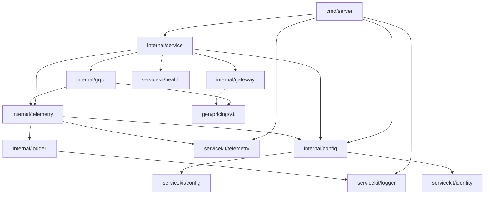

<!-- START doctoc generated TOC please keep comment here to allow auto update -->
<!-- DON'T EDIT THIS SECTION, INSTEAD RE-RUN doctoc TO UPDATE -->

- [Pricing service](#pricing-service)
  - [Prerequisites](#prerequisites)
    - [Mutating and runtime targets](#mutating-and-runtime-targets)
    - [Non-mutating validation targets](#non-mutating-validation-targets)
    - [Go file selection](#go-file-selection)
    - [Setup and normal validation](#setup-and-normal-validation)
    - [Repository onboarding](#repository-onboarding)
  - [Runtime configuration](#runtime-configuration)
  - [Run and stop the service](#run-and-stop-the-service)
  - [PostgreSQL administration commands](#postgresql-administration-commands)
  - [Quote RPC and HTTP gateway](#quote-rpc-and-http-gateway)
  - [Reusable baseline and ownership](#reusable-baseline-and-ownership)
    - [Package map and request walkthrough](#package-map-and-request-walkthrough)

<!-- END doctoc generated TOC please keep comment here to allow auto update -->

# Pricing service

The Go Pricing service reads the ordered tariff catalog from PostgreSQL and exposes private quote
calculation over direct gRPC and an HTTP gateway. Its separate management listener serves liveness
and readiness.

## Prerequisites

- Go 1.27.4 exactly
- uv 0.13.1 for the repository CPython environment
- managed CPython 3.14.8; repository-level `make python-toolchain-setup` provisions it without
  changing system Python
- GNU Make 4.3 or newer
- Git for the default changed-file formatting scope; `FORMAT_SCOPE=all` also works outside Git
- GCC on Linux for `test-race`
- Docker for the disposable PostgreSQL migration smoke in `coverage-check` and `test-integration`
- kubectl with Kustomize replacements and field creation support (verified with kubectl 1.34.1)
  and a full repository checkout for the Pricing deployment and release fixtures
- Network access when the Go module proxy/checksum service, source-based tool installation, Buf
  Schema Registry dependencies, or `vuln.go.dev` are not already cached

All Go and tooling operations use this module's Makefile. Bare `make` displays help without installing tools. Run module targets from
`services/pricing-service/`, or use `make -C services/pricing-service <target>` from the repository root.
Tool installation, dependency maintenance, formatting, linting, tests, builds, vulnerability
analysis, and execution set `GOWORK=off`; normal validation uses readonly module resolution and
never depends on a root workspace or filesystem replacement. `GO` may override the Go executable,
and `UV` may override uv. `test-tooling` preserves both selections across nested
Make boundaries. It also prefers the selected Go executable's directory when child tools invoke
`go` by name.

`bootstrap-tools` verifies or provisions the repository's ignored `.venv/` from the root
`.python-version`, `pyproject.toml`, and `uv.lock`, then installs these exact binaries under the
module's ignored `.tools/bin/`:

- Buf 1.73.0
- protoc-gen-go 1.36.12
- protoc-gen-go-grpc 1.6.2
- protoc-gen-grpc-gateway 2.30.0
- protoc-gen-openapiv2 2.30.0
- golangci-lint 2.14.0
- govulncheck 1.8.0

### Mutating and runtime targets

These operations are explicit and are never hidden inside `check`:

| Target                   | Mutation or side effect                                                                                                    | Prerequisite and network behavior                                                              |
|--------------------------|----------------------------------------------------------------------------------------------------------------------------|------------------------------------------------------------------------------------------------|
| `make python-toolchain-setup` | Installs managed CPython 3.14.8 when needed and creates or synchronizes the repository's ignored `.venv/` from the root lock. | uv 0.13.1 and Python package/index access unless cached; rejects a conflicting existing root environment. |
| `make bootstrap-tools`   | Runs the repository Python setup, then installs or replaces only binaries under the module's ignored `.tools/bin/`; it does not change source, generated output, or manifests. | uv 0.13.1, Go 1.27.4, and source/module download access unless cached; finishes by running `verify-tools`. |
| `make update-deps`       | Updates only `go.mod` and `go.sum` to the Makefile's pinned Go dependencies, then tidies.              | Go proxy and checksum access unless cached.                                                    |
| `make update-proto-deps` | Updates only `buf.lock` for the schema dependency declared in `buf.yaml`.                                                  | Verified pinned Buf binary and BSR access unless cached.                                       |
| `make format`            | Rewrites only the selected eligible handwritten Go files through gofumpt, goimports, then golines at 100 columns.          | Verified pinned tools; file selection is described below.                                      |
| `make format-proto`      | Rewrites only `api/pricing/v1/pricing_service.proto` with pinned Buf.                                                     | Verified pinned tools.                                                                         |
| `make gen-proto`         | Removes and regenerates the exact declared Go/gateway/Swagger inventory under `gen/`.                                     | Pinned Buf and generators already installed; BSR access unless cached.                         |
| `make run`               | Starts `./cmd/server`; it changes no repository file.                                                                      | Go 1.27.4; readonly modules; runtime settings below.                                           |

Generated bindings must never be edited by hand. `gen-proto` owns only:

```text
gen/pricing/v1/pricing_service.pb.go
gen/pricing/v1/pricing_service.pb.gw.go
gen/pricing/v1/pricing_service_grpc.pb.go
gen/openapiv2/pricing/v1/pricing_service.swagger.json
```

### Non-mutating validation targets

These targets preserve source and write reports and caches to ignored paths. Targets that invoke pinned tools
require `bootstrap-tools` to have been run explicitly.

| Target                      | Coverage                                                                                                                                                                                                                                                                   | Network or other prerequisite                                                                                                                                                      |
|-----------------------------|----------------------------------------------------------------------------------------------------------------------------------------------------------------------------------------------------------------------------------------------------------------------------|------------------------------------------------------------------------------------------------------------------------------------------------------------------------------------|
| `make verify-tools`         | Exact Go/tool versions, golangci-lint schema and formatter order, module/import prefix, 100-column settings, readonly loading, all-test lint scope, and vet-equivalent coverage.                                                                                           | All seven pinned binaries already installed; no installation.                                                                                                                      |
| `make python-toolchain-check` | Exact CPython, pytest, Ruff, and root locked-environment identity without installing or changing packages. | uv 0.13.1 and the provisioned repository environment, or a verified `PYTHON` override containing the root-locked tools. |
| `make python-check`         | Ruff format/lint plus fast gateway, deployment render and release fixtures. | Passing `python-toolchain-check`, kubectl/Kustomize and repository overlays. The fixtures do not access a cluster. |
| `make dockerfile-check` | Exact generated Dockerfile bytes against the validated service configuration and repository-owned fixed template. | Managed Python; no container runtime or mutation. |
| `make image-check` | Builds the generated non-root image from committed source identity, verifies OCI labels and runtime hardening, and exercises the server, migrator and seeder entry points with bounded safe failures. | Docker Buildx and access to the pinned builder and runtime images unless cached. |
| `make format-check`         | The same ordered formatter pipeline and selected handwritten files as `format`, reported without rewriting them.                                                                                                                                                           | Verified tools; file selection below.                                                                                                                                              |
| `make check-deps`           | Reproduces `update-deps` in a temporary standalone module and compares `go.mod` and `go.sum`.                                                                                                                                                                              | Go proxy/checksum access unless cached.                                                                                                                                            |
| `make format-proto-check`   | Buf formatting for the one owned schema.                                                                                                                                                                                                                                   | Verified tools.                                                                                                                                                                    |
| `make lint-proto`           | Buf lint for the one owned schema.                                                                                                                                                                                                                                         | Verified tools and locked BSR dependencies.                                                                                                                                        |
| `make check-proto-breaking` | Current schema against `testdata/contract-baseline/` with Buf `FILE` rules. The baseline is fixed and never promoted automatically.                                                                                                                                        | Verified tools and readable checked-in baseline/lock data.                                                                                                                         |
| `make check-proto-drift`    | Exact generated path set and bytes against two isolated regenerations, detecting added, modified, missing, deleted, and non-reproducible output.                                                                                                                           | Verified tools and BSR access unless cached.                                                                                                                                       |
| `make check-gateway-contract` | Generated Swagger route, schemas, media types, responses and safe examples against `testdata/http-contract.json`. | Managed Python and readable generated Swagger; no service process or network. |
| `make lint`                 | golangci-lint over `./...`, including tests and vet-equivalent analysis; generated, vendor, third-party, fixture, and tool paths are excluded by configuration.                                                                                                            | Verified tools; readonly modules.                                                                                                                                                  |
| `make test`                 | Every package under `./...`, including `cmd/server`, generated consumers, configuration, transport, health, logging, service lifecycle, and telemetry.                                                                                                                     | Go 1.27.4; readonly modules.                                                                                                                                                       |
| `make test-race`            | The same complete package/test scope as `test`, with race instrumentation.                                                                                                                                                                                                 | Go 1.27.4, readonly modules, and a C compiler.                                                                                                                                     |
| `make test-integration` | Production composition and one disposable TLS-enabled PostgreSQL smoke for migration, seeding, and reader access. | Docker, the pinned PostgreSQL test image, and a C compiler. |
| `make build`                | Every package under `./...` and the `server`, `migrate`, and `seed` executables, with build output in a removed temporary directory.                                                                                                                                                                | Go 1.27.4; readonly modules.                                                                                                                                                       |
| `make vulncheck`            | Reachability-aware analysis of every package under `./...`.                                                                                                                                                                                                                | Verified govulncheck; access to `vuln.go.dev` unless cached.                                                                                                                       |
| `make check`                | In order: tool/configuration verification, Go and Protobuf format checks, Go and Protobuf lint, race tests with coverage, real-listener integration coverage, build, dependency reproduction, generation drift/reproducibility, compatibility, and vulnerability analysis. It does not repeat the equivalent non-race suite. | All prerequisites and network access inherited from its checks. It writes only the coverage profiles and tool-managed output. Integration uses disposable loopback listeners and PostgreSQL. |
| `make test-tooling`         | Pytest-managed Git-free disposable copies containing controlled Go-format, lint, test, dependency, schema, compatibility, and generated-output defects; each intended gate must reject its defect without mutation. Child commands have 20-minute phase deadlines inside a 60-minute suite deadline, 30-second activity heartbeats, and bounded process-group cleanup. | Verified Python and Go tools; temporary storage and the network/cache prerequisites of nested checks. |

The shared `test-tooling` runner handles SIGINT and SIGTERM, unwinds the active child process group, and
returns 130 or 143 when invoked through `scripts/test-tooling.sh`. GNU Make reports an interrupted
`test-tooling` recipe with its own nonzero Make status after the runner exits; it does not preserve
the runner's numeric status. The runner disables pytest temporary-path retention, so its disposable
tooling fixtures are removed after successful, failed, and interrupted sessions.

Use the [deployment runbook](deployment-runbook.md) for deployment validation and operator commands.

### Go file selection

`format` and `format-check` share one stable ordered selector:

- `FORMAT_FILES="path/a.go path/b.go"` has highest precedence and accepts only module-relative
  handwritten Go files.
- `FORMAT_SCOPE=all` selects every eligible handwritten Go file and works without Git.
- The default `FORMAT_SCOPE=changed` compares tracked added/copied/modified/renamed files against
  `FORMAT_BASE` when supplied, or against `HEAD`, then includes eligible untracked files.
- An unresolved supplied base fails. A legitimate zero-file selection is reported as zero and does
  not broaden scope.
- Generated headers and paths under `gen/`, `vendor/`, `third_party/`, `testdata/`, and `.tools/`
  are excluded. Escaping the module or selecting an excluded file explicitly fails.

### Setup and normal validation

Bootstrap and refresh owned generated/dependency content explicitly:

```sh
make bootstrap-tools
make update-proto-deps
make gen-proto
make update-deps
make format FORMAT_SCOPE=all
make dockerfile-generate
```

Run normal non-mutating validation after tools are installed:

```sh
make check FORMAT_SCOPE=all
make test-tooling
```

### Repository onboarding

The [Go module topology guide](../../docs/go-module-topology.md) describes
inventory and CI ownership. Pricing is registered as a standalone module and Servicekit consumer.
The [copy procedure](COPYING.md) records how the foundation was derived from the committed template.

## Runtime configuration

Settings are read once from the process environment. An explicitly empty setting is invalid unless
the optional OTLP endpoint is empty while telemetry is disabled. Diagnostics name the setting and
do not repeat its supplied value.

| Setting | Default | Validation |
| --- | --- | --- |
| `SERVICE_NAME` | `pricing-service` | Must equal the service's fixed logical name; the copy flow replaces that name. |
| `HTTP_ADDR` | `127.0.0.1:8080` | Valid host and numeric port; port `0` is available for tests. |
| `GRPC_ADDR` | `127.0.0.1:9090` | Valid host and numeric port; port `0` is available for tests. |
| `HEALTH_ADDR` | `127.0.0.1:8081` | Valid host and numeric port; port `0` is available for tests. Nonzero listener addresses must be pairwise distinct. |
| `HTTP_MAX_HEADER_BYTES` | `16384` | Integer from 1024 through 1048576; applied by the business HTTP server. |
| `HTTP_MAX_BODY_BYTES` | `4096` | Integer from 1024 through 1048576; overflow is rejected before RPC. |
| `HTTP_READ_HEADER_TIMEOUT` | `5s` | Positive duration no greater than `HTTP_READ_TIMEOUT`. |
| `HTTP_READ_TIMEOUT` | `10s` | Positive duration no greater than `HTTP_WRITE_TIMEOUT`. |
| `HTTP_WRITE_TIMEOUT` | `10s` | Positive duration greater than `REQUEST_TIMEOUT`. |
| `HTTP_IDLE_TIMEOUT` | `30s` | Positive duration. |
| `LOG_LEVEL` | `info` | A level accepted by `slog.Level`, including documented offsets. |
| `REQUEST_TIMEOUT` | `8s` | Positive duration bounding HTTP admission and application work; never extends a shorter caller deadline. |
| `PROBE_TIMEOUT` | `2s` | Positive duration bounding initial gateway connection and readiness checks. |
| `GRPC_MAX_RECV_BYTES` | `1048576` | Integer from 1 through 16777216; server receive and gateway-client send limit. |
| `GRPC_MAX_SEND_BYTES` | `8388608` | Integer from 1 through 67108864; server send and gateway-client receive limit. |
| `DEPLOYMENT_ENVIRONMENT` | `development` when disabled | General identity string; an explicit non-development value is required when telemetry is enabled. |
| `SERVICE_VERSION` | `development` when disabled | General identity string in `development`; otherwise exactly `git-` plus 12 lowercase hexadecimal characters with at least one nonzero suffix character, even when telemetry is disabled. |
| `SERVICE_INSTANCE_ID` | `local-<pid>` when disabled | General identity string; enabled telemetry requires an explicit value without the `local-` prefix. Kubernetes injects Pod `metadata.uid`. |
| `SHUTDOWN_TIMEOUT` | `10s` | Positive duration at least `REQUEST_TIMEOUT + OTEL_EXPORTER_OTLP_TIMEOUT`. |
| `OTEL_ENABLED` | `false` | Boolean. Disabled mode creates no exporter and needs no collector. |
| `OTEL_EXPORTER_OTLP_ENDPOINT` | unset | Required when telemetry is enabled. An `http` or `https` OTLP/gRPC URL with host and numeric port; credentials, query, fragment and HTTP path are rejected. |
| `OTEL_EXPORTER_OTLP_TIMEOUT` | `2s` | Positive duration reserved at the end of `SHUTDOWN_TIMEOUT`. |

Identity values use 1–128 ASCII letters, digits, dots, underscores or hyphens. The namespace
`insurance-hub`, implementation `go` and generated logical service name are fixed. `development` is
the only environment exempt from canonical-version validation. Enabled telemetry requires explicit
non-development environment/version/instance values and rejects the `local-` instance prefix.
Kubernetes deployments use the Downward API to inject Pod `metadata.uid`; the existing release
process derives the matching canonical version from verified full source. See the common
[Go service identity contract](../../docs/migration/phase-4/go-service-identity-and-validation.md).

Logs are JSON with UTC timestamps and `service_namespace`, `service_name`, `service_version`,
`service_instance_id`, `deployment_environment_name`, and `service_implementation`. Valid logging
contexts add `trace_id` and `span_id`. Credential, token, payload, customer, policy and payment
attribute keys are redacted recursively, and error objects are redacted entirely. Callers must
still select safe fields and keep sensitive data out of messages and ordinary string attributes.
Configuration failures include validator-owned `setting` and `reason` fields alongside the redacted
error. Unrecognized errors use constant fallback fields and never contribute their raw text.
The shared `servicekit/logger.New` constructor is available for tests; process wiring uses
`servicekit/logger.NewIdentity`. The local logger package owns the required `request completed`
record and delegates its redaction and threshold handling to the shared logger.

Enabled telemetry exports traces and cumulative metrics over OTLP/gRPC to the configured collector,
using the same six identity dimensions as logs. Disabled mode creates neither exporter and needs
no collector. W3C trace context is extracted at HTTP ingress and propagated through the owned gRPC
client and registered gRPC server; arbitrary application metadata and B3 propagation are excluded.

The pinned `libs/servicekit` `v1.1.0` provider owns a nonblocking trace queue (2048 spans, 256-span
batches, one-second batch delay), a ten-second periodic metric reader, and Go runtime instruments
for memory, allocations, GC, goroutines and processor limit. Exporter initialization, retries,
flush and shutdown use bounded contexts. Safe export diagnostics are rate-limited to once per 30
seconds; queue saturation has a separate safe warning. The executable installs the shared
diagnostic handler before enabled providers and restores the previous handler after service exit.

`insurance_hub.pricing.requests` and `insurance_hub.pricing.request.duration` separately record
bounded HTTP and gRPC transport outcomes. Their labels are `insurance_hub.pricing.operation`
(`calculate_price`, or `unknown` for an unmatched HTTP route), `insurance_hub.pricing.transport`
(`http` or `grpc`), `insurance_hub.pricing.outcome` and the final `http.response.status_code` or
`rpc.response.status_code`. The `/pricing/calculate` route template is a span attribute only.
Request paths, queries, payloads, raw errors, headers and instance IDs are not metric labels. The
same provider connects the HTTP server, gRPC client and gRPC server trace. Service identity stays on
the resource.

The service lifecycle owns provider shutdown within the overall shutdown budget.
`Config` embeds the shared `Runtime`, `GRPC`, `HTTPServer`, and `Telemetry` setting groups. The local identity
type embeds `servicekit/identity.Identity` and adds Pricing validation. Loading uses the shared
environment keys and `LoadGRPC` at the existing lookup position, then applies local
identity, listener and shutdown-budget rules. The development identity uses the shared constructor.
Embedding does not load environment variables or automatically validate settings. The telemetry
provider embeds the shared provider and uses its promoted methods directly.
All 17 canonical gRPC statuses remain distinct in completion logs and request metrics; unsupported
compression returns and records `UNIMPLEMENTED`. Unknown status values normalize to `UNKNOWN`.

Local tests use an owned loopback OTLP receiver to verify actual trace/metric transport; they do
not prove Alloy pipelines or deployed delivery.

For deployment, private verification and recovery, see the [Pricing deployment runbook](deployment-runbook.md).
For monitoring assets, signal investigation and their recovery, see the
[Pricing observability runbook](observability-runbook.md).

## Run and stop the service

Start the executable from this module root:

```sh
make run
```

The owning target disables workspace mode and uses readonly module resolution. Override runtime
settings in the environment when needed; for example, this selects ephemeral loopback ports:

```sh
HTTP_ADDR=127.0.0.1:0 GRPC_ADDR=127.0.0.1:0 HEALTH_ADDR=127.0.0.1:0 make run
```

The business HTTP, gRPC and management defaults are `127.0.0.1:8080`, `127.0.0.1:9090` and
`127.0.0.1:8081`. Management exposes only `GET /livez` and `GET /readyz`. Startup marks readiness
only after the actual gRPC server is accepting the owned gateway connection and all listeners are
serving. The owned same-process connection disables grpc-go channel idleness so an inactive but
healthy gateway cannot become permanently unready. Each readiness request rechecks that the
connection remains `READY` within `PROBE_TIMEOUT`; liveness stays independent of that dependency.

An interrupt or `SIGTERM` withdraws readiness, stops new business HTTP admission and lets accepted
HTTP handlers finish before closing the gateway connection. It then gracefully or forcibly stops
gRPC, stops management HTTP and shuts down telemetry. HTTP, connection, gRPC and management cleanup
share the cutoff at `SHUTDOWN_TIMEOUT - OTEL_EXPORTER_OTLP_TIMEOUT`; telemetry receives the final
reserved interval within the one overall deadline.

## PostgreSQL administration commands

`cmd/migrate` runs independently from the quote-serving process. It accepts `--operation` with
`status`, `version` or `migrate`, and requires `--environment`, `--context`, `--target-file`,
`--database-url-file` and `--ca-file`. The connection URL uses the enrolled host, the migrator
login, `sslmode=verify-full`, and `sslrootcert` set to the selected CA file.

`internal/service` owns the migration connection lifecycle, and `internal/postgres` opens and
configures the database connection. `internal/administration` verifies the database marker and
roles and applies the migration. Status reports `uninitialized` for a fresh database, `unmanaged`
when tariff objects exist without Pricing migration history, and `version=1` after migration. The
version operation reports `uninitialized` or `1`. Both inspect PostgreSQL in a read-only
transaction. Goose commits the schema and its history together under an advisory lock. The
installed schema uses PostgreSQL identity columns for tariff and markup-rule IDs and requires an
explicit position for every ordered rule.

`cmd/seed` accepts the same target and credential file flags with the dedicated seeder login.
It loads the embedded version-1 tariff catalog, checks the target seed policy and migration
version, and applies the complete corpus in one transaction. It inserts missing tariffs,
validates existing tariffs and their ordered rules, and reports inserted and existing counts.
Replay preserves IDs and positions. A mismatch in any of the four tariffs aborts the transaction.

Deployment packages all three commands in the same reviewed image. The retained initialization
Job runs `/pricing-migrate` as its only init container and `/pricing-seed` as its only application
container, with separate target, migrator and seeder Secret mounts. It has no automatic retry;
operators inspect a retained failure before preparing an explicit next attempt. The API Deployment
mounts only the Pricing reader Secret and CA.

## Quote RPC and HTTP gateway

The generated `pricing.v1.PricingService` exposes unary `CalculatePrice`. Its RPC request carries
date-only strings, selected cover codes and typed answer choices; exact decimal results remain
strings in the generated RPC response. Protovalidate and the transport boundary reject invalid
calendar dates as `InvalidArgument` with the stable message `invalid request`. Domain, tariff or
evaluation failures return `Internal` with `internal error`, and unavailable PostgreSQL returns
`Unavailable` with `service unavailable`.

The generated gateway exposes the same use case as `POST /pricing/calculate` and converts exact
prices to JSON numbers for HTTP callers:

```sh
curl --fail-with-body \
  -H 'Content-Type: application/json' \
  -d '{"productCode":"TRI","policyFrom":"2017-04-16","policyTo":"2018-04-15","selectedCovers":["C1","C2"],"answers":[{"questionCode":"NUM_OF_ADULTS","answer":1},{"questionCode":"NUM_OF_CHILDREN","answer":1},{"questionCode":"DESTINATION","answer":"EUR"}]}' \
  http://127.0.0.1:8080/pricing/calculate
```

The response is `{"totalPrice":78,"coversPrices":{"C1":26,"C2":52}}`. Each HTTP date may also be
a three-element year, month and day array, such as `[2017,4,16]`. The gateway converts it to the
RPC's `YYYY-MM-DD` text before calling gRPC, so both transports share one date validation and the
RPC contract is unchanged. An invalid date returns
HTTP 400 and `{"code":3,"message":"invalid request","details":[]}`. Malformed, duplicate or
unknown JSON members, a nonempty query, unsupported media, an unknown route and a wrong method
receive fixed JSON error envelopes. The generated Swagger 2.0 document is
`gen/openapiv2/pricing/v1/pricing_service.swagger.json`; `testdata/http-contract.json` is the
independent contract fixture checked by `make check-gateway-contract`.

Against the seeded TRI tariff, the generated gRPC client receives exact decimal text:
`total_price = "78"`, `C1 = "26"`, and `C2 = "52"`. Amounts keep the caller-visible scale:
a base formula result carries no trailing fractional zeros, each applied markup rounds to two
places, and the total keeps the widest cover scale. The deployment verifier uses
structured `go test -json` events to prove that this named direct-RPC smoke ran and passed once.

The transports log neither request/response bodies nor underlying failure details. HTTP identity,
forwarding, `Grpc-Timeout` and `Grpc-Metadata-*` headers are stripped; application metadata and
upstream response metadata have empty allowlists. `REQUEST_TIMEOUT` begins at HTTP admission and
the configured HTTP/gRPC limits remain independent. Reflection, CORS, profiling, authentication,
debug endpoints and production exposure are not enabled by this foundation.

## Reusable baseline and ownership

Pricing owns its contracts, runtime wiring, persistence behavior, authorization boundary,
deployment manifests and monitoring assets. It consumes the published `libs/servicekit` module and
the repository's shared non-runtime Go tooling without importing a sibling application module.
The [copy procedure](COPYING.md) explains how to derive a new independent module from the committed
scaffold. A copy must define its own business contract and operational boundaries.

### Package map and request walkthrough

| Package | Responsibility |
| --- | --- |
| `cmd/server` | Load validated settings, create identity logger, install safe enabled diagnostics, own signals/exit. |
| `internal/service` | Construct the one provider, three listeners, owned gateway connection and servers; own channel readiness, partial-start cleanup and ordered drain. |
| `internal/gateway` | Strict HTTP contract, generated client registration, safe status mapping, metadata policy and HTTP telemetry. |
| `internal/grpc` | Generated Pricing registration, request validation, deadlines, size limits, safe status mapping and final-status observation. |
| `internal/config` | Compose shared setting groups, load the environment and apply Pricing identity and cross-setting policy. |
| `internal/logger`, `internal/telemetry` | Completion-log and quote signal contracts; shared provider construction with local policy and metric views. |
| `servicekit/config`, `servicekit/identity`, `servicekit/logger`, `servicekit/health`, `servicekit/telemetry` | Published shared settings, identity fields, parsing, safe logs, probes and SDK resource ownership. |
| `api/pricing/v1`, `gen/pricing/v1`, `gen/openapiv2/pricing/v1` | Editable protobuf/HTTP contract and generated Go, gateway and Swagger output; compatibility baseline remains separate. |

This component diagram shows source dependencies; construction and runtime dispatch are described
below it.



At startup, composition opens the read-only PostgreSQL pool, binds all listeners, starts gRPC,
derives the same-process client target from the bound address and waits for that channel to become
ready. An HTTP quote obtains a bounded HTTP server span, uses the generated client across the
instrumented connection, obtains client and server spans, passes validation and calls the
application calculation use case with the shorter deadline.
HTTP and gRPC record separate bounded completion signals. Shutdown withdraws readiness and drains
accepted HTTP work before connection and gRPC teardown, then closes management and telemetry within
the shared deadline.
