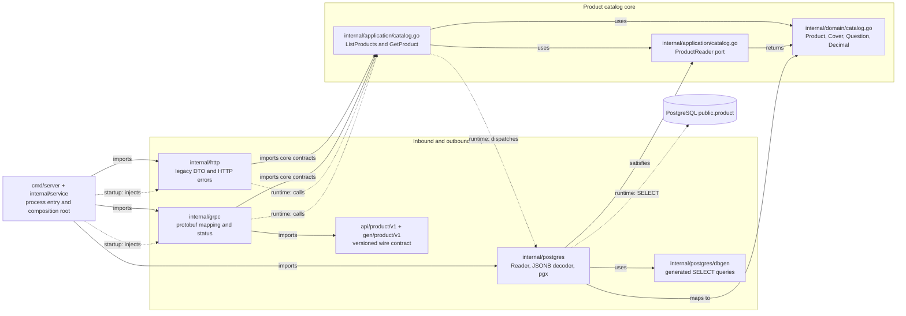

<!-- START doctoc generated TOC please keep comment here to allow auto update -->
<!-- DON'T EDIT THIS SECTION, INSTEAD RE-RUN doctoc TO UPDATE -->

- [Product catalog read service](#product-catalog-read-service)
  - [Reusable foundation parity](#reusable-foundation-parity)
  - [Runtime contracts and boundaries](#runtime-contracts-and-boundaries)
    - [Interim security validation](#interim-security-validation)
  - [Product catalog architecture](#product-catalog-architecture)
  - [Container release and deployment](#container-release-and-deployment)

<!-- END doctoc generated TOC please keep comment here to allow auto update -->

# Product catalog read service

This standalone module is the Go Product pilot. Its executable serves the direct Product HTTP API,
the generated Product v1 gRPC API, and management health routes from one explicit composition root.
It uses one process-owned PostgreSQL pool for catalog reads and dependency-aware readiness. The
service remains an internal migration candidate; do not route production Product traffic to it.

The module path is
`github.com/igor-baiborodine/insurance-hub/services/product-service`. It resolves with
`GOWORK=off` and has no filesystem replacement or dependency on the scaffold module. Go 1.27.3 is
required. From the repository root, use its owning Makefile:

```sh
make go-product-bootstrap-tools
make -C services/product-service format FORMAT_SCOPE=all
make -C services/product-service check FORMAT_SCOPE=all
make go-product-test-tooling
make -C services/product-service build
make -C services/product-service check-docs
```

`go-product-bootstrap-tools` installs the pinned Go generators/checkers and Mermaid renderer under
the ignored `services/product-service/.tools/` directory. To start the service, have the approved
local secret mechanism export the restricted reader URL, then invoke the owning target without
putting the value in this file or the command line:

```sh
# PRODUCT_DATABASE_URL is already exported by the approved local secret source.
make -C services/product-service run
```

The Product check requires a working Docker daemon. Integration tests pin Testcontainers Go
v0.44.0 and `postgres:17.10-alpine` at digest
`sha256:742f40ea20b9ff2ff31db5458d127452988a2164df9e17441e191f3b72252193`, create an isolated
`product_test` database, and remove it
after the run:

```sh
make -C services/product-service test-integration INTEGRATION_SUITE=harness FIXTURE_SET=qa
```

`INTEGRATION_SUITE` accepts `harness`, `reader`, `grpc`, `http`, `startup`, `parity`,
`cancellation`, `lifecycle`, `telemetry`, `read-only`, `access`, `schema-adoption`, `migration`,
`seed`, `marker-columns`, or `all`.
`FIXTURE_SET` accepts only `qa`, the
production-like snapshot captured by issue 131; the local-dev snapshot is intentionally excluded.
The selector never connects to the QA environment. Empty or unknown selectors, unavailable Docker,
missing fixtures, zero selected tests, and any configured `PRODUCT_DATABASE_URL` fail the target.
The harness resolves and reads the accepted QA snapshot directly under
`legacy/product-service/src/test/resources/product-read-baseline/` without copying or changing
it. Its setup identity creates the legacy table and `go_product_reader`; service tests receive only
the generated reader URL.

The `schema-adoption` suite is the issue-190 decision prototype. It starts the same pinned
disposable PostgreSQL image with an empty schema, then exercises Goose v3.27.0 creation,
verified adoption of the accepted catalog, drift/history rejection, concurrency, cancellation,
replay, and inspection side effects. It also compares the migrated table with the sqlc schema.
Its test-only SQL and synthetic ownership checks are not administrative commands or an approved
live role policy. Run it with
`make -C services/product-service test-integration INTEGRATION_SUITE=schema-adoption`.
`make -C services/product-service check-schema-adoption` also lints the prototype and its
existing harness/fixture helpers and scans the tagged test dependency graph for vulnerabilities.
The suite has a three-minute work deadline, bounded harness cleanup, and mandatory scenario
discovery; the existing runner reports progress and retains failed test output before cleanup.
`update-goose-dependency` explicitly resolves the pinned library; checks never install tools.

The `migration` suite exercises the real embedded migration and status path against a separate
disposable `product` database. It checks empty and populated adoption, modified rows, marker and
history drift, concurrent replay, cancellation, reader denial and production enrollment without
a seed role. `check-sql-drift` also runs this suite to compare the migrated table with the accepted
issue-131 schema and the sqlc input; this check requires Docker. Run the focused path with
`make -C services/product-service test-integration INTEGRATION_SUITE=migration`.

The `seed` suite passes the version-1 base catalog explicitly to the generic seeder through the
restricted seed identity. It checks accepted storage checksums and HTTP/gRPC responses,
supplemental catalog application through the same engine, missing-only counts, preservation of
modified and unrelated rows, concurrent replay, cancellation and target rejection against an owned
disposable database. Run it with
`make -C services/product-service test-integration INTEGRATION_SUITE=seed`.

The `marker-columns` suite checks that status, migration, and seed reject column-level grants
on the protected target marker in fresh and managed databases without changing protected state.
It covers owner, migrator, seeder, and reader privileges, including grant options, and verifies
permission denial before each grant and after its revocation. Run it with
`make -C services/product-service test-integration INTEGRATION_SUITE=marker-columns`.

`cmd/migrate` is the standalone schema administrator. Build it with
`make -C services/product-service build-migrator MIGRATOR_OUTPUT=<owned-output-path>`.
Invoke it with explicit `--operation=migrate|status|version`, `--environment`, `--context`,
`--target-file`, `--database-url-file`, `--ca-file`, and optional `--timeout`. The timeout defaults
to `120s`, accepts Go duration syntax greater than zero and at most `180s`, and is rejected before
database opening when invalid. The protected target JSON records the exact
environment, context, data/service namespaces, CNPG cluster and UID, database-instance UUID,
database, host and seed policy. The credential file contains only the migrator URL, with
`go_product_migrator`, the enrolled host and database, `sslmode=verify-full`, and the selected
`sslrootcert` path. The target marker must independently match the enrollment after TLS connects.
`status` and `version` use a read-only transaction; an absent table/history reports
`uninitialized`, an accepted unmanaged table reports `unmanaged`, and a valid zero-history
recovery state reports `pending` or version `0`. Migration holds Product
advisory lock `190001`, validates the table and history before Goose can initialize history, and
applies only version 1. There is no down operation. One migration/inspection deadline starts before
database opening and covers the complete operation; an earlier caller deadline still wins. Seed has
a 60-second command budget. Connection, lock, SQL and
cleanup are also bounded;
inspect and resolve any uncertain result before replaying the same reviewed migration. The
runtime reader still has no migration or seeding path.

Administration deliberately uses a small validation boundary: the connected identity and protected
marker, Product columns/primary key/owner and behavior-affecting features, and logical Goose history.
Owner-only legacy tables, renamed primary-key constraints and additional ordinary non-unique indexes
are accepted. Goose owns its history sequence/index/default layout. Migration reapplies explicit
reader and optional seeder table grants transactionally on every successful run, including replay
after interrupted grant setup; version-1 migration assets remain unchanged.

Platform provisioning owns role memberships, restricted login attributes and database/schema/default
permissions. Commands do not enumerate every role or ACL or attempt general permission repair.
The marker remains platform-owned and non-writable by the command identities; unexpected marker
column ACLs are rejected. Real SQL tests verify the provisioned reader/seeder permissions, but the
commands do not promise to detect all later permission drift. API requests never run these checks.

`cmd/seed` is the generic catalog administrator. Build it with
`make -C services/product-service build-seeder SEEDER_OUTPUT=<owned-output-path>`. Invoke it with
explicit `--environment`, `--context`, `--target-file`, `--catalog-file`,
`--database-url-file` and `--ca-file` arguments. The target must enroll a non-production
environment for seeding, and the credential URL must use `go_product_seeder` with the same protected
target and TLS requirements as migration. The command validates the selected catalog before one
insert-only transaction and prints deterministic `inserted=<n> existing=<n>` counts. Apply the base
catalog first; a later environment-specific catalog can use the same command and explicit file
selection without another Go seeder.

Both commands write structured JSON failures to stderr through the service's redacting logger,
with operation, validated environment, configuration/database stage and failure classification.
Error text, credentials, URLs and SQL payloads are not emitted. Successful state/count output
remains on stdout; failures exit with status 1.

The standard `build` target verifies the API server, migrator and seeder executables. The Product
image keeps `/product-service` as its entry point and also packages `/product-migrate`,
`/product-seed`, the reviewed migration at
`/usr/share/insurance-hub/product/migrations/00001_product.sql` and the base catalog at
`/usr/share/insurance-hub/product/catalogs/base.json`. All three commands run as the image's
non-root UID/GID `65532:65532`; the administrative binaries still require explicit protected files
and never run during API startup. `image-check` inspects those paths and exercises migration then
seeding from the image against its owned disposable PostgreSQL instance. Its required fault suite
exercises both commands under SIGTERM, the actual advisory-lock deadline, failed startup and
connection failure, plus lost COMMIT acknowledgements and a seed disconnect after earlier inserts.
It checks database state, session/lock release, safe replay and diagnostics. Faults use a test-only
TLS proxy and synthetic credentials; required subtest discovery prevents silent omissions. Image
publication and deployment activation remain separate operations.

`make -C services/product-service check-administration-design` runs the issue-190 administration
contract checks: authenticated PostgreSQL role denials and protected target markers,
plus actual local-dev/QA Kustomize renders and negative release-lifecycle checks. It requires the existing
managed Python environment, Docker, the already provisioned PostgreSQL image above and `kubectl`.
It creates and removes isolated containers and temporary render directories; it installs no tools,
contacts no Kubernetes API and reads no live credentials. These checks do not qualify Flux
reconciliation or deployed TLS. Java Product is assumed absent; desired state must not recreate it.
Historical databases remain adoption inputs.

The reader integration suite uses the same disposable database and QA snapshot:

```sh
make -C services/product-service test-integration INTEGRATION_SUITE=reader FIXTURE_SET=qa
```

The reader uses sqlc v1.31.1 with pgx v5.11.0. Its source-only schema and parameterized list/get
queries are under `internal/postgres/sql`; generated code is under `internal/postgres/dbgen`. The
schema file describes the existing Java-owned table for generation and tests. The service never
executes it at runtime. Use `gen-sql` only when intentionally changing SQL inputs; `check-sql-drift`
verifies the exact output set, source preservation, and byte-reproducible generation.

The direct HTTP boundary is exercised on a real loopback listener with test-owned callbacks:
`make -C services/product-service test TEST_PACKAGES=./internal/http`. The `startup` integration
suite exercises the production composition path, all three listeners, empty-table health,
dependency loss/recovery, startup failures, and resource cleanup.

The `parity` suite uses that production composition path to replay the immutable QA catalog, every
accepted synthetic data-edge case, and every direct Product failure case through its applicable
HTTP and gRPC boundary. The malformed URI case is HTTP-only because gRPC has no URI parser. The two
SQL-null cases remain database-constraint checks and must fail with SQLSTATE `23502`.

The `cancellation` suite uses deterministic PostgreSQL table locks and a one-connection runtime
pool to prove caller cancellation, configured and caller deadlines, bounded acquisition, HTTP
disconnect propagation, backend-connection loss, probe behavior, connection release, and
subsequent recovery. It controls only its disposable database and does not use timing sleeps.

The `lifecycle` suite launches the race-built production executable and sends it `SIGTERM`. It
proves bounded idle shutdown, graceful completion of accepted HTTP and gRPC work, forced
termination of blocked work after the drain period, rejection of new work during shutdown, and
release of listeners and PostgreSQL connections within the one configured shutdown budget.

The `telemetry` suite uses the same disposable database and a loopback OTLP collector. It proves
disabled mode makes no collector connection, refused export does not affect reads or probes,
new spans export after collector recovery, and SIGTERM bounds an in-flight export. Export
failures produce sanitized, rate-limited warnings. A definite trace-queue overflow emits one
safe warning, while a failed drain does not turn normal signal termination into a service failure.
The [Product observability runbook](../../docs/migration/phase-4/product-service/observability-runbook.md)
records the complete disabled-mode proof, disposable acceptance phases, guarded QA verification,
signal queries, alert response, staged enablement, recovery, rollback, and evidence requirements.

The Product v1 schema is `api/product/v1/product_service.proto`; generated Go bindings are under
`gen/product/v1`. The frozen initial compatibility baseline lives in
`testdata/contract-baseline`, separate from the scaffold Echo baseline. Use `format-proto`,
`update-proto-deps`, and `gen-proto` only when intentionally changing the schema or generated
output; `check` verifies format, lint, reproducible generation, and breaking compatibility.

`bootstrap-tools`, `update-deps`, `format`, and the protobuf/SQL generation targets are explicit
mutating targets. `check` is
non-mutating and currently covers tool/config verification, all handwritten Go formatting,
lint/vet, all-package race tests, the race-enabled disposable PostgreSQL integration suite,
executable build, dependency reproduction, and vulnerability analysis, plus Product v1 protobuf
format, lint, drift, and breaking checks, sqlc output drift, and documentation links and rendering.
Tools are pinned in this Makefile and installed under ignored `.tools/`.
Normal checks use readonly module resolution. `FORMAT_SCOPE=changed` is the default for local
formatting; `FORMAT_SCOPE=all` checks every eligible handwritten Go file.

The module includes the root-owned `scripts/go/module/common.mk` for identical tool verification,
formatting, dependency reproduction, and generated-output drift logic. Its Makefile continues to
own all version pins, SQL generation, integration selection, and service execution. The controlled
`test-tooling` suite proves Product formatting, dependency, compatibility, Protobuf/SQL drift, and
integration-selection and documentation failures without changing its disposable fixture.

The relevant reproducibility pins are:

| Capability | Pin |
| --- | --- |
| Go | 1.27.3 |
| Buf / `protoc-gen-go` / `protoc-gen-go-grpc` | 1.73.0 / 1.36.12 / 1.6.2 |
| sqlc / pgx | 1.31.1 / 5.11.0 |
| gRPC Go / protobuf Go / Protovalidate | 1.83.2 / 1.36.12 / 1.4.0 |
| OpenTelemetry core / gRPC instrumentation | 1.46.0 / 0.71.0 |
| Testcontainers Go | 0.44.0 |
| PostgreSQL integration image | `postgres:17.10-alpine@sha256:742f40ea20b9ff2ff31db5458d127452988a2164df9e17441e191f3b72252193` |
| Mermaid CLI / Puppeteer | 11.14.0 / 24.43.1; Node.js 20 or newer |

`check-docs` validates local Markdown links and anchors, extracts every Mermaid block, and renders
it to SVG with the pinned CLI. It does not keep generated images in the working tree.
The checked-in `puppeteer-config.json` supplies Chromium's `--no-sandbox` and
`--disable-setuid-sandbox` launch arguments for the supported Ubuntu environment; documentation
rendering is limited to repository-controlled Mermaid sources.

Configuration is read once and validated before service resources are acquired. Duration values use
Go duration syntax. Listener ports may be zero for test-owned ephemeral listeners; listener hosts
must be explicit, and the three configured addresses must be distinct. Invalid configuration
returns a setting-name diagnostic without the rejected value. `PRODUCT_DATABASE_URL` has no
fallback and is held in a redacting value type; it must include an explicit, non-blank username
in the URL authority identifying the restricted Product reader. A conflicting `user` query
parameter is rejected.

| Setting                       | Default           | Constraint                                                                                                              |
|-------------------------------|-------------------|-------------------------------------------------------------------------------------------------------------------------|
| `SERVICE_NAME`                | `product-service` | Non-empty, non-blank service identity.                                                                                  |
| `HTTP_ADDR`                   | `127.0.0.1:8081`  | Business HTTP host and numeric port.                                                                                    |
| `GRPC_ADDR`                   | `127.0.0.1:9090`  | Business gRPC host and numeric port.                                                                                    |
| `HEALTH_ADDR`                 | `127.0.0.1:8080`  | Management HTTP host and numeric port; all listener addresses must differ.                                              |
| `PRODUCT_DATABASE_URL`        | required          | `postgres` or `postgresql` URL with an explicit non-blank reader username before `@`, host, and database name; a `user` query override is rejected; never logged or echoed. |
| `DB_MAX_CONNS`                | `8`               | Integer from 1 through 32; minimum pool size remains zero.                                                              |
| `DB_CONNECT_TIMEOUT`          | `3s`              | Positive; no greater than `STARTUP_TIMEOUT`.                                                                            |
| `DB_ACQUIRE_TIMEOUT`          | `2s`              | Positive; no greater than `DB_QUERY_TIMEOUT`.                                                                           |
| `DB_QUERY_TIMEOUT`            | `5s`              | Positive; no greater than `REQUEST_TIMEOUT`.                                                                            |
| `STARTUP_TIMEOUT`             | `10s`             | Positive total startup budget.                                                                                          |
| `REQUEST_TIMEOUT`             | `8s`              | Positive outer business request budget.                                                                                 |
| `PROBE_TIMEOUT`               | `2s`              | Positive; no greater than `DB_QUERY_TIMEOUT`.                                                                           |
| `HTTP_READ_HEADER_TIMEOUT`    | `5s`              | Positive.                                                                                                               |
| `HTTP_READ_TIMEOUT`           | `10s`             | Positive; at least `HTTP_READ_HEADER_TIMEOUT`.                                                                          |
| `HTTP_WRITE_TIMEOUT`          | `10s`             | Positive; at least `REQUEST_TIMEOUT`.                                                                                   |
| `HTTP_IDLE_TIMEOUT`           | `30s`             | Positive keep-alive idle limit.                                                                                         |
| `GRPC_MAX_RECV_BYTES`         | `1048576`         | Integer from 1 through 16777216.                                                                                        |
| `GRPC_MAX_SEND_BYTES`         | `8388608`         | Integer from 1 through 67108864; overflow fails instead of truncating.                                                  |
| `SHUTDOWN_TIMEOUT`            | `10s`             | Positive total drain, force-stop, and cleanup budget; the lifecycle reserves its final `2s` for force-stop and cleanup. |
| `LOG_LEVEL`                   | `info`            | Supported `slog` level.                                                                                                 |
| `OTEL_ENABLED`                | `false`           | Boolean; disabled mode requires no collector.                                                                           |
| `OTEL_EXPORTER_OTLP_ENDPOINT` | unset             | HTTP(S) OTLP/gRPC URL, required only when telemetry is enabled.                                                         |
| `OTEL_EXPORTER_OTLP_TIMEOUT`  | `2s`              | Positive; no greater than `SHUTDOWN_TIMEOUT`.                                                                           |
| `DEPLOYMENT_ENVIRONMENT`      | `development`     | Enabled telemetry requires `qa` or `test`; normal local development remains disabled.                                   |
| `SERVICE_VERSION`             | `development`     | QA requires an immutable `sha-<git-sha>`; disposable tests require `test-<revision>`.                                  |
| `SERVICE_INSTANCE_ID`         | local process ID  | QA requires the Pod UID from the Downward API; enabled tests generate a UUIDv4 when unset.                              |

Enabled telemetry fixes `SERVICE_NAME=product-service` and `OTEL_EXPORTER_OTLP_TIMEOUT=2s`.
The application supplies the six approved non-Kubernetes identity fields on trace and metric
resources and on validated service logs. Alloy adds Kubernetes identity later. QA telemetry and
its version/Pod UID wiring remain disabled until the separate QA activation step. The provider
uses parent-based root sampling, a bounded trace batch, and a ten-second cumulative metric reader
with explicit request, database, and pool-wait histogram buckets. Both business listeners now
emit a bounded server span, an application child span for dispatched use cases, one request counter
and duration observation, and one safe completion log per routed request. After route selection,
HTTP extracts W3C Trace Context and B3 single or multi headers; a valid B3 context takes precedence
over a conflicting valid W3C context. HTTP injection writes W3C and B3 multi headers from the same
span so the test-only Go-to-Java consumer can continue context into legacy Brave. Production gRPC
remains W3C-only, limits tracing to the two registered Product methods, and disables its automatic
meter. Probes, unmatched paths, and malformed requests rejected before dispatch have no Product
business measurement. Each dispatched read also records pool acquisition and safe SELECT child
spans, bounded acquire/query/decode outcomes, query and pool-wait durations, and pool
usage/max/timeout metrics. An owned runtime callback records Go memory, allocation, GC-cycle,
goroutine, and processor signals. The Go memory-limit datapoint is present only when a runtime
memory limit is configured. The database and runtime callbacks stop during the shared shutdown
budget. Request logs remain local JSON when telemetry is disabled.

The owning mixed-language continuity check requires Go 1.27.3, Java 14, system Maven, the Docker
CLI, and a running Docker daemon. It exercises disposable Brave Java-to-Go and test-only Go-to-Java
HTTP paths without changing the production gateway route:

```sh
make -C services/product-service test-telemetry-continuity
```

Callers with a shorter deadline keep that deadline. Acquisition and query work share the request
budget rather than starting new clocks. Startup, readiness, and shutdown each use their one
documented budget. Startup pings PostgreSQL, verifies `SELECT` access to `public.product`, and binds
all listeners before readiness becomes true. `/livez` is process-only; `/readyz` performs a bounded
read-access check, treats an empty table as healthy, returns `503` during dependency loss or drain,
and recovers without changing schema or permissions. The composition root closes the singleton pool
after partial startup or process shutdown.


## Reusable foundation parity

Product and the [Go scaffold](../../templates/go-service/README.md) independently own their
runtime code. Changes to either foundation should review the other against this inventory;
the scaffold's `check-foundations` target detects common version drift only. There is no runtime
import between modules. Bare `make` prints help; tool installation requires explicit
`make bootstrap-tools`.

| Boundary | Aligned behavior | Intentional Product adaptation |
| --- | --- | --- |
| [Config](internal/config/config.go) and [startup](cmd/server/main.go) | Typed validator-owned `setting`/`reason` diagnostics; raw errors and arbitrary wrappers remain redacted; unknown errors use constant fallback fields. | Three listeners, database URL/pool validation and linked timeout budgets; QA SHA/Pod UID and generated test UUID identity; enabled exporter timeout stays 2s. |
| [Logger](internal/logger/logger.go) | UTC JSON, six-field identity, trace correlation, recursive redaction and completion records independent of diagnostic threshold. | Product completion message and service identity. |
| [Health](internal/health/health.go) | Bounded dependency probes recheck cancellation and lifecycle readiness after success; withdrawal during a probe returns 503; liveness stays independent. | PostgreSQL read-access probe supplied by composition. |
| [gRPC](internal/grpc/server.go) | Known methods begin observation before decoding and finish once at the final stats event. All 17 canonical status names remain distinct; invalid codes normalize to UNKNOWN. Pre-handler rejection and send-size failure appear in completion logs and metrics. Unknown methods do not create Product observations or arbitrary method labels. | ListProducts/GetProduct contracts, Product validation/mapping and bounded list/get operation labels. |
| [Request telemetry](internal/telemetry/request.go) | Final status, bounded outcome labels, request counter/duration and safe completion logging. | Product metric names, application child spans, HTTP status handling, and domain outcomes including `not_found`, `storage_unavailable` and `invalid_data`. |
| [Providers](internal/telemetry/telemetry.go), [runtime metrics](internal/telemetry/runtime.go) and [diagnostics](internal/telemetry/diagnostics.go) | Cumulative OTLP metrics, process runtime instruments, safe exporter diagnostics and bounded cleanup including partial startup. | HTTP W3C/B3 compatibility, gRPC W3C-only propagation, database histogram views and fixed 2s export/retry budgets. |
| [Lifecycle](internal/service/service.go) | Composition owns resource acquisition, readiness withdrawal, drain and cleanup. | Product startup/read-access verification, singleton pool, three listeners, parallel drains and two-second forced-cleanup reserve. |
| [Make](Makefile) | Help is the non-mutating default; shared pins and explicit setup/check commands retain their owners. | SQL generation, migration/seed executables, PostgreSQL integration and Product deployment targets. |

The config/startup, health and gRPC regression tests exercise these shared invariants. Real gRPC
cases cover unsupported compression, malformed protobuf, receive/send limits and preserved Product
domain outcomes. Existing HTTP/Brave continuity, identity, database and lifecycle suites cover the
service adaptations. Future alignment should preserve these contracts rather than replace Product
files wholesale with scaffold files.

## Runtime contracts and boundaries

The two business listeners are intentionally anonymous internal entries for this migration stage.
They do not validate JWTs, enforce Product roles, or expose gRPC reflection or HTTP profiling.
They must not be published directly. Issue #133's isolated gateway/direct tests prove the accepted
credential and identity-propagation matrix; #134 owns internal-only deployed exposure.

| Entry | Successful behavior | Bounded failure behavior |
| --- | --- | --- |
| HTTP `GET /products` | `200 application/json` with the complete legacy-compatible Product array. | Unsupported methods return `405`; application/storage failures return only `500 {"message":"Internal Server Error"}`. |
| HTTP `GET /products/{code}` | Exact, case-sensitive lookup and legacy-compatible Product JSON. | Missing/unknown paths return the accepted `404` body; malformed percent encoding returns the accepted `400` body; other application/storage failures use the generic `500`. |
| gRPC `product.v1.ProductService/ListProducts` | Generated `ListProductsResponse` with the complete catalog. | Safe `Canceled`, `DeadlineExceeded`, `Unavailable`, or `Internal` status details. |
| gRPC `product.v1.ProductService/GetProduct` | Generated `GetProductResponse` for an exact code. | Empty/invalid requests are `InvalidArgument`; missing products are `NotFound`; dependency and internal failures remain bounded as above. |
| Management `GET /livez` / `GET /readyz` | Constant text responses for process liveness and dependency-aware readiness. | Readiness returns constant `503 not ready` during startup, dependency loss, or drain; it never returns a database cause. |

The HTTP contract is implemented by
[`internal/http/handler.go`](internal/http/handler.go) and its transport-owned DTO mapper. The
versioned gRPC schema is [`api/product/v1/product_service.proto`](api/product/v1/product_service.proto),
with generated Go bindings under [`gen/product/v1`](gen/product/v1). Structured logs redact
credentials, tokens, request/response payloads, and arbitrary error causes. Telemetry is disabled by
default and requires no collector; #135 owns usable pipeline and delivery qualification.

The `read-only` suite proves the runtime identity has only the required database connect, schema
use, and Product table select privileges. Issue #190 owns separate migrator/seeder identities,
protected target enrollment, and a prerequisite Job; the service never falls back to an owner
credential and never migrates or seeds during API startup. Java Product is absent from current
desired state. Earlier differential and cutover evidence remains historical compatibility input.

### Interim security validation

The [Product security baseline](../../docs/migration/phase-4/product-service/security-baseline.md)
maps Auth issuance, Java gateway verification, the anonymous gateway-to-Go HTTP hop, direct
HTTP/gRPC, management, and the separate PostgreSQL reader identity to owners and evidence. Go
consumes `PRODUCT_DATABASE_URL` but no gateway HMAC signing setting. Auth and the Java gateway keep
their existing HS256 trust configuration and configured 86,400-second token lifetime; this service
adds no JWT parser, role check, rotation, or revocation behavior.

From the repository root, after `make go-product-bootstrap-tools`, run
`make product-security-test-tooling` and `make product-security-check` for the accepted access
fixtures, Java baseline regression, and real gateway → Go → disposable PostgreSQL suite. The
module's `make -C services/product-service check` runs the direct HTTP/gRPC access matrix as part
of its full integration gate, enforcing all eighteen accepted case IDs on each transport. The
security aggregate deliberately leaves that direct suite to the module gate. These checks use
generated test signing material and a disposable QA catalog, reject an external database URL, and
clean up listeners, processes, and containers on completion or failure. See the
[reproduction instructions](../../docs/migration/phase-4/product-service/security-baseline.md#reproduction)
for prerequisites and safe temporary-token handling. These are change-based local review checks;
the hosted Product security workflow has been retired. The
[contributor validation matrix](../../CONTRIBUTING.md#change-based-local-validation) records when
the broader local checks and evidence are required.

`make product-security-verify` is a separate read-only probe for an explicitly selected, already
running Go target. The [#134 exposure gate](../../docs/migration/phase-4/product-service/security-baseline.md#go-deployment-exposure-gate-for-issue-134)
defines its endpoint/context inputs and the rendered/effective resource, read-only role, and
unchanged Java-routing checks still required in local-dev and QA. Anonymous internal access is an
interim compatibility constraint; `ClusterIP` does not authenticate in-cluster callers. #135 owns
telemetry delivery, #136 integrated qualification, and #137 any traffic cutover.

## Product catalog architecture

The module makes its business purpose visible through `Product`, `Cover`, and question values plus
the named `ListProducts` and `GetProduct` use cases. That is the screaming-architecture aspect: a
reader can identify the Product catalog capability without decoding generic handler or command-bus
layers. Clean/Onion principles supply the separate inward dependency rule. The domain and
application packages define the values and reader contract; transport, PostgreSQL, lifecycle, and
tooling details depend toward that core.

Go's `internal` rule limits these packages to code rooted under the Product module's parent tree.
That language visibility rule is separate from the architectural rule: an exported core symbol may
be visible to an adapter, while the core still has no source dependency on that adapter. The
`postgres.Reader` method set satisfies the application-owned `ProductReader` interface implicitly;
the compile-time assertion documents the relationship, and no application import of
`internal/postgres` is required.

In the diagram, solid arrows represent selected source or contract dependencies. Dashed arrows
represent startup wiring or runtime calls; they do not assert an inverse Go import. This is a
component explanation, not a deployment or complete import graph.



The concrete package and file responsibilities are:

| Package or file | Responsibility |
| --- | --- |
| [`cmd/server/main.go`](cmd/server/main.go) | Loads configuration, creates the redacting logger, owns signal handling, and invokes the composition root. |
| [`cmd/migrate/main.go`](cmd/migrate/main.go) / [`cmd/seed/main.go`](cmd/seed/main.go) | Parse explicit command settings, read the selected protected files, own signals and delegate to the administrative composition roots. |
| [`internal/service`](internal/service) | Constructs and owns runtime or administrative database resources, injects them into the selected operation, and owns startup and cleanup. |
| [`internal/administration`](internal/administration) | Owns protected target checks, versioned Product schema creation/adoption, Goose locking, read-only status and generic catalog seeding. |
| [`internal/domain/catalog.go`](internal/domain/catalog.go) | Owns transport-independent Product catalog values and exact decimal tokens. |
| [`internal/application/catalog.go`](internal/application/catalog.go) | Owns `ProductReader`, `ListProducts`, `GetProduct`, and application errors. |
| [`internal/postgres`](internal/postgres) | Owns runtime pool and administrative database construction, restricted read execution, sqlc use, JSONB decoding, storage error classification, and safe database/pool telemetry. |
| [`internal/http`](internal/http) | Owns direct URI behavior, legacy-compatible DTO/presence/decimal mapping, JSON responses, and HTTP error mapping. |
| [`internal/grpc`](internal/grpc) | Owns generated-service registration, validation, domain-to-protobuf mapping, limits, tracing hooks, and status mapping. |
| [`internal/config`](internal/config) | Parses and validates the bounded runtime settings and holds the database URL in a redacting type. |
| [`internal/health`](internal/health) | Owns process liveness and bounded dependency-aware readiness. |
| [`internal/logger`](internal/logger) / [`internal/telemetry`](internal/telemetry) | Own structured redaction/identity/context, the optional bounded trace and metric provider lifecycle, shared request classification/accounting, and Go runtime instruments. |
| [`api/product/v1`](api/product/v1) / [`gen/product/v1`](gen/product/v1) | Own the versioned protobuf source and generated Go boundary. |

For a get-product request:

1. The HTTP adapter selects a normalized route and starts a server span, or the gRPC boundary
   starts its registered server span before validating `GetProductRequest`. Each calls the same
   injected use case through the composition-owned application span wrapper.
2. `GetProduct` validates the code and calls its application-owned `ProductReader` port.
3. Runtime interface dispatch reaches `postgres.Reader`, which uses the sqlc-generated exact
   parameterized lookup and converts the stored JSONB into domain values.
4. The inbound adapter maps the domain Product to its own legacy HTTP DTO or protobuf message. A
   missing product or bounded failure maps to that transport's safe contract. The request boundary
   records a bounded outcome, response status, duration, and correlated completion log.

Stored JSONB exists only at the PostgreSQL boundary, Product domain values cross the application
port, and protobuf messages and legacy HTTP DTOs stay inside their owning adapters. Both transports
therefore reuse the same use cases without importing one another or moving wire/storage types into
the core.

## Container release and deployment

The [Product Go deployment runbook](../../docs/migration/phase-4/product-service/deployment-runbook.md)
owns image publication, local-dev/QA prerequisites, reader provisioning, rollout/rotation recovery,
database initialization, and Go-only stop/restoration. Use root `go-svc-* SVC_NAME=product` targets
and the `reader` and `administration` Product role profiles. PR checks build and test.
For a Product image-build input merged to canonical `main`, **Go Service Release** uses the same
standard module convention intended for future Go services. Release inputs are the Dockerfile,
Docker context policy, module manifests, and non-test content copied from `cmd`, `gen`, and
`internal`; documentation, scripts, tests, generator inputs, and local validation configuration do
not publish an image. The workflow creates the scoped semantic release, builds once, publishes
semantic and short-SHA image tags, resolves the image digest, and commits the semantic version plus
an immutable dormant Product source/prerequisite/API tuple. The explicit QA Flux root excludes that
tuple until a separate reviewed activation change.

**Go Module PR Check** runs Product's focused `check-go-pr` target only when a qualifying
Product input changes and the complete pull-request diff touches no second supported Go module. It
owns Product's Go, Protobuf, SQL, race-enabled unit/coverage, disposable PostgreSQL integration,
build, dependency, generated-code, contract, vulnerability, and 75% coverage gates. Release
selection, image, overlay, role-tooling, baseline, and deployment-tooling checks remain local and
run when their inputs change. Local `go-svc-deploy-test` owns only its labelled disposable namespace
in an explicitly prepared local Kind cluster. Neither hosted validation nor that local suite
establishes shared-environment acceptance. `make -C services/product-service bootstrap-ci-tools`
installs the pinned workflow validators; `check-ci` checks release and selected-module workflow
boundaries, and `make go-svc-release-test` proves generic service selection, QA-entry requirements,
and semantic-tag updates with controlled fixtures.

The shared release workflow reads service and target policy from
[`scripts/go/service/catalog.json`](../../scripts/go/service/catalog.json). It uses one preparation
path for every registered service; optional initialization selects the immutable Flux prerequisite
bundle. Administration manifests live below `product/base/administration` and each environment's
`product/administration` overlay, outside the API's Kustomize resource list. The shared deployment
engine owns Job ordering and release checks; Product-specific workload and SQL probes remain in
[`product_deployment_checks.py`](scripts/product_deployment_checks.py).
