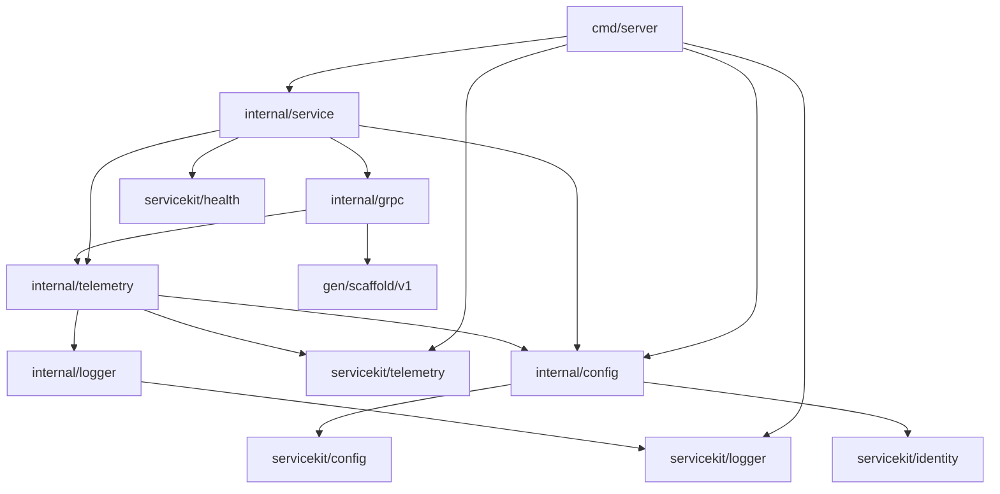

<!-- START doctoc generated TOC please keep comment here to allow auto update -->
<!-- DON'T EDIT THIS SECTION, INSTEAD RE-RUN doctoc TO UPDATE -->

- [Go service scaffold](#go-service-scaffold)
  - [Prerequisites](#prerequisites)
    - [Mutating and runtime targets](#mutating-and-runtime-targets)
    - [Non-mutating validation targets](#non-mutating-validation-targets)
    - [Go file selection](#go-file-selection)
    - [Setup and normal validation](#setup-and-normal-validation)
    - [Root scaffold delegates](#root-scaffold-delegates)
    - [Continuous integration](#continuous-integration)
    - [Repository topology](#repository-topology)
  - [Create a repository-owned service](#create-a-repository-owned-service)
  - [Runtime configuration](#runtime-configuration)
  - [Run and stop the service](#run-and-stop-the-service)
  - [Example RPC](#example-rpc)
  - [Reusable baseline and ownership](#reusable-baseline-and-ownership)
    - [Package map and request walkthrough](#package-map-and-request-walkthrough)

<!-- END doctoc generated TOC please keep comment here to allow auto update -->

# Go service scaffold

This standalone module is the reference structure for new Insurance Hub Go services. Its module
identity is `github.com/igor-baiborodine/insurance-hub/templates/go-service`. Run every command in
this document from `templates/go-service/` with workspace mode disabled. The module has no root
workspace, filesystem replacements, legacy dependencies, database, broker, or collector.

The scaffold provides a versioned Echo contract, authentic generated Go bindings, typed
configuration, safe structured logging, optional trace and metric export, dependency-aware HTTP health, and bounded
signal-driven shutdown.

## Prerequisites

- Go 1.27.3 exactly
- uv 0.13.1 for the repository CPython environment
- managed CPython 3.14.8; repository-level `make python-toolchain-setup` provisions it without
  changing system Python
- GNU Make 4.3 or newer
- Git for the default changed-file formatting scope; `FORMAT_SCOPE=all` also works outside Git
- GCC on Linux for `test-race`
- Network access when the Go module proxy/checksum service, source-based tool installation, Buf
  Schema Registry dependencies, or `vuln.go.dev` are not already cached

All Go and tooling operations use this module's Makefile. Bare `make` displays help without installing tools. Run module targets from
`templates/go-service/`, or use `make -C templates/go-service <target>` from the repository root.
Tool installation, dependency maintenance, formatting, linting, tests, builds, vulnerability
analysis, and execution set `GOWORK=off`; normal validation uses readonly module resolution and
never depends on a root workspace or filesystem replacement. `GO` may override the Go executable,
and `UV` may override uv. `test-tooling` and `check-copy` preserve both selections across nested
Make boundaries; they also prefer the selected Go executable's directory when child tools invoke
`go` by name.

`bootstrap-tools` verifies or provisions the repository's ignored `.venv/` from the root
`.python-version`, `pyproject.toml`, and `uv.lock`, then installs these exact binaries under the
module's ignored `.tools/bin/`:

- Buf 1.73.0
- protoc-gen-go 1.36.12
- protoc-gen-go-grpc 1.6.2
- golangci-lint 2.14.0
- govulncheck 1.8.0

### Mutating and runtime targets

These operations are explicit and are never hidden inside `check`:

| Target                   | Mutation or side effect                                                                                                    | Prerequisite and network behavior                                                              |
|--------------------------|----------------------------------------------------------------------------------------------------------------------------|------------------------------------------------------------------------------------------------|
| `make python-toolchain-setup` | Installs managed CPython 3.14.8 when needed and creates or synchronizes the repository's ignored `.venv/` from the root lock. | uv 0.13.1 and Python package/index access unless cached; rejects a conflicting existing root environment. |
| `make bootstrap-tools`   | Runs the repository Python setup, then installs or replaces only binaries under the module's ignored `.tools/bin/`; it does not change source, generated output, or manifests. | uv 0.13.1, Go 1.27.3, and source/module download access unless cached; finishes by running `verify-tools`. |
| `make update-deps`       | Updates only `go.mod` and `go.sum` to the Makefile's pinned runtime/generated-code dependencies, then tidies.              | Go proxy and checksum access unless cached.                                                    |
| `make update-proto-deps` | Updates only `buf.lock` for the schema dependency declared in `buf.yaml`.                                                  | Verified pinned Buf binary and BSR access unless cached.                                       |
| `make format`            | Rewrites only the selected eligible handwritten Go files through gofumpt, goimports, then golines at 100 columns.          | Verified pinned tools; file selection is described below.                                      |
| `make format-proto`      | Rewrites only `api/scaffold/v1/example_service.proto` with pinned Buf.                                                     | Verified pinned tools.                                                                         |
| `make gen-proto`         | Removes and regenerates only the two declared files under `gen/scaffold/v1/`.                                              | Pinned Buf and generators already installed; BSR access unless cached.                         |
| `make run`               | Starts `./cmd/server`; it changes no repository file.                                                                      | Go 1.27.3; readonly modules; runtime settings below.                                           |

Generated bindings must never be edited by hand. `gen-proto` owns only:

```text
gen/scaffold/v1/example_service.pb.go
gen/scaffold/v1/example_service_grpc.pb.go
```

### Non-mutating validation targets

These targets preserve the module outside ignored `.tools/`. Targets that invoke pinned tools
require `bootstrap-tools` to have been run explicitly.

| Target                      | Coverage                                                                                                                                                                                                                                                                   | Network or other prerequisite                                                                                                                                                      |
|-----------------------------|----------------------------------------------------------------------------------------------------------------------------------------------------------------------------------------------------------------------------------------------------------------------------|------------------------------------------------------------------------------------------------------------------------------------------------------------------------------------|
| `make check-foundations` | Source-template-only comparison of shared Go, tool and dependency versions against Product; fails on drift or a missing reference. Removed from produced copies. | Managed Python; reads the Product manifests without installing Product tools. |
| `make verify-tools`         | Exact Go/tool versions, golangci-lint schema and formatter order, module/import prefix, 100-column settings, readonly loading, all-test lint scope, and vet-equivalent coverage.                                                                                           | All five pinned binaries already installed; no installation.                                                                                                                       |
| `make python-toolchain-check` | Exact CPython, pytest, Ruff, and root locked-environment identity without installing or changing packages. | uv 0.13.1 and the provisioned repository environment, or a verified `PYTHON` override containing the root-locked tools. |
| `make python-check`         | Ruff format/lint plus fast lifecycle and copy-decision pytest coverage for scaffold-owned Python. | Passing `python-toolchain-check`; no Go tools or network mutation. |
| `make format-check`         | The same ordered formatter pipeline and selected handwritten files as `format`, reported without rewriting them.                                                                                                                                                           | Verified tools; file selection below.                                                                                                                                              |
| `make check-deps`           | Reproduces `update-deps` in a temporary standalone module and compares `go.mod` and `go.sum`.                                                                                                                                                                              | Go proxy/checksum access unless cached.                                                                                                                                            |
| `make format-proto-check`   | Buf formatting for the one owned schema.                                                                                                                                                                                                                                   | Verified tools.                                                                                                                                                                    |
| `make lint-proto`           | Buf lint for the one owned schema.                                                                                                                                                                                                                                         | Verified tools and locked BSR dependencies.                                                                                                                                        |
| `make check-proto-breaking` | Current schema against `testdata/contract-baseline/` with Buf `FILE` rules. The baseline is fixed and never promoted automatically.                                                                                                                                        | Verified tools and readable checked-in baseline/lock data.                                                                                                                         |
| `make check-proto-drift`    | Exact generated path set and bytes against two isolated regenerations, detecting added, modified, missing, deleted, and non-reproducible output.                                                                                                                           | Verified tools and BSR access unless cached.                                                                                                                                       |
| `make lint`                 | golangci-lint over `./...`, including tests and vet-equivalent analysis; generated, vendor, third-party, fixture, and tool paths are excluded by configuration.                                                                                                            | Verified tools; readonly modules.                                                                                                                                                  |
| `make test`                 | Every package under `./...`, including `cmd/server`, generated consumers, configuration, transport, health, logging, service lifecycle, and telemetry.                                                                                                                     | Go 1.27.3; readonly modules.                                                                                                                                                       |
| `make test-race`            | The same complete package/test scope as `test`, with race instrumentation.                                                                                                                                                                                                 | Go 1.27.3, readonly modules, and a C compiler.                                                                                                                                     |
| `make build`                | Every package under `./...` and an executable `server`, with build output in a removed temporary directory.                                                                                                                                                                | Go 1.27.3; readonly modules.                                                                                                                                                       |
| `make vulncheck`            | Reachability-aware analysis of every package under `./...`.                                                                                                                                                                                                                | Verified govulncheck; access to `vuln.go.dev` unless cached.                                                                                                                       |
| `make check`                | In order: tool/configuration verification, Go and Protobuf format checks, Go and Protobuf lint, race tests, build, dependency reproduction, generation drift/reproducibility, compatibility, and vulnerability analysis. It does not repeat the equivalent non-race suite. | All prerequisites and network access inherited from its checks. It never installs tools, formats, tidies, regenerates real output, updates baselines, starts services, or deploys. |
| `make test-tooling`         | Pytest-managed Git-free disposable copies containing controlled Go-format, lint, test, dependency, schema, compatibility, and generated-output defects; each intended gate must reject its defect without mutation. Child commands have 20-minute phase deadlines inside a 60-minute suite deadline, 30-second activity heartbeats, and bounded process-group cleanup. | Verified Python and Go tools; temporary storage and the network/cache prerequisites of nested checks. |
| `make check-copy`           | Source-scaffold maintainer proof that creates a Git-free `services/example-copy`, validates its renamed identities, repository Python and Go tooling references, and Make checks, removes scaffold-only copy tooling, compares inventories, and cleans up. The workflow has a 40-minute overall deadline, bounded phase deadlines, 30-second activity heartbeats, and a 15-second teardown budget. | Verified repository tools, temporary storage, and all public network endpoints listed above. The target is removed from produced service copies. |

The `test-tooling` runner handles SIGINT and SIGTERM, unwinds the active child process group, and
returns 130 or 143 when invoked through `scripts/test-tooling.sh`. GNU Make reports an interrupted
`test-tooling` recipe with its own nonzero Make status after the runner exits; it does not preserve
the runner's numeric status. The runner disables pytest temporary-path retention, so its disposable
tooling fixtures are removed after successful, failed, and interrupted sessions.

Database/broker integration, mock generation, migrations, containers, deployment, workspace
validation, and live infrastructure are not applicable to this standalone scaffold. It has no such
dependencies or placeholder targets.

### Go file selection

`format` and `format-check` share one stable ordered selector:

- `FORMAT_FILES="path/a.go path/b.go"` has highest precedence and accepts only module-relative
  handwritten Go files.
- `FORMAT_SCOPE=all` selects every eligible handwritten Go file and works without Git.
- The default `FORMAT_SCOPE=changed` compares tracked added/copied/modified/renamed files against
  `FORMAT_BASE` when supplied, or against `HEAD`, then includes eligible untracked files.
- An unresolved supplied base fails. A legitimate zero-file selection is reported as zero and does
  not broaden scope.
- Generated headers and paths under `gen/`, `vendor/`, `third_party/`, `testdata/`, and `.tools/`
  are excluded. Escaping the module or selecting an excluded file explicitly fails.

### Setup and normal validation

Bootstrap and refresh owned generated/dependency content explicitly:

```sh
make bootstrap-tools
make update-proto-deps
make gen-proto
make update-deps
make format FORMAT_SCOPE=all
```

Run normal non-mutating validation after tools are installed:

```sh
make check FORMAT_SCOPE=all
make test-tooling
make check-copy
```

### Root scaffold delegates

The repository root exposes these narrowly scoped scaffold delegates. Repository-wide discovery
and Product-specific delegates are documented in the topology guide.

| Root target                        | Owning module target                           |
|------------------------------------|------------------------------------------------|
| `make go-scaffold-bootstrap-tools` | `make -C templates/go-service bootstrap-tools` |
| `make go-scaffold-build`           | `make -C templates/go-service build`           |
| `make go-scaffold-check`           | `make -C templates/go-service check`           |
| `make go-scaffold-test-tooling`    | `make -C templates/go-service test-tooling`    |
| `make go-scaffold-check-copy`      | `make -C templates/go-service check-copy`      |
| `make go-scaffold-run`             | `make -C templates/go-service run`             |

### Continuous integration

[Go PR Module Validation](../../.github/workflows/go-pr-mod.yml) runs only on pull requests to
`main` when qualifying Go source, generated Go output, module metadata, Protobuf contracts, contract
baselines, or lint/generator configuration changes in this scaffold or an immediate
`services/*-service` module. Module scripts, Makefiles, documentation, workflow files, topology
metadata, deployment assets, and other auxiliary changes do not independently start the workflow.

After workflow filtering, the job maps the complete pull-request diff to the scaffold or
conventionally named service roots. It validates one selected module, reports a successful no-op for
zero supported modules, and rejects a diff spanning multiple modules before installing tools. The
scaffold runs `bootstrap-go-tools` and `check-go-pr`; its role excludes coverage collection,
threshold enforcement, and Codecov upload. Pull requests use the explicit base SHA for
`FORMAT_BASE`.

Topology, tooling-fixture, and scaffold-copy changes are validated locally as applicable:

```sh
make go-scaffold-bootstrap-tools
make go-product-bootstrap-tools
make go-modules-check FORMAT_SCOPE=all
make go-topology-test
make go-scaffold-test-tooling
make go-product-test-tooling
make go-scaffold-check-copy
```

A local pass is local equivalent-job evidence. Workflow inspection is configuration evidence. Only
a successful GitHub Actions run on a pushed branch or pull request is hosted-CI evidence.

### Repository topology

The root [Go module topology guide](../../docs/migration/phase-4/go-module-topology.md) defines
repository-wide discovery, resolution, import boundaries, CI coverage, and onboarding. This
scaffold and Product service are the current inventory modules. Generic workflow selection also
covers newly added immediate `services/*-service` modules while their inventory and ownership are
reviewed. The scaffold's supported mode is
standalone `GOWORK=off`, it
has no filesystem replacement or cross-module runtime dependency, and the repository has no
approved workspace. Future modules are unsupported until their inventory, owning target,
consumers, and controlled fixtures are reviewed together, even though standard service paths are
selected automatically by the workflow.

The source scaffold and every generated service use the repository's shared
`scripts/go/module/common.mk`, root Python declarations, and root `.venv/`. Generated services stay
in this repository, so their Makefiles resolve those resources through `INSURANCE_HUB_ROOT` and do
not duplicate `.python-version`, `pyproject.toml`, `uv.lock`, or a virtual environment.

## Create a repository-owned service

Follow [COPYING.md](COPYING.md) to produce a renamed service without importing this scaffold's
runtime packages or relying on a workspace or filesystem replacement. The procedure updates module,
runtime, schema, generated-code, and documentation identities together and regenerates protobuf
bindings rather than editing them. It also removes the source-scaffold-only `check-copy` target,
module, and tests and replaces root-delegate/CI claims with the copied module's actual onboarding
status. Keep the generated service in this repository so its shared tooling references remain
valid.

Repository maintainers own this reference. A copied service owns its code and dependencies and
adopts later scaffold fixes through normal review; copies do not update automatically.

## Runtime configuration

Settings are read once from the process environment. An explicitly empty setting is invalid unless
the optional OTLP endpoint is empty while telemetry is disabled. Diagnostics name the setting and
do not repeat its supplied value.

| Setting                       | Default          | Validation                                                                                                                                                                                                                       |
|-------------------------------|------------------|----------------------------------------------------------------------------------------------------------------------------------------------------------------------------------------------------------------------------------|
| `SERVICE_NAME`                | `go-service`     | 1–128 ASCII letters, digits, dots, underscores or hyphens; change it when copying the scaffold.                                                                                                                                                                                  |
| `GRPC_ADDR`                   | `127.0.0.1:9090` | Valid host and numeric port; port `0` is available for tests.                                                                                                                                                                    |
| `HEALTH_ADDR`                 | `127.0.0.1:8081` | Valid host and numeric port; port `0` is available for tests.                                                                                                                                                                    |
| `LOG_LEVEL`                   | `info`           | A level accepted by `slog.Level`, such as `debug`, `info`, `warn`, `error`, or a documented level offset.                                                                                                                        |
| `REQUEST_TIMEOUT` | `8s` | Positive duration bounding application work; never extends a shorter caller deadline. |
| `PROBE_TIMEOUT` | `2s` | Positive duration passed to the readiness dependency check. |
| `GRPC_MAX_RECV_BYTES` | `1048576` | Integer from 1 through 16777216. Oversized messages return ResourceExhausted. |
| `GRPC_MAX_SEND_BYTES` | `8388608` | Integer from 1 through 67108864. Oversized responses return ResourceExhausted. |
| `DEPLOYMENT_ENVIRONMENT` | `development` when disabled | Explicit non-development value required when telemetry is enabled. |
| `SERVICE_VERSION` | `development` when disabled | Explicit non-development revision required when telemetry is enabled. |
| `SERVICE_INSTANCE_ID` | `local-<pid>` when disabled | Explicit instance identity without the `local-` prefix required when telemetry is enabled. |
| `SHUTDOWN_TIMEOUT`            | `10s`            | Positive Go duration.                                                                                                                                                                                                            |
| `OTEL_ENABLED`                | `false`          | Boolean. Disabled mode creates no exporter and needs no collector.                                                                                                                                                               |
| `OTEL_EXPORTER_OTLP_ENDPOINT` | unset            | Required when telemetry is enabled. Use an `http` or `https` OTLP/gRPC URL with a host and numeric port, such as `http://127.0.0.1:4317`; do not append `/v1/traces`. Credentials, query parameters, and fragments are rejected. |
| `OTEL_EXPORTER_OTLP_TIMEOUT`  | `2s`             | Positive Go duration bounding exporter initialization, flush, and shutdown; cannot exceed SHUTDOWN_TIMEOUT.                                                                                                                                                      |

Identity values use 1–128 ASCII letters, digits, dots, underscores or hyphens. The namespace
`insurance-hub` and implementation `go` are fixed. Enabled telemetry requires explicit environment,
version and instance values; each deployed instance should receive its unique platform identity.
Product's QA-only revision/Pod-UID policy is not imposed on this reusable template.

Logs are JSON with UTC timestamps and `service_namespace`, `service_name`, `service_version`,
`service_instance_id`, `deployment_environment_name`, and `service_implementation`. Valid logging
contexts add `trace_id` and `span_id`. Credential, token, payload, customer, policy and payment
attribute keys are redacted recursively, and error objects are redacted entirely. Callers must
still select safe fields and keep sensitive data out of messages and ordinary string attributes.
Configuration failures include validator-owned `setting` and `reason` fields alongside the redacted
error. Unrecognized errors use constant fallback fields and never contribute their raw text.
The shared `servicekit/logger.New` constructor is available for tests; process wiring uses
`servicekit/logger.NewIdentity`. The local logger package owns the required `request completed`
record and delegates its redaction and threshold handling to the shared logger.

Enabled telemetry exports traces and cumulative metrics over OTLP/gRPC to the configured collector,
using the same six identity dimensions as logs. Disabled mode creates neither exporter and needs
no collector. W3C trace context is propagated at the registered gRPC boundary; arbitrary methods
are excluded. There is no business HTTP API or B3 propagation requirement in this scaffold.

The pinned `libs/servicekit` `v0.2.1` provider owns a nonblocking trace queue (2048 spans, 256-span batches, one-second batch delay),
a ten-second periodic metric reader, and Go runtime instruments for memory, allocations, GC,
goroutines and processor limit. Exporter initialization, retries, flush and shutdown use bounded
contexts. Safe export diagnostics are rate-limited to once per 30 seconds; queue saturation has a
separate safe warning. The executable installs the shared diagnostic handler before enabled providers and restores the previous handler after service exit.

`insurance_hub.service.requests` and `insurance_hub.service.request.duration` record the fixed
`echo` operation, `grpc` transport, bounded outcome and final RPC status. The stats End event
captures decode and send-size failures as well as application results. Completion logs retain
these safe fields and duration even when the diagnostic log threshold is higher. Request payloads,
raw errors, client-selected methods and instance IDs are not metric labels. Service identity stays
on the resource. The service lifecycle owns provider shutdown within the overall shutdown budget; `internal/config.Load` and scaffold identity policy remain local.
`Config` embeds the shared `Runtime`, `GRPC`, and `Telemetry` setting groups. The local identity
type embeds `servicekit/identity.Identity` and adds scaffold validation. Loading uses the shared
environment keys and `LoadGRPC` at the scaffold's existing lookup position, then applies local
identity, listener and shutdown-budget rules. The development identity uses the shared constructor.
Embedding does not load environment variables or automatically validate settings. The telemetry
provider embeds the shared provider and uses its promoted methods directly.
All 17 canonical gRPC statuses remain distinct in completion logs and request metrics; unsupported
compression returns and records `UNIMPLEMENTED`. Unknown status values normalize to `UNKNOWN`.

Local tests use an owned loopback OTLP receiver to verify actual trace/metric transport; they do
not prove Alloy pipelines or deployed delivery.

## Run and stop the service

Start the executable from this module root:

```sh
make run
```

The owning target disables workspace mode and uses readonly module resolution. Override runtime
settings in the environment when needed; for example, this selects ephemeral loopback ports:

```sh
GRPC_ADDR=127.0.0.1:0 HEALTH_ADDR=127.0.0.1:0 make run
```

The default gRPC listener is `127.0.0.1:9090`. The separate management listener on
`127.0.0.1:8081` exposes only `GET /livez` and `GET /readyz`. Liveness returns 200 while the
management server accepts requests. Readiness returns 200 after both listeners start and 503 once
shutdown begins. It combines lifecycle state with a dependency check bounded by `PROBE_TIMEOUT`. The composition
root supplies a no-dependency check for Echo. A future service supplies checks for its required
resources; those checks must honor context cancellation, return safe errors, and never mutate the
dependency. Liveness does not depend on dependency availability.
After each successful dependency probe, readiness rechecks cancellation and lifecycle state so a
probe cannot restore a successful readiness result after withdrawal during the probe.

An interrupt or `SIGTERM` first withdraws readiness and asks gRPC to stop accepting new work while
in-flight RPCs drain. Half of `SHUTDOWN_TIMEOUT` is reserved for graceful gRPC drain. The remaining
budget covers forced gRPC stop when required, management shutdown, and telemetry cleanup;
management remains reachable during the drain so `/readyz` can report 503. The executable then
closes management HTTP and telemetry within the original overall deadline.

## Example RPC

The generated `scaffold.v1.ExampleService` exposes unary `Echo`. A valid request contains a UTF-8
message from 1 through 128 bytes, and the response returns the same bytes. Protovalidate enforces
the schema at the gRPC boundary before the Echo handler runs. Empty or oversized input returns
`InvalidArgument`; cancellation and deadlines keep their gRPC status; unexpected handler failures
return `Internal` with the stable message `internal error`.

The transport logs neither request/response bodies nor underlying failure details. Its server
stats handler uses the explicitly supplied tracer provider and W3C propagator. Built-in otelgrpc
metrics are disabled to avoid duplicate/unbounded instruments; the owned request observer records
the bounded request metrics above. `REQUEST_TIMEOUT` bounds the Echo handler, and configured gRPC
message limits bound receive/send sizes. Reflection, profiling, authentication, and
production exposure are not enabled by this scaffold.

## Reusable baseline and ownership

Product is the reference for operational foundations, not a runtime dependency. Both modules own
independent runtime code and use the repository's shared non-runtime Go Make tooling. New copies
must define their own contracts, persistence, authorization, exposure and deployment requirements.

| Foundation | Product reference | Scaffold adaptation |
| --- | --- | --- |
| Go and shared libraries/tools | `go.mod`, `Makefile` | Exact matching shared pins; independent manifests and tool caches. |
| Typed configuration and identity | `internal/config/config.go` | Same six identity dimensions; general environment/version/instance validation instead of Product QA release rules. Existing loopback ports preserved. |
| Safe structured logs | `servicekit/logger`, `internal/logger/logger.go` | Shared UTC, recursive redaction, redacted error objects and trace correlation; local completion message. |
| Trace/metric lifecycle | `servicekit/telemetry`, `internal/telemetry/telemetry.go` | Shared provider resources, bounded queue/export/cleanup, diagnostics and process instruments; local identity policy and metric views. |
| Request observation and limits | `internal/grpc/server.go`, `internal/telemetry/request.go` | Fixed Echo operation, generic service metric names, final transport outcomes, configurable request/message bounds. |
| Health and lifecycle | `servicekit/health`, `internal/service/service.go` | Shared dependency-aware readiness and management server defaults; local listener ownership and cleanup, with no database dependency. |
| Business architecture | Product application-owned catalog ports and injected adapters | Echo remains a small injected function. Add domain/application/repository packages when a real migration requires them. |

Run `make check-foundations` when maintaining the source template; its version comparison also runs in the source template's aggregate check. It does not certify semantic runtime parity or update copies automatically.

Review this adaptation map whenever Product changes an operational foundation. Adopt compatible
fixes with behavior tests, update intentional differences explicitly, and run the renamed copy
proof. Existing services adopt later fixes through their own reviewed changes.

### Package map and request walkthrough

| Package | Responsibility |
| --- | --- |
| `cmd/server` | Load validated settings, create identity logger, install safe enabled diagnostics, own signals/exit. |
| `internal/service` | Construct and inject provider, observer, Echo handler, readiness check and listeners; own partial-start cleanup and drain. |
| `internal/grpc` | Generated Echo registration, request validation, deadlines, size limits, safe status mapping and final-status observation. |
| `internal/config` | Compose shared setting groups, load the environment and apply scaffold identity and cross-setting policy. |
| `internal/logger`, `internal/telemetry` | Completion-log and Echo signal contracts; shared provider construction with local policy and metric views. |
| `servicekit/config`, `servicekit/identity`, `servicekit/logger`, `servicekit/health`, `servicekit/telemetry` | Published shared settings, identity fields, parsing, safe logs, probes and SDK resource ownership. |
| `api/scaffold/v1`, `gen/scaffold/v1` | Editable protobuf contract and generated bindings; compatibility baseline remains separate. |

This component diagram shows source dependencies; construction and runtime dispatch are described
below it.



At startup, composition injects the provider, request observer and Echo function into the gRPC
adapter and constructs readiness state with its dependency check. A registered Echo call obtains
a server span and request observation, passes protobuf validation, and calls the injected function
with the shorter of caller and service deadlines. The adapter maps its result into the unchanged
protobuf response. At the transport End event, observation records the final status, counter,
duration and safe completion log before the server span ends. Composition withdraws readiness on
shutdown, drains gRPC and closes listeners and telemetry within the shared deadline.
